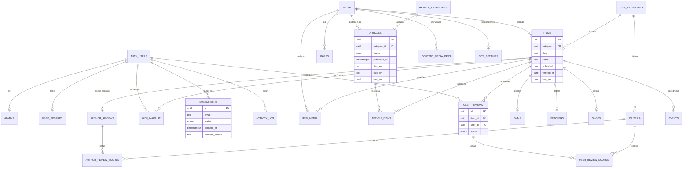

# ChalkGuide · Modelo de datos (schema `guide`)

> Tarea **F2.1** de `docs/PLAN.md`. Diseño **aprobado por Xavi** (2026-10-04, P1–P5 resueltas en §7).
> Aplicado en F2.2–F2.9 con las migraciones de `supabase/migrations/` (desviaciones en §8).
> Autor: jabali-javi · Estado: 🔁 pendiente de revisión de seguridad (leona-lia, F2.10).
> Proyecto Supabase `eqtjlafxtrzbjazhhyin`. `public` es de Chalk app y no se toca.

## 0. Estado actual del proyecto (inspección en solo lectura, 2026-10-04)

- Postgres 17.6. **No existe el schema `guide`**: no hay nada que migrar ni conflictos de nombres.
- `public` (Chalk app): `gyms`, `profiles`, `availability`, `messages`, `subscriptions`, `app_config`,
  `admin_roles`, todas con RLS. 28 migraciones, todas de Chalk app.
- Extensiones instaladas: `pgcrypto`, `uuid-ossp`, `pg_stat_statements`, `supabase_vault`.
  **No** están `pg_cron`, `pg_net`, `pg_trgm`, `citext`, `moddatetime`. El diseño no depende de ninguna.
- Storage: solo el bucket `avatars` (Chalk app), con policies acotadas a `bucket_id = 'avatars'`.
  Las policies del bucket `media` no chocan con ellas.
- `auth.users` tiene el trigger `on_auth_user_created` → `public.handle_new_user()`, que inserta una fila
  en `public.profiles` por **cada** usuario nuevo. Los lectores de la guía que inicien sesión con Google
  también tendrán fila en `public.profiles` (ver pregunta abierta P4).
- `authenticator` no tiene `pgrst.db_schemas` configurado por SQL: exponer `guide` en la API se hace en
  el dashboard (Settings → API → Exposed schemas). Paso manual de Xavi en F2.2.
- Observación fuera de alcance (para leona-lia / Chalk app): `public.profiles` tiene `SELECT using (true)`
  para `public`, lo que expone `fcm_token`, `is_admin` y otros datos a cualquiera con la anon key.
  No lo tocamos; se avisa.

---

## 1. Resumen y decisiones de diseño

**25 tablas** en `guide`, agrupadas en 4 bloques:

| Bloque | Tablas |
| --- | --- |
| Núcleo y administración | `admins`, `activity_log`, `site_settings`, `media`, `content_media_refs` |
| Editorial | `article_categories`, `articles`, `article_items`, `pages` |
| Fichas (modelo genérico) | `item_categories`, `items`, `item_media`, `gyms`, `resolers`, `shoes`, `criteria`, `author_reviews`, `author_review_scores` |
| Comunidad | `user_profiles`, `user_reviews`, `user_review_scores`, `subscribers`, `events`, `gym_waitlist`, `page_views` (opcional, D5) |

### Decisiones

| Tema | Decisión | Motivo |
| --- | --- | --- |
| Bilingüe (D3) | Columnas `_es` / `_en` en la misma fila. `_es` obligatorio donde aplica; `_en` siempre nullable. Cada tabla con contenido traducible tiene `has_en boolean generated always as (...) stored` que dice si la versión inglesa está completa. El sitio solo publica en `/en` filas con `has_en = true` y el sitemap/hreflang se generan a partir de esa columna. Coherencia: `check ((title_en is null) = (slug_en is null))`. | Una sola consulta por página, tipos generados simples, y la regla "sin mezclar idiomas" queda en un único sitio (la columna generada). |
| Idioma como dato | Enum `guide.locale ('es','en')` en suscriptores, opiniones y visitas. | Valores cerrados. |
| IDs | `uuid default gen_random_uuid()` en entidades. `bigint generated always as identity` en tablas de log de alto volumen y solo-inserción (`activity_log`, `page_views`). PK compuestas en tablas puente. `text` PK legible en `item_categories` (`'gym'`, `'resoler'`, `'shoe'`). `smallint` fijo a 1 en el singleton `site_settings`. | Los uuid no filtran volumen ni orden y facilitan el seed determinista; los logs no necesitan uuid. |
| Slugs | Artículos, categorías del blog y páginas: `slug_es` (not null) y `slug_en` (nullable), **únicos por idioma** (`unique(slug_es)`, `unique(slug_en)`). Fichas (`items`): **un solo `slug`** único por categoría (`unique(category, slug)`), compartido por ambos idiomas, porque son nombres propios ("sharma-climbing-bcn", "la-sportiva-solution"); la ruta ya va localizada por el prefijo. Formato en CHECK: `^[a-z0-9]+(-[a-z0-9]+)*$`, máximo 120. | URLs localizadas donde el texto se traduce; estables donde no. |
| Timestamps | `created_at` y `updated_at timestamptz not null default now()`. `updated_at` lo mantiene un trigger propio `guide.set_updated_at()` (no se reutiliza `public.touch_updated_at`). En tablas editoriales, `created_by` / `updated_by uuid` → `auth.users(id) on delete set null`; `updated_by` lo fija el mismo trigger con `auth.uid()`. Fechas de calendario (`verified_at`, `visit_date`) en `date`. | Consistente y sin extensiones. |
| Soft delete | **No hay soft delete genérico.** Ocultar = estado (`status`, `published`); borrar = `delete` real. Lo que no se puede perder se protege con `on delete restrict` (medios, categorías, criterios con notas, **fichas con opiniones de usuarios** — D24: trigger `items_block_delete_with_reviews` + FK restrict; la ficha se oculta, no se borra). `activity_log` guarda una instantánea `old_row` de lo borrado, lo que permite recuperarlo a mano. Suscriptores: la baja es `status = 'unsubscribed'` (queda la prueba del consentimiento y de la baja); el borrado físico solo se hace por derecho de supresión (RGPD), a mano desde el panel. | Menos complejidad en las policies (sin `deleted_at is null` por todas partes) y sin datos fantasma. |
| Enums vs. lookup | **Enums** solo para máquinas de estado cerradas: `article_status`, `review_status`, `visit_type`, `event_status`, `event_source`, `subscriber_status`, `activity_action`, `locale`. **Tablas de lookup** para taxonomías que Xavi edita desde el panel: `item_categories`, `article_categories`, `criteria`. **`text` + CHECK** para atributos técnicos de catálogo (perfil, cierre, asimetría del pie de gato), que se amplían con una migración trivial. | Los estados los usa el código y las policies; las taxonomías son configuración. |
| Modelo genérico | `items` es la base de todo lo evaluable; detalle 1:1 en `gyms`, `resolers`, `shoes`. La integridad categoría↔detalle es **declarativa**: `items` tiene `unique (id, category)` y cada tabla de detalle lleva `category text not null default 'gym' check (category = 'gym')` con FK compuesta `(item_id, category) → items(id, category)`. Igual en notas: un criterio solo puede puntuar un ítem de su misma categoría (FK compuestas, sin triggers). Sumar una categoría = fila en `item_categories` + filas en `criteria`; si necesita columnas tipadas, una tabla de detalle nueva copiando la plantilla; si no, usa `items.attributes jsonb`. | "Sumar categorías es configuración" sin perder integridad. |
| Rich text (D6) | `body_json_xx jsonb` (documento Tiptap, fuente de verdad del editor) + `body_html_xx text` (HTML generado con `generateHTML` y sanitizado al guardar). El sitio renderiza `body_html` y lo vuelve a sanitizar en servidor (defensa en profundidad). Las imágenes del editor son nodos con `attrs.mediaId`. Un trigger calcula `reading_minutes_xx` (palabras del HTML / 200). | Editor sin pérdidas y render rápido. |
| Programar publicación | `articles.status ∈ {draft, scheduled, published}` + `published_at`. **La visibilidad es por tiempo**, no por cron: un artículo es público si `status in ('scheduled','published') and published_at <= now()`. Esa condición vive en la policy RLS y en la función `guide.article_is_live()`. Trigger: al pasar a `published` sin fecha pone `now()`; `scheduled` exige `published_at > now()` en el momento de guardar. Como el sitio prerenderiza, la reconstrucción de Netlify a la hora programada es tarea de F4 (función programada de Netlify que llama a `guide.publish_due_articles()` y al build hook). | Funciona aunque no haya cron; nunca se ve un programado antes de tiempo. |
| "Medio en uso" | Toda referencia a `media` es una **FK real con `on delete restrict`**: portadas, imagen OG, galerías (`item_media`) y ajustes (`default_og_media_id`). **Excepción D41:** `site_settings.hero_photo_1_media_id` y `hero_photo_2_media_id` usan `on delete set null`: un borrado directo de `guide.media` (la purga de datos de ejemplo, por ejemplo) no falla y vacía la ranura; desde el panel `delete_media` también las bloquea porque cuentan en `media_usage`. Las imágenes incrustadas en cuerpos rich text se vuelcan por trigger a `content_media_refs` (también con FK `restrict`). Resultado: **la BD impide** borrar un medio en uso, y la vista `guide.media_usage` dice **dónde** se usa para avisar antes de intentarlo. Reemplazar un medio conserva su `id` (cambia `storage_path` y sube `version`), así que no rompe ninguna referencia. | Imposible dejar imágenes rotas, y la UI puede avisar con detalle. |
| Escrituras públicas | Ningún rol público escribe directamente en tablas sensibles. Opinión → RPC `guide.submit_user_review`. Newsletter → RPC `guide.subscribe_newsletter`. Visitas → RPC `guide.track_page_view`. Todas SECURITY DEFINER, `search_path = ''`, validadas, `revoke execute from public` y grant explícito. | Imposible escribir `status`, `user_id` ajeno, `consent_at` o columnas internas. |
| Admin | `guide.is_admin()` = `exists (select 1 from guide.admins where user_id = auth.uid())`, SECURITY DEFINER, `stable`, `search_path = ''`. En policies se usa como `(select guide.is_admin())` para que se evalúe una vez por consulta. No se usa `public.admin_roles` ni `public.profiles.is_admin`. | D2; sin recursión porque `admins` no se consulta a sí misma vía RLS. |
| Vistas | Todas con `security_invoker = true` (respetan RLS del que consulta; sin aviso de "security definer view" en advisors). | |
| Opiniones de usuarios (D17) | Nombre público = **nombre + inicial del apellido** ("Marta G."), derivado en BD (`guide.short_display_name`) y forzado por trigger en `user_profiles`. **Nota global 1–5 obligatoria** (`user_reviews.overall_score`) y notas por criterio **opcionales**; la media pública sale de `overall_score` y la de cada criterio solo de quien lo puntuó. **Máximo 5 opiniones nuevas por usuario en 24 h** (editar no cuenta). Pies de gato admiten opiniones. Las reseñas del autor siguen siendo siempre por criterio. | Privacidad mínima, opinar rápido sin rellenar 7 criterios y freno antispam sin infraestructura extra. |
| Servicios de resoladores (D18) | `resolers.services text[]` con claves cerradas por CHECK (`half_sole`, `full_sole`, `rand`, `toe_patch`, `closure_repair`, `stitching`, `other`); etiquetas en i18n del frontend. Sin índice GIN (pocas filas). | Filtrable desde la tabla del listado sin tabla puente. |
| Registro de actividad | Trigger genérico `guide.log_activity()` (SECURITY DEFINER) en las tablas editoriales y de moderación: guarda actor, tabla, id, acción, columnas cambiadas y etiqueta legible; en `delete`, la fila completa. No guarda diffs de cuerpos HTML. | Cubre F6.18 sin código en el cliente. |
| Borradores de cambios (D23) | Tabla genérica `content_drafts` (una fila por entidad publicada: artículo, página o ficha completa) con `payload jsonb` por secciones y **semántica de parche**. Columnas editables en una lista blanca única (`draft_allowed_columns`). Las RPC `save_draft`/`publish_draft`/`discard_draft` son SECURITY INVOKER, así que aplican la RLS de admin, los CHECK y los triggers de siempre, y `activity_log` registra al actor real. Conflictos con `base_updated_at`. Los medios citados en un borrador cuentan como «en uso». Lo que nunca se publicó se edita directamente. | Sumar una entidad o columna es configuración (lista blanca + mapeo), sin tablas de revisión por entidad ni SQL con nombres sin validar. |
| Redirecciones de slugs (D24) | Tabla `slug_redirects` alimentada **solo por trigger**: al cambiar el slug de un artículo, categoría del blog, página o ficha que era pública, el slug antiguo apunta a la **entidad** (FK con cascada), no a otro slug. Un slug vivo borra cualquier redirección con ese slug. Lectura pública solo por `resolve_redirect(kind, locale, slug)`, que devuelve el slug actual si la entidad sigue publicada. | Sin cadenas ni bucles por construcción, sin huérfanas y sin exponer borradores; el frontend decide el 301. Si algún día se permite cambiar la categoría de una ficha (hoy lo impiden las FK de detalle), el `ON UPDATE CASCADE` de `slug_redirects_item_fk` podría chocar con la clave única: revisarlo entonces (leona-lia, D24 obs. 3). |
| Última visita a Opiniones (D24) | `admins.reviews_seen_at` por cuenta; solo la RPC `mark_reviews_seen()` la escribe (devuelve la marca anterior). | El panel resalta lo nuevo sin estado en el cliente y sin dar UPDATE sobre `admins`. |
| Registro de exportaciones (D23) | El panel lee las vistas `export_*` y después llama a `log_export` (SECURITY DEFINER; es la única vía de escritura de clientes en `activity_log`). Guarda formato, filas y filtros saneados, sin datos personales. Es un registro **declarativo** (lo pide el propio cliente), no una auditoría a prueba de manipulación. | Una RPC que devolviera los datos no garantizaría nada más: el admin ya lee las vistas por RLS. Así no se duplican las 5 vistas ni se reimplementan los filtros. |

---

## 2. Diagrama ER



(`page_views` y `site_settings` no tienen relaciones relevantes más allá de las mostradas.)

---

## 3. Tablas

Convenciones de esta sección:

- **[ts]** = `created_at timestamptz not null default now()`, `updated_at timestamptz not null default now()` + trigger `set_updated_at`.
- **[audit]** = `created_by uuid null default auth.uid()` y `updated_by uuid null` → `auth.users(id) on delete set null` (trigger fija `updated_by`).
- **[log]** = la tabla tiene trigger `log_activity`.
- **slug** = `text` con `check (char_length(x) <= 120 and x ~ '^[a-z0-9]+(-[a-z0-9]+)*$')`.
- **[seo]** = `seo_title_es text check (≤ 70)`, `seo_title_en`, `seo_description_es text check (≤ 160)`, `seo_description_en`, `og_media_id uuid null → media(id) on delete restrict`, `noindex boolean not null default false`.
- Todas las tablas: `alter table ... enable row level security` en la misma migración que las crea.

### Enums

```
guide.locale            ('es','en')
guide.article_status    ('draft','scheduled','published')
guide.review_status     ('pending','visible','hidden')
guide.visit_type        ('paid','invited')          -- en pies de gato: comprado / cedido por la marca
guide.event_status      ('draft','approved','rejected')
guide.event_source      ('manual','agent')
guide.subscriber_status ('pending','active','unsubscribed','bounced','expired','erased')   -- F6.14: expired, erased
guide.brevo_sync_status ('not_synced','pending','synced','error')                         -- F6.14 (F4.6)
guide.activity_action   ('insert','update','delete','draft_publish','draft_discard','export')   -- D23
```

### 3.1 Núcleo y administración

#### `admins`
| Columna | Tipo | Null | Default | Notas |
| --- | --- | --- | --- | --- |
| user_id | uuid | no | | PK, FK `auth.users(id)` **on delete cascade** |
| email | text | no | | copia informativa para el panel |
| created_at | timestamptz | no | now() | |
| reviews_seen_at | timestamptz | sí | | D24: última visita a Opiniones de esa cuenta. Solo la escribe `guide.mark_reviews_seen()`; no entra en `activity_log` |

Sin índices extra. Alta de Xavi a mano (SQL de F4.3), nunca desde el cliente. [log]

#### `activity_log`
| Columna | Tipo | Null | Default | Notas |
| --- | --- | --- | --- | --- |
| id | bigint identity | no | | PK |
| occurred_at | timestamptz | no | now() | |
| actor_id | uuid | sí | auth.uid() | FK `auth.users` on delete set null |
| action | activity_action | no | | |
| entity_table | text | no | | nombre de tabla |
| entity_id | text | no | | id como texto (uuid o clave compuesta) |
| entity_label | text | sí | | título/nombre para el panel |
| changed_columns | text[] | sí | | solo en update |
| old_row | jsonb | sí | | solo en delete (permite recuperar) |

Índices: `(occurred_at desc)`, `(entity_table, entity_id)`. Solo la escribe el trigger (SECURITY DEFINER). Retención propuesta: 24 meses (limpieza manual o tarea de F4).

#### `site_settings` (singleton)
| Columna | Tipo | Null | Default | Notas |
| --- | --- | --- | --- | --- |
| id | smallint | no | 1 | PK, `check (id = 1)` |
| site_name | text | no | 'ChalkGuide' | |
| tagline_es / tagline_en | text | sí / sí | | |
| default_seo_title_es / _en | text | sí | | |
| default_seo_description_es / _en | text | sí | | |
| default_og_media_id | uuid | sí | | FK `media` on delete restrict |
| hero_photo_1_media_id / hero_photo_2_media_id | uuid | sí | | D41: fotos del carrusel de la home. FK `media` **on delete set null** (la purga de datos de ejemplo las retira sin sentencia explícita; el FK vacía las ranuras); `delete_media` las bloquea igualmente porque cuentan en `media_usage`. Exigen `alt_es` y `alt_en` (D27) |
| social_links | jsonb | no | '{}' | `{instagram, youtube, ...}`, check `jsonb_typeof = 'object'` |
| contact_email | text | sí | | público |
| footer_text_es / _en | text | sí | | |
| newsletter_title_es / _en, newsletter_body_es / _en | text | sí | | textos del bloque de captación |
| newsletter_consent_text_es / _en | text | no / sí | | texto legal de la casilla |
| consent_version | integer | no | 1 | se incrementa al cambiar el texto; el suscriptor guarda la versión aceptada |
| user_reviews_premoderation | boolean | no | false | post-moderación por defecto (P2); si true, las opiniones nuevas o editadas quedan `pending` |
| min_user_reviews_for_average | smallint | no | 3 | |
| updated_at, updated_by | | | | [ts]/[audit] parcial · [log] |

Singleton tipado en vez de clave/valor: tipos generados útiles, `_es/_en` coherente con D3 y FK real a `media`. Añadir un ajuste nuevo es una migración de una línea.

#### `media`
| Columna | Tipo | Null | Default | Notas |
| --- | --- | --- | --- | --- |
| id | uuid | no | gen_random_uuid() | PK |
| storage_path | text | no | | unique; ruta en bucket `media`: `{id}/{version}-{nombre-slug}.{ext}` |
| version | integer | no | 1 | sube al reemplazar el archivo |
| original_filename | text | no | | |
| mime_type | text | no | | check in (`image/jpeg`,`image/png`,`image/webp`,`image/avif`,`image/gif`) |
| size_bytes | integer | no | | check `> 0 and <= 10485760` |
| width / height | integer | sí | | px |
| alt_es | text | sí | | obligatorio para usarlo en contenido publicado (validación de panel, ver nota) |
| alt_en | text | sí | | |
| caption_es / caption_en | text | sí | | |
| credit | text | sí | | autoría/créditos |
| has_en | boolean | generated | | `alt_en is not null` |
| dominant_color | text | sí | | D22. Color dominante de la foto (`#rrggbb`, minúsculas; check `~ '^#[0-9a-f]{6}$'`). Lo calcula el panel al subir/reemplazar (README §9.9.3); el hero de la home deriva de él sus tonos en servidor. null = colores por defecto |
| [ts] [audit] [log] | | | | |

Índices: `unique(storage_path)`, `(created_at desc)`. Búsqueda del panel por `original_filename`/`alt_es` con `ilike` (volumen pequeño; si crece, `pg_trgm`).
Reemplazar: subir el archivo nuevo a una ruta nueva, actualizar `storage_path`, `version`, tamaño y dimensiones, y borrar el objeto antiguo. El `id` no cambia y la URL cambia (sin problemas de caché).
Borrar: primero la fila (falla con `23503` si está en uso), después el objeto de Storage.
Nota: alt vacío no se bloquea en BD (se suben fotos antes de describirlas); el panel avisa y el dashboard cuenta "medios sin alt".

#### `content_media_refs` (interna)
| Columna | Tipo | Null | Default | Notas |
| --- | --- | --- | --- | --- |
| media_id | uuid | no | | FK `media(id)` **on delete restrict** |
| owner_table | text | no | | check in (`articles`,`pages`,`author_reviews`) |
| owner_id | uuid | no | | |
| locale | locale | no | | |

PK `(media_id, owner_table, owner_id, locale)`; índice `(owner_table, owner_id)`.
La mantiene el trigger `guide.sync_content_media_refs()` en insert/update/delete de las tablas dueñas: extrae `jsonb_path_query(body_json_xx, 'strict $.**.attrs.mediaId')`, borra las refs del dueño e inserta las nuevas. Un `mediaId` inexistente hace fallar el guardado (la FK lo rechaza), lo cual es correcto.

### 3.2 Editorial

#### `article_categories`

Las categorías del blog **son** los 6 pilares editoriales (P1): no existe campo `pillar`.

| Columna | Tipo | Null | Default | Notas |
| --- | --- | --- | --- | --- |
| id | uuid | no | gen_random_uuid() | PK |
| name_es | text | no | | check 1..80 |
| name_en | text | sí | | |
| slug_es | slug | no | | unique |
| slug_en | slug | sí | | unique; check `(name_en is null) = (slug_en is null)` |
| description_es / _en | text | sí | | también sirve de meta description |
| color | text | sí | | check `~ '^#[0-9a-fA-F]{6}$'` |
| icon | text | sí | | nombre de icono |
| sort_order | integer | no | 0 | |
| has_en | boolean | generated | | `name_en is not null and slug_en is not null` |
| [ts] [audit] [log] | | | | |

Índices: `unique(slug_es)`, `unique(slug_en)`, `(sort_order)`.
Borrado: la FK de `articles` es `restrict`, así que el `delete` directo falla si tiene artículos. El panel usa `guide.delete_article_category(p_id, p_reassign_to)`, que mueve los artículos (al final del orden de la categoría destino) y borra, en una transacción.

#### `articles`
| Columna | Tipo | Null | Default | Notas |
| --- | --- | --- | --- | --- |
| id | uuid | no | gen_random_uuid() | PK |
| category_id | uuid | no | | FK `article_categories` **on delete restrict** |
| status | article_status | no | 'draft' | |
| published_at | timestamptz | sí | | check `status = 'draft' or published_at is not null` |
| title_es | text | no | | check 1..200 |
| title_en | text | sí | | |
| slug_es | slug | no | | unique |
| slug_en | slug | sí | | unique; check `(title_en is null) = (slug_en is null)` |
| excerpt_es / _en | text | sí | | check ≤ 300 |
| body_json_es | jsonb | no | `'{"type":"doc","content":[]}'` | Tiptap |
| body_html_es | text | no | '' | sanitizado |
| body_json_en | jsonb | sí | | |
| body_html_en | text | sí | | check `(body_json_en is null) = (body_html_en is null)` |
| cover_media_id | uuid | sí | | FK `media` on delete restrict |
| is_featured | boolean | no | false | destacado |
| sort_order | integer | no | 0 | orden dentro de la categoría |
| reading_minutes_es / _en | smallint | sí | | trigger |
| author_id | uuid | sí | auth.uid() | FK `auth.users` on delete set null |
| [seo] | | | | |
| canonical_url | text | sí | | para contenido republicado |
| has_en | boolean | generated | | `title_en, slug_en, body_html_en` no nulos y `body_html_en <> ''` |
| search_es / search_en | tsvector | generated | | D21. Título (A), extracto (B) y cuerpo sin etiquetas (C) con `guide.spanish_unaccent` / `guide.english_unaccent` (sin acentos + stemming). GIN. No seleccionar desde el frontend: se busca con `search_articles` |
| [ts] [audit] [log] | | | | |

Índices: `unique(slug_es)`, `unique(slug_en)`, `(category_id, sort_order)`, `(status, published_at desc)`, parcial `(published_at desc) where is_featured`, GIN `(search_es)` y `(search_en)`.
Triggers: `set_updated_at`, `articles_publish_guard` (fecha al publicar / futuro al programar), `reading_time`, `sync_content_media_refs`, `log_activity`.
"Duplicar" es una operación del panel (insert con `status = 'draft'` y slugs con sufijo `-copia`).

#### `article_items` (artículos ↔ fichas)
| Columna | Tipo | Null | Default | Notas |
| --- | --- | --- | --- | --- |
| article_id | uuid | no | | FK `articles` on delete cascade |
| item_id | uuid | no | | FK `items` on delete cascade |
| sort_order | integer | no | 0 | |

PK `(article_id, item_id)`; índice `(item_id)`. Sirve para "artículo de la visita" en la ficha y para relacionados.

#### `pages`
| Columna | Tipo | Null | Default | Notas |
| --- | --- | --- | --- | --- |
| id | uuid | no | gen_random_uuid() | PK |
| key | text | no | | unique; clave estable que usa el código: `about`, `legal_notice`, `privacy`, `cookies` |
| title_es / title_en | text | no / sí | | |
| slug_es / slug_en | slug | no / sí | | unique por idioma; coherencia con title_en |
| body_json_es / body_html_es | jsonb / text | no | | como `articles` |
| body_json_en / body_html_en | jsonb / text | sí | | |
| published | boolean | no | false | |
| [seo] | | | | |
| has_en | boolean | generated | | igual que en `articles` |
| [ts] [audit] [log] | | | | |

Índices: `unique(key)`, `unique(slug_es)`, `unique(slug_en)`. Triggers: `set_updated_at`, `sync_content_media_refs`, `log_activity`.
Sin programación: las páginas son pocas y estables.

### 3.3 Fichas (modelo genérico)

#### `item_categories`
| Columna | Tipo | Null | Default | Notas |
| --- | --- | --- | --- | --- |
| key | text | no | | PK; check `~ '^[a-z][a-z_]*$'` (`gym`, `resoler`, `shoe`) |
| name_es / name_en | text | no / sí | | singular |
| plural_es / plural_en | text | no / sí | | |
| route_es / route_en | slug | no / sí | | segmento de URL (`rocodromos` / `climbing-gyms`), unique por idioma |
| detail_table | text | sí | | tabla de detalle si existe (`gyms`…); null = solo `items.attributes` |
| allows_user_reviews | boolean | no | true | las tres categorías = true (D17 activó `shoe`) |
| sort_order | integer | no | 0 | |
| is_active | boolean | no | true | |
| [ts] [log] | | | | |

#### `items`
| Columna | Tipo | Null | Default | Notas |
| --- | --- | --- | --- | --- |
| id | uuid | no | gen_random_uuid() | PK |
| category | text | no | | FK `item_categories(key)` on update cascade **on delete restrict** |
| name | text | no | | check 1..120 |
| slug | slug | no | | `unique(category, slug)` |
| summary_es / summary_en | text | sí | | check ≤ 400 |
| cover_media_id | uuid | sí | | FK `media` on delete restrict |
| attributes | jsonb | no | '{}' | para categorías sin tabla de detalle; check objeto |
| published | boolean | no | false | |
| published_at | timestamptz | sí | | se fija al publicar por primera vez (trigger) |
| is_featured | boolean | no | false | p. ej. "pie de gato del mes" |
| verified_at | date | sí | | fecha de verificación de los datos |
| source | text | sí | | "web oficial", "visita", "fabricante"… |
| source_url | text | sí | | check `~ '^https?://'` |
| [seo] | | | | overrides opcionales; si son null se generan de nombre + resumen |
| has_en | boolean | generated | | `summary_en is not null`: significa solo "tiene resumen EN". Para decidir si la ficha se publica en `/en` (hreflang, sitemap, aviso de "versión EN incompleta" en el panel) se usa `guide.item_is_en_ready(id)`, que además exige `has_en` en la reseña del autor si la hay (F6.7). |
| [ts] [audit] [log] | | | | |

Restricciones: `unique (id, category)` (destino de las FK compuestas).

Publicada = solo lectura en directo (F6.7, `20261016090532`): con `published = true`, `items`, su detalle (`gyms`/`resolers`/`shoes`), `author_reviews`, `author_review_scores` e `item_media` dan PT423 `item is live` salvo vía `publish_draft` (GUC `apply:<id>`) o mantenimiento como postgres. Sin borrador se permite ocultar/publicar y marcar solo `verified_at` (o `gyms.prices_verified_at`). Una ficha publicada no se borra: primero `unpublish_item`.
Índices: `unique(category, slug)`, `(category, published)`, `(verified_at)`, parcial `(category) where is_featured`.

#### `item_media` (galerías)
| Columna | Tipo | Null | Default | Notas |
| --- | --- | --- | --- | --- |
| item_id | uuid | no | | FK `items` on delete cascade |
| media_id | uuid | no | | FK `media` **on delete restrict** |
| sort_order | integer | no | 0 | |

PK `(item_id, media_id)`; índice `(media_id)`.

#### `gyms`
| Columna | Tipo | Null | Default | Notas |
| --- | --- | --- | --- | --- |
| item_id | uuid | no | | PK |
| category | text | no | 'gym' | check `= 'gym'`; FK `(item_id, category) → items(id, category)` **on delete cascade** |
| address | text | sí | | |
| city | text | no | 'Barcelona' | |
| district | text | sí | | barrio / municipio del área metropolitana |
| postal_code | text | sí | | |
| lat / lng | numeric(9,6) | sí | | check rangos válidos |
| metro_stations | text[] | no | '{}' | |
| opening_hours | jsonb | no | '{}' | `{"mon":[["10:00","23:00"]], ...}` |
| opening_hours_note_es / _en | text | sí | | festivos, verano… |
| website_url / instagram_url | text | sí | | |
| phone | text | sí | | |
| price_registration_eur | numeric(6,2) | sí | | matrícula; check ≥ 0 (igual en todos los precios) |
| price_day_eur | numeric(6,2) | sí | | entrada de día |
| price_10_pass_eur | numeric(6,2) | sí | | bono 10 |
| price_monthly_eur | numeric(6,2) | sí | | cuota mensual sin permanencia |
| discounts_es / _en | text | sí | | estudiante, joven, familia… |
| prices_verified_at | date | sí | | |
| surface_m2 | integer | sí | | |
| max_height_m | numeric(4,1) | sí | | |
| has_lead / has_boulder | boolean | sí | | null = desconocido |
| routes_count | integer | sí | | vías |
| autobelays_count | integer | sí | | |
| has_training_area | boolean | sí | | |
| belay_test_required | boolean | sí | | test de aseguramiento |
| gear_rental | boolean | sí | | alquiler de material |
| has_beginner_courses | boolean | sí | | cursos de iniciación (alimenta índice principiante) |
| has_cafe / serves_beer / has_kids_area / has_showers / has_wifi | boolean | sí | | |
| kids_min_age | smallint | sí | | edad mínima para niños |
| grading_difficulty | smallint | sí | | D21. 1 = grados generosos … 5 = grados duros; check 1..5. Descriptivo: no es criterio ni entra en medias/índices |
| setting_dynamism | smallint | sí | | D22. Dinamismo de vías/bloques: 1 = estático/técnico … 5 = dinámico/coordinación; check 1..5. Descriptivo como `grading_difficulty` |
| [ts] [log] | | | | |

Booleanos nullables a propósito: "no lo sé" ≠ "no tiene". Índice: `(city, district)`.
No hay FK a `public.gyms` (F9.2, requiere aprobación de Xavi).

#### `resolers`
| Columna | Tipo | Null | Default | Notas |
| --- | --- | --- | --- | --- |
| item_id / category | | | 'resoler' | como `gyms` |
| address, city, district, postal_code, lat, lng | | sí | | como `gyms` |
| website_url / instagram_url / phone | text | sí | | |
| price_per_pair_eur | numeric(6,2) | sí | | |
| price_rand_eur | numeric(6,2) | sí | | |
| turnaround_days_min / _max | smallint | sí | | check min ≤ max |
| accepts_mail | boolean | sí | | envío por correo |
| mail_notes_es / _en | text | sí | | |
| rubber_brands | text[] | no | '{}' | |
| services | text[] | no | '{}' | D18. CHECK `services <@ {half_sole, full_sole, rand, toe_patch, closure_repair, stitching, other}` y sin nulls. Filtro: `services=cs.{rand}` |
| prices_verified_at | date | sí | | |
| [ts] [log] | | | | |

#### `shoes`
| Columna | Tipo | Null | Default | Notas |
| --- | --- | --- | --- | --- |
| item_id / category | | | 'shoe' | como `gyms` |
| brand / model | text | sí | | F6.9: null mientras la ficha no está publicada; publicada ⇒ ambos (trigger, 23514 `shoes_brand_model_required`). 1–60 / 1–80, sin espacios en los extremos (`shoes_brand_trimmed`, `shoes_model_trimmed`). `unique(lower(brand), lower(model))` (los null no chocan) |
| fit | text | no | 'unisex' | check in (`unisex`,`women`,`men`,`kids`) |
| profile | text | sí | | check in (`flat`,`moderate`,`aggressive`) |
| asymmetry | text | sí | | check in (`none`,`slight`,`moderate`,`strong`) |
| closure | text | sí | | check in (`lace`,`velcro`,`slipper`) |
| rubber | text | sí | | |
| rubber_thickness_mm | numeric(3,1) | sí | | |
| stiffness | smallint | sí | | 1 (blanda) – 5 (rígida) |
| recommended_use | text[] | no | '{}' | check `<@ array['gym','boulder','sport','trad','multipitch','training']` |
| levels | text[] | no | '{}' | check `<@ array['beginner','intermediate','advanced']` |
| price_min_eur / price_max_eur | numeric(6,2) | sí | | check min ≤ max |
| price_checked_at | date | sí | | fecha del precio; obligatoria si hay `price_min_eur` o `price_max_eur` (`shoes_price_dated`, F6.9) |
| affiliate_url | text | sí | | F6.9: `https://` + host con dominio (sin userinfo), puerto opcional, ruta solo con caracteres RFC 3986; ≤ 2048 (`shoes_affiliate_url_check`) |
| affiliate_program | text | sí | | Deporvillage, Barrabes… ≤ 80. Solo con `affiliate_url` y no en blanco (`shoes_affiliate_program_needs_url`, F6.9) |
| is_affiliate | boolean | generated | | `affiliate_url is not null` → la UI marca el enlace siempre |
| owned_by_author | boolean | no | false | tiene "Lo que aprendí" (= `author_reviews` del ítem) |
| author_size_eu | numeric(3,1) | sí | | D21. Talla EU que usa el autor en este modelo; 30–50, paso 0,5 |
| author_street_size_eu | numeric(3,1) | sí | | D21. Talla EU de calle del autor; 30–50, paso 0,5. CHECK: ambas null si `not owned_by_author` |
| author_size_note_es / author_size_note_en | text | sí | | D22. Nota libre de ajuste de la talla (1–140). `_en` exige `_es`. CHECK `shoes_author_sizes_owned`: tallas y notas null si `not owned_by_author` |
| [ts] [log] | | | | |

Índices: `(brand)`, `(profile)`, `(price_min_eur)`; filtros del comparador sobre ≤ 100 filas, sin más índices.

#### `criteria`
| Columna | Tipo | Null | Default | Notas |
| --- | --- | --- | --- | --- |
| id | uuid | no | gen_random_uuid() | PK |
| category | text | no | | FK `item_categories(key)` on update cascade on delete restrict. **Inmutable** (F6.10) |
| key | text | no | | `^[a-z][a-z0-9]*(_[a-z0-9]+)*$`, 2..40; `unique(category, key)`. **Inmutable** (F6.10): identifica el criterio en `item_author_scores.criterion_key`, `item_user_ratings.avg_by_criterion` y las fórmulas de índices |
| name_es / name_en | text | no / no | | 1..80, sin controles ni espacios/invisibles Unicode en los extremos (F6.10: `name_en` obligatorio) |
| description_es / _en | text | sí | | 1..300 y recortada si existe; ayuda al opinar |
| sort_order | integer | no | 0 | alta sin valor (o ≤ 0) → al final de su categoría |
| is_active | boolean | no | true | desactivar en vez de borrar si ya tiene notas |
| used_in_formula | boolean | generada | | F6.10. `category = 'gym' and key in ('beginner_friendly', 'family_friendly')`: no se desactiva ni se borra |
| [ts] [log] | | | | |

Restricción `unique(id, category)`. Trigger `criteria_before_write` (F6.10): id/category/key inmutables (22023
`criterion <col> is immutable`); un criterio `used_in_formula` no se desactiva ni se borra (22023 `criterion used by an
index formula`); borrar uno con notas del autor, de usuarios o citado en borradores de fichas → 23503 `criterion has
scores` con detail `author_review_scores: N, user_review_scores: M, content_drafts: K` (la FK restrict sigue de red).
Exención solo para mantenimiento explícito (`guide.draft_op = 'maintenance'` + rolbypassrls).

**Desactivar (configuración, sin borrador):** el criterio sale de los formularios y de las vistas públicas para todos
(`item_author_scores`, `item_user_ratings`, `gym_indices` filtran `is_active`); la media del autor de cada ficha se
recalcula sobre los activos y `avg_by_criterion` pierde la key; la media global de usuarios no cambia. Las notas se
conservan (`author_review_scores_keep_inactive`: ni `publish_draft` ni la edición directa las borran o cambian; no
admite notas nuevas, 22023 `inactive criterion`). Reactivar lo restaura todo.

#### `author_reviews`
| Columna | Tipo | Null | Default | Notas |
| --- | --- | --- | --- | --- |
| id | uuid | no | gen_random_uuid() | PK |
| item_id | uuid | no | | unique (una reseña vigente por ítem) |
| category | text | no | | FK `(item_id, category) → items(id, category)` **on delete cascade** |
| headline_es / _en | text | sí | | veredicto corto |
| body_json_es / body_html_es | jsonb / text | no | | |
| body_json_en / body_html_en | jsonb / text | sí | | |
| visit_date | date | sí | | |
| visit_type | visit_type | no | 'paid' | **invitada se muestra siempre** (transparencia) |
| disclosure_note_es / _en | text | sí | | detalle de la invitación/cesión |
| has_en | boolean | generated | | `body_html_en` no nulo ni vacío |
| [ts] [audit] [log] | | | | |

Restricción `unique(id, category)`. Visibilidad heredada de `items.published`. Triggers: `sync_content_media_refs`, `log_activity`.

#### `author_review_scores`
| Columna | Tipo | Null | Default | Notas |
| --- | --- | --- | --- | --- |
| review_id | uuid | no | | |
| criterion_id | uuid | no | | |
| category | text | no | | FK `(review_id, category) → author_reviews(id, category)` on delete cascade; FK `(criterion_id, category) → criteria(id, category)` **on delete restrict** |
| score | smallint | no | | check 1..5 |

PK `(review_id, criterion_id)`; índice `(criterion_id)`.

### 3.4 Comunidad

#### `user_profiles`
| Columna | Tipo | Null | Default | Notas |
| --- | --- | --- | --- | --- |
| user_id | uuid | no | | PK, FK `auth.users` on delete cascade |
| display_name | text | no | | check 2..40 + saneo (N1/N2). **D17:** siempre "Nombre I." — el trigger `user_profiles_short_name` (BEFORE insert/update) aplica `guide.short_display_name()`, también si el usuario lo edita |
| avatar_url | text | sí | | |
| [ts] | | | | |

Perfil público mínimo de la guía (no se lee `public.profiles`). Se crea en el primer `submit_user_review` si no existe.

#### `user_reviews`
| Columna | Tipo | Null | Default | Notas |
| --- | --- | --- | --- | --- |
| id | uuid | no | gen_random_uuid() | PK |
| item_id | uuid | no | | |
| category | text | no | | FK `(item_id, category) → items(id, category)` **on delete restrict** (D24; antes cascade) |
| user_id | uuid | no | | FK `auth.users` on delete cascade |
| author_name | text | no | 'Escalador/a' | copia de `user_profiles.display_name` (H5) |
| overall_score | smallint | no | | **D17.** Nota global 1..5 obligatoria. Las notas por criterio (`user_review_scores`) son opcionales |
| body | text | sí | | check ≤ 1000 |
| locale | locale | no | 'es' | idioma en que se escribió |
| status | review_status | no | 'visible' | lo fija la RPC según `site_settings.user_reviews_premoderation` |
| edited_at | timestamptz | sí | | |
| moderated_at | timestamptz | sí | | |
| moderated_by | uuid | sí | | FK `auth.users` on delete set null |
| [ts] [log: solo cambios de `status`] | | | | |

Restricciones: `unique(item_id, user_id)` (una por usuario e ítem), `unique(id, category)`.
Índices: `(item_id, status)`, `(status, created_at desc)` (cola de moderación), `(user_id, created_at desc)` (límite diario de D17; cubre también la FK `user_id`).

#### `user_review_scores`
Igual que `author_review_scores` pero con `review_id → user_reviews(id, category)` on delete cascade. PK `(review_id, criterion_id)`, score 1..5.

#### `subscribers`
| Columna | Tipo | Null | Default | Notas |
| --- | --- | --- | --- | --- |
| id | uuid | no | gen_random_uuid() | PK |
| email | text | sí (F6.14) | | check `email = lower(trim(email))`, formato y ≤ 254; `unique(email)`. Null **solo** en `erased`, y `erased` exige null (`subscribers_email_null_only_erased`). Inmutable salvo al suprimir |
| status | subscriber_status | no | 'pending' | `pending` hasta el doble opt-in (`confirm_newsletter`, F6.14). Transiciones cerradas por `subscribers_guard` (ver «F6.14») |
| locale | locale | no | 'es' | idioma del newsletter |
| consent_at | timestamptz | no | now() | fecha del consentimiento |
| consent_source | text | no | | check in (`footer`,`article`,`article_mid`,`article_end`,`item_page`,`home`,`popup`,`newsletter_page`); `admin_import` retirado en F6.14 (D35). D22: `article_mid`/`article_end` = tarjeta a mitad y bloque final del artículo; `article` se mantiene por compatibilidad. D44: `newsletter_page` = formulario de la página `/newsletter` |
| consent_version | integer | no | | versión del texto aceptado (`site_settings.consent_version`) |
| consent_page | text | sí | | ruta donde se dio |
| confirmed_at | timestamptz | sí | | doble opt-in |
| unsubscribed_at | timestamptz | sí | | |
| unsubscribe_source | text | sí | | `link`, `brevo`, `admin`, `user` |
| unsubscribe_token | uuid | no | gen_random_uuid() | unique; para enlace de baja sin login. Se rota al re-suscribir, en la baja del panel y al suprimir |
| confirm_token_hash | bytea | sí | | F6.14. SHA-256 (32 bytes) del token de confirmación; nunca el token en claro. Unique parcial. Null ⇔ `confirm_expires_at` null |
| confirm_expires_at | timestamptz | sí | | F6.14. Caducidad del token (48 h) |
| user_id | uuid | sí | | FK `auth.users` on delete set null (si se suscribió logueado) |
| brevo_contact_id | text | sí | | sincronización (F4.6) |
| synced_at | timestamptz | sí | | |
| brevo_sync_status | brevo_sync_status | no | 'not_synced' | F6.14 (solo preparado para F4.6). Pasa a `pending` al cambiar el estado de una fila confirmada o de baja |
| brevo_sync_error | text | sí | | F6.14. ≤ 300 y solo con `brevo_sync_status = 'error'` |
| [ts] [log: cambios de `status`, trigger `subscribers_log_status` (F6.14)] | | | | |

Índices: `unique(email)`, `unique(unsubscribe_token)`, `(status, created_at)`, `(status, consent_at desc)`, `unique(confirm_token_hash) where not null`.
No se guarda IP ni user-agent. Reactivar a alguien dado de baja exige un consentimiento nuevo desde el sitio (se sobrescriben `consent_*` y se limpian `confirmed_at`/`unsubscribed_at`/`unsubscribe_source`; lo anterior queda en `subscriber_consent_events`). Desde el panel no hay alta ni reactivación (D35). Ver «F6.14».

#### `events`
| Columna | Tipo | Null | Default | Notas |
| --- | --- | --- | --- | --- |
| id | uuid | no | gen_random_uuid() | PK |
| item_id | uuid | sí | | FK `items` on delete set null (rocódromo u otro lugar) |
| title_es / title_en | text | no / sí | | |
| description_es / _en | text | sí | | |
| event_type | text | no | 'other' | check in (`competition`,`workshop`,`outing`,`social`,`course`,`other`) |
| starts_at | timestamptz | no | | |
| ends_at | timestamptz | sí | | check `ends_at >= starts_at` |
| all_day | boolean | no | false | |
| location_text | text | sí | | si no hay `item_id` |
| url | text | sí | | |
| price_text | text | sí | | "gratis", "15 € socios"… |
| status | event_status | no | 'draft' | |
| source | event_source | no | 'manual' | |
| source_url | text | sí | | página donde lo encontró el agente |
| dedupe_key | text | sí | | unique; hash (fuente + título + fecha) para que el agente no duplique |
| agent_meta | jsonb | sí | | confianza, extracto original (F8) |
| approved_at | timestamptz | sí | | |
| approved_by | uuid | sí | | FK `auth.users` on delete set null |
| has_en | boolean | generated | | `title_en is not null` |
| [ts] [audit] [log] | | | | |

Índices: `(status, starts_at)`, `(item_id)`, `unique(dedupe_key)`.
El agente (F8 v2, D72) escribe con RPC `guide.ingest_*` y token hasheado (sin `service_role`) y **solo** en `status = 'draft'`; aprobar es siempre un acto del admin. Desde F6.12 lo impone la guarda `events_before_write` (ver «F6.12»).

#### `gym_waitlist` (F9)
| Columna | Tipo | Null | Default | Notas |
| --- | --- | --- | --- | --- |
| item_id | uuid | no | | |
| category | text | no | 'gym' | check `= 'gym'`; FK `(item_id, category) → items(id, category)` on delete cascade |
| user_id | uuid | no | auth.uid() | FK `auth.users` on delete cascade |
| created_at | timestamptz | no | now() | |

PK `(item_id, user_id)`.

#### `page_views` (opcional, D5)
| Columna | Tipo | Null | Default | Notas |
| --- | --- | --- | --- | --- |
| id | bigint identity | no | | PK |
| viewed_at | timestamptz | no | now() | |
| path | text | no | | check empieza por `/`, ≤ 300, sin querystring |
| locale | locale | no | | |
| referrer_host | text | sí | | solo dominio, ≤ 200 |

Índices: `(viewed_at)`, `(path, viewed_at)`. Sin IP, sin UA, sin cookies, sin `user_id`. Solo se crea si en F4 se elige la tabla propia frente a Cloudflare Web Analytics.

---

## 4. Vistas y funciones

### Funciones de infraestructura

| Función | Tipo | Grant | Qué hace |
| --- | --- | --- | --- |
| `guide.is_admin() returns boolean` | SECURITY DEFINER, stable, `search_path = ''` | anon, authenticated | `exists(select 1 from guide.admins where user_id = auth.uid())` |
| `guide.set_updated_at()` | trigger | — | `updated_at = now()`, `updated_by = auth.uid()` si la tabla lo tiene |
| `guide.log_activity()` | trigger, SECURITY DEFINER | — | inserta en `activity_log` |
| `guide.sync_content_media_refs()` | trigger, SECURITY DEFINER | — | mantiene `content_media_refs` |
| `guide.articles_publish_guard()` | trigger | — | coherencia `status` / `published_at` |
| `guide.compute_reading_time()` | trigger | — | `reading_minutes_xx` |
| `guide.article_is_live(status, published_at) returns boolean` | sql, stable | anon, authenticated | `status in ('scheduled','published') and published_at <= now()` (la usan policies y frontend) |
| `guide.search_plain_text(p_excerpt text, p_body_html text) returns text` | sql, immutable | anon, authenticated | D21. Texto plano para el fragmento de búsqueda: sin etiquetas, `<`/`>` → `‹`/`›`, entidades básicas decodificadas, sin caracteres de control |
| `guide.item_is_en_ready(item_id) returns boolean` | sql, stable, invoker | anon, authenticated | `items.has_en` y, si hay reseña del autor, `author_reviews.has_en` |

### RPC públicas (validadas)

| Función | Grant | Contrato |
| --- | --- | --- |
| `guide.submit_user_review(p_item_id uuid, p_overall integer, p_scores jsonb default '{}', p_body text default null, p_locale guide.locale default 'es') returns uuid` | authenticated | SECURITY DEFINER. Exige `auth.uid()`, ítem publicado, `item_categories.allows_user_reviews`, `p_overall` entero 1..5, `p_body` ≤ 1000. `p_scores` (`{criterion_id: 1..5}`) es **opcional**: puede ir vacío; si trae claves, todas deben ser criterios activos de la categoría del ítem con entero 1..5. **Límite (D17):** si no existe ya una opinión del usuario en ese ítem y ha creado ≥ 5 en las últimas 24 h, lanza `rate_limited` (SQLSTATE `PT429` → HTTP 429). Serializa por usuario con `pg_advisory_xact_lock`. Errores estables (`message`): `authentication required` (42501), `item not reviewable`, `invalid overall`, `invalid scores`, `body too long` (22023), `rate_limited` (PT429). Crea `user_profiles` si falta con el nombre de Google saneado y acortado ("Marta G."). Upsert de la opinión del propio usuario + reemplazo de notas en una transacción. `status` = `pending` si hay premoderación; si no, se conserva `hidden` cuando el admin la había ocultado (editar no la reaparece) y en otro caso `visible`. |
| `guide.subscribe_newsletter(p_email text, p_locale guide.locale, p_source text, p_consent boolean, p_page text default null) returns void` | anon, authenticated | SECURITY DEFINER. Rechaza si `p_consent` no es true. Normaliza email, valida formato/longitud/origen, toma `consent_version` de `site_settings`. Idempotente y **siempre responde igual** (no revela si el email existía). Vincula `user_id` si hay sesión. El alta en Brevo / doble opt-in la dispara un Database Webhook → Edge Function (F4.6). Límite de abuso: en la Edge Function o un endpoint Nitro con rate limit, no en SQL. **F6.14:** re-suscribe desde `unsubscribed`/`bounced`/`expired` o `pending` de más de 24 h; limpia `confirmed_at`, `unsubscribed_at` y `unsubscribe_source`, rota `unsubscribe_token` y emite un token de confirmación nuevo (solo se guarda su SHA-256, caduca a las 48 h). El token en claro no sale de la función: F4.6 debe emitirlo desde el servidor. |
| `guide.confirm_newsletter(p_token text) returns text` | anon, authenticated | F6.14. SECURITY DEFINER. Token = 64 hex en minúsculas. Respuesta neutra `ok` \| `expired` \| `invalid` (nunca el email). Solo confirma desde `pending` y antes de `confirm_expires_at`; un segundo clic en una fila ya activa devuelve `ok`. |
| `guide.search_articles(p_query text, p_locale guide.locale, p_category_id uuid default null, p_limit int default 20, p_offset int default 0) returns table(id, slug, slug_es, slug_en, title, excerpt, category_id, category_slug, category_name, published_at, rank real, headline, total_count bigint)` | anon, authenticated | D21. **SECURITY INVOKER**. Solo artículos vivos (`article_is_live`, también para el admin) y en `en` solo `has_en`. `p_query` ≤ 200 caracteres (si no, 22023 `query too long`); < 2 caracteres o sin lexemas → 0 filas. `websearch_to_tsquery` (comillas, `-`, `or`) + prefijo de la última palabra (≥ 3 letras). `p_limit` 1..50, `p_offset` 0..1000. Orden: `ts_rank` desc, `published_at` desc. `slug`/`title`/`excerpt`/`category_*` ya en el idioma pedido (`category_name` cae a es; `category_slug` puede ser null en en). `headline`: texto plano (extracto + cuerpo) con coincidencias entre U+0002 y U+0003; **el frontend escapa todo y después cambia U+0002/U+0003 por `<mark>`/`</mark>`**. `total_count` = coincidencias totales (igual en cada fila) |
| `guide.unsubscribe_newsletter(p_token uuid) returns void` | anon, authenticated | SECURITY DEFINER. Marca `unsubscribed` + fecha + `link` y borra el token de confirmación. Solo desde `pending`/`active`/`bounced` (F6.14). Respuesta neutra. |
| `guide.track_page_view(p_path text, p_locale guide.locale, p_referrer_host text) returns void` | anon, authenticated | Opcional (D5). SECURITY DEFINER, valida y recorta. |

### RPC del panel (comprueban `guide.is_admin()` y lanzan `42501` si no)

| Función | Qué hace |
| --- | --- |
| `delete_article_category(p_id uuid, p_reassign_to uuid)` | reasigna artículos al final del destino y borra la categoría |
| `reorder_article_categories(p_ids uuid[])` | `sort_order` = posición en el array |
| `reorder_articles(p_category_id uuid, p_ids uuid[])` | orden dentro de una categoría (valida que todos pertenezcan a ella) |
| `reorder_criteria(p_category text, p_ids uuid[])` | F6.10. Lista completa de la categoría (activos e inactivos) sin nulos ni duplicados (22023); categoría inexistente P0002; solo escribe las filas que cambian |
| `criteria_usage(p_category text)` | F6.10. Por criterio: `author_items`, `user_reviews`, `draft_items`, `used_by_index`, `can_delete`. Categoría inexistente P0002 |
| `reorder_item_media(p_item_id uuid, p_media_ids uuid[])` | ídem |
| `publish_due_articles() returns integer` | pasa a `published` los `scheduled` vencidos; devuelve cuántos (para decidir si disparar el build hook). Sin grant a clientes: la llama la función programada de F4 con `service_role` |
| `moderate_user_review(p_id uuid, p_status guide.review_status) returns jsonb` | F6.11. Solo `visible`/`hidden` (fija `status` y `moderated_at`; con el mismo estado = «revisada»). Devuelve las medias de la ficha. Ver «F6.11» |
| `approve_event(p_id uuid)` / `reject_event(p_id uuid)` | fija estado, `approved_at/by` |
| `admin_dashboard_stats() returns jsonb` | artículos por estado (incluye programados próximos), suscriptores activos/total, altas 30 d vs. 30 d previos, bajas 30 d, opiniones `pending` y `hidden`, fichas publicadas con `verified_at` nulo o > 6 meses, borradores de agenda pendientes, medios sin `alt_es`, visitas 30 d (si existe `page_views`), últimas 10 entradas de `activity_log` |
| `admin_timeseries(p_metric text, p_from date, p_to date, p_bucket text) returns table(bucket date, value bigint)` | `p_metric` en whitelist (`subscribers_new`, `subscribers_total`, `articles_published`, `user_reviews`, `page_views`), `p_bucket` en (`day`,`week`,`month`). F6.14: `subscribers_new` = eventos `confirm` del tramo; `subscribers_total` = suscriptores cuyo último evento de estado antes del cierre del tramo es `confirm` |
| `admin_list_subscribers(…) returns jsonb`, `admin_subscribers_summary()`, `admin_get_subscriber(p_id)`, `admin_unsubscribe_subscribers(p_ids, p_reason)`, `admin_erase_subscriber(p_id, p_email_confirm, p_reason)` | F6.14. Ver «F6.14» |
| `admin_top_pages(p_from date, p_to date, p_limit int)` | opcional (D5) |
| `save_draft(p_entity text, p_entity_id uuid, p_payload jsonb, p_base_updated_at timestamptz default null) returns table(id, base_updated_at, updated_at)` | D23. Crea o reemplaza el borrador de cambios. Ver §8 D23 |
| `publish_draft(p_entity text, p_entity_id uuid, p_force boolean default false) returns timestamptz` | D23. Aplica el parche en una transacción y devuelve la versión nueva |
| `discard_draft(p_entity text, p_entity_id uuid) returns boolean` | D23 |
| `draft_entity_version(p_entity text, p_id uuid) returns timestamptz` | D23. Versión publicada, para detectar conflictos |
| `draft_entity_is_live(p_entity text, p_id uuid) returns boolean` | D23. ¿Está publicada? (`null` si no existe). La usan `save_draft` y el trigger de `content_drafts` |
| `log_export(p_view text, p_format text, p_filters jsonb default '{}', p_row_count int)` | D23. SECURITY DEFINER. Escribe `export` en `activity_log` |

### Vistas (todas `security_invoker = true`)

| Vista | Para | Contenido |
| --- | --- | --- |
| `guide.item_user_ratings` | público | por ítem: `review_count` (visibles), `avg_overall` (**media de `overall_score`**, D17) y `avg_by_criterion jsonb` (media de quienes puntuaron cada criterio; solo criterios con ≥ `min_user_reviews_for_average` notas); **promedios null si `review_count < site_settings.min_user_reviews_for_average`** (3). El conteo sí se muestra. |
| `guide.user_reviews_public` | público | opiniones sin `user_id`: `id, item_id, category, author_name, body, locale, status, edited_at, created_at, overall_score` |
| `guide.item_author_scores` | público | por ítem: notas del autor por criterio y media global, con nombres de criterio es/en |
| `guide.gym_indices` | público | por gimnasio publicado: `monthly_cost_2pw_eur`, `price_index`, `beginner_index`, `family_index` (ver fórmulas) |
| `guide.media_usage` | admin | `media_id, usage_table, usage_id, usage_field, label`: `union all` de portadas, OG, galerías, ajustes y `content_media_refs` |
| `guide.media_library` | admin | `media.*` + `usage_count` |
| `guide.export_articles`, `export_items` (ítem + detalle por categoría vía left join), `export_user_reviews` (con notas en jsonb, `display_name` y `overall_score`), `export_subscribers`, `export_events` | admin | aplanadas para CSV/JSON. Llevan `where (select guide.is_admin())` además de RLS, y `revoke select from anon` |

### Fórmulas de los índices derivados (propuesta, ver P3)

- **Coste mensual a 2 visitas/semana** (`monthly_cost_2pw_eur`): 2 × 52 / 12 ≈ **8,67 visitas/mes**;
  `least(price_monthly_eur, price_day_eur × 8.67, price_10_pass_eur / 10 × 8.67)` ignorando nulos.
  La matrícula se reparte en 12 meses y se suma solo a la opción mensual.
- **Índice precio (1–5, 5 = más barato)** (F6.7, `20261016140643`, aprobado por Xavi): sobre el coste anterior redondeado a céntimos.
  - Con **menos de 10** rocódromos publicados con precio (`guide.gym_price_quintile_min()`): **tramos fijos de 7,50 €/mes** (`guide.gym_price_tier`): 5 = < 50 € · 4 = 50–57,49 € · 3 = 57,50–64,99 € · 2 = 65–72,49 € · 1 = ≥ 72,50 €. Con los datos de octubre de 2026: Via Sants 4, Presa Badalona 4, Altura Cornellà 3, Magnesi Poblenou 3, La Paret de Gràcia 2.
  - Con **10 o más**: quintil del coste entre los publicados (6 − `ntile(5)`), como antes.
  - **En el umbral** la vista previa del panel (`gym_indices_preview`) cuenta la ficha como si estuviera publicada: con 9 publicadas con precio, una ficha nueva se previsualiza por quintiles (10) mientras la vista pública sigue por tramos (9). Es esperado: la ficha pública se ajusta al publicarla.
  - **No usar `gym_price_tier` en índices, columnas generadas ni vistas materializadas**: es `immutable` para poder usarla en la vista, pero sus tramos cambian cada año y un valor guardado quedaría desfasado. Solo en cálculos al vuelo (`gym_indices`, `gym_indices_preview`).
  - **Revisión anual de los tramos** (cada octubre, o antes si las tarifas suben de forma general): si la mayoría de rocódromos se mueve de tramo solo por la subida de precios, se desplazan los cortes en una migración nueva que cambie `guide.gym_price_tier` (y se anota aquí la fecha y los cortes). `gym_indices` y `gym_indices_preview` usan las mismas funciones; el test F6.7 2a/7 comprueba que coinciden.
  Relativo al mercado, se recalcula solo.
- **Índice principiante (1–5)**: media ponderada de: nota del autor en el criterio `beginner_friendly` (50 %),
  `has_beginner_courses` (20 %), `gear_rental` (15 %), `not belay_test_required or has_boulder` (15 %;
  se puede empezar sin saber asegurar). Booleanos null cuentan 0 y la vista expone `beginner_index_complete`.
- **Índice familia (1–5)**: `has_kids_area` (40 %), `kids_min_age ≤ 6` (20 %), `has_cafe` (20 %),
  nota del autor en `family_friendly` si existe (20 %).

Los criterios se referencian por `criteria.key`, nunca por id (por eso la key es inmutable y los de fórmula llevan `used_in_formula`; añadir una fórmula exige ampliar esa columna generada y `criteria_before_write`). Todo es una vista: cambiar un peso es reemplazar la vista, sin migrar datos.

---

## 5. Matriz RLS

Leyenda: **S/I/U/D** = select/insert/update/delete. "admin" = rol `authenticated` + `(select guide.is_admin())`; las policies de admin son `for all ... using (is_admin) with check (is_admin)`. "pub" = condición pública de la tabla. Ninguna tabla tiene policy de escritura para anon. GRANTs: `anon` solo `select` en las tablas con lectura pública; `authenticated` `select, insert, update, delete` en las tablas que el admin edita (RLS filtra); nada en `activity_log`, `content_media_refs`, `page_views` e `subscribers` salvo `select` para el admin.

| Tabla | anon | authenticated (no admin) | admin | Condición "pub" |
| --- | --- | --- | --- | --- |
| admins | — | S solo su propia fila (para el guard del panel) | S | — |
| activity_log | — | — | S | (escribe el trigger) |
| site_settings | S | S | S, U | `true` (no contiene secretos) |
| media | S | S | S/I/U/D | `true` (los archivos ya son públicos) |
| content_media_refs | — | — | S | (escribe el trigger) |
| article_categories | S | S | S/I/U/D | `true` |
| articles | S pub | S pub | S/I/U/D | `guide.article_is_live(status, published_at)` |
| article_items | S pub | S pub | S/I/U/D | artículo vivo **y** ítem publicado |
| pages | S pub | S pub | S/I/U/D | `published` |
| item_categories | S pub | S pub | S/I/U/D | `is_active` |
| items | S pub | S pub | S/I/U/D (D24: D bloqueado si tiene opiniones) | `published` |
| item_media, gyms, resolers, shoes | S pub | S pub | S/I/U/D | ítem padre publicado (`exists`) |
| criteria | S pub | S pub | S/I/U/D | `is_active` |
| author_reviews, author_review_scores | S pub | S pub | S/I/U/D | ítem publicado |
| user_profiles | S pub | S pub + S/I/U propia | S/I/U/D | tiene alguna opinión `visible` |
| user_reviews | S pub | S pub + S propias (cualquier estado) + **D propia** (no oculta); I/U solo vía RPC | S/U; D solo vía `admin_delete_user_review` (F6.11) | `status = 'visible'` y ítem publicado |
| user_review_scores | S pub | S pub + S propias | S (sin D desde F6.11: las notas caen solo en cascada) | opinión padre visible |
| subscribers | — (alta/baja por RPC) | — (ídem) | S de columnas no secretas (sin tokens, `user_id` ni Brevo); sin I/U/D: todo por RPC (F6.14) | — |
| consent_texts (F6.14) | — | — | S (append-only; la escribe el trigger de `site_settings`) | — |
| events | S pub (sin `source`, `source_url`, `dedupe_key`, `agent_meta`) | igual que anon | S/I/U; D solo borradores y descartados (PT423); estados por `set_event_status` (F6.12) | `status in ('approved','cancelled')` |
| gym_waitlist | — | S/I/D propias (`user_id = auth.uid()`), I con ítem `gym` publicado | S/D | — |
| page_views | — (insert por RPC) | — (ídem) | S | — |
| slug_redirects (D24) | — (resolver por RPC `resolve_redirect`) | — (ídem) | S/D (I/U solo el trigger) | — |

Notas:
- `user_reviews` y `user_review_scores` **no** tienen grant de insert para `authenticated`, y en `user_reviews` el UPDATE es **solo de columna** `(status, moderated_at)` (lo que escribe `moderate_user_review`, y la RLS lo limita al admin): la única vía para crear o editar una opinión es `submit_user_review`, así que nadie puede escribir `body`, `overall_score`, `author_name`, `user_id` ajeno ni notas de otra categoría. El borrado propio sí es directo (`using (user_id = (select auth.uid()))`).
- Las policies para `authenticated` no admin son por usuario; un usuario de Chalk app no obtiene nada extra.
- Pruebas de fuga (F2.10, leona-lia): las de `.ai/security-rls.md` + leer programados antes de hora, leer `content_media_refs`/`activity_log`, ejecutar RPC de admin como no admin, `submit_user_review` en ítem `shoe` o no publicado, notas con criterio de otra categoría.

### Storage (bucket `media`)

Bucket: `public = true`, `file_size_limit = 10 MB`, `allowed_mime_types = jpeg, png, webp, avif, gif` (**sin SVG**: vector de XSS).

| Policy en `storage.objects` | Operación | Rol | Condición |
| --- | --- | --- | --- |
| guide media admin read | SELECT | authenticated | `bucket_id = 'media' and (select guide.is_admin())` (listar/upsert desde el panel) |
| guide media admin insert | INSERT | authenticated | with check igual |
| guide media admin update | UPDATE | authenticated | using + with check igual |
| guide media admin delete | DELETE | authenticated | using igual |

La lectura pública va por la URL pública del bucket, sin policy SELECT para anon (así no se puede listar el bucket). No se tocan las policies de `avatars`.

---

## 6. Plan de migraciones (F2.2–F2.9) y seed (F2.11)

Cada archivo es idempotente (`create ... if not exists`, `create or replace`, `drop policy if exists` + `create policy`, enums en bloques `do $$ ... exception when duplicate_object`), activa RLS y crea las policies de sus propias tablas **en la misma migración** (no hay ventana sin RLS). Copia en `supabase/migrations/`.

| Orden | Archivo | Tarea | Contenido |
| --- | --- | --- | --- |
| 1 | `20261005100000_guide_schema.sql` | F2.2 | `create schema guide`; `grant usage` a anon/authenticated/service_role; `alter default privileges in schema guide revoke all ... from public, anon, authenticated` (los grants serán explícitos por tabla); enums; `set_updated_at()`. Paso manual: Xavi añade `guide` a Exposed schemas. |
| 2 | `20261005100100_guide_admins.sql` | F2.3 | `admins`, `is_admin()`, `activity_log`, `log_activity()` |
| 3 | `20261005100200_guide_media.sql` | F2.4 | `media`, `content_media_refs`, `sync_content_media_refs()` |
| 4 | `20261005100300_guide_editorial.sql` | F2.4 | `site_settings` (+ fila id=1), `article_categories`, `articles`, `pages`, triggers de publicación y tiempo de lectura |
| 5 | `20261005100400_guide_catalog.sql` | F2.5 | `item_categories` (+ filas `gym`, `resoler`, `shoe`), `items`, `item_media`, `gyms`, `resolers`, `shoes`, `criteria`, `author_reviews`, `author_review_scores`, `article_items` |
| 6 | `20261005100500_guide_community.sql` | F2.6 | `user_profiles`, `user_reviews`, `user_review_scores`, `subscribers`, `events`, `gym_waitlist`, `page_views` (si D5 lo confirma; si no, migración aparte en F4) |
| 7 | `20261005100600_guide_rpc.sql` | F2.6 | RPC públicas y de panel, con `revoke execute ... from public` + grants |
| 8 | `20261005100700_guide_derived.sql` | F2.7 | `article_is_live`, `item_is_en_ready`, `item_user_ratings`, `item_author_scores`, `gym_indices`, `media_usage`, `media_library`, vistas de exportación, `admin_dashboard_stats`, `admin_timeseries` |
| 9 | `20261005100800_guide_storage.sql` | F2.8 | bucket `media` + 4 policies en `storage.objects` |
| 10 | `20261005100900_guide_rls_hardening.sql` | F2.9 | repaso final: verificación de que toda tabla de `guide` tiene RLS y policies (bloque `do` que falla si no), revisión de grants de columna, `get_advisors` sin avisos nuevos |
| — | `supabase/tests/guide_rls_leaks.sql` | F2.10 | script de pruebas de fuga en transacción con `rollback` (no es migración) |

### Seed dummy (F2.11)

Archivos fuera de `migrations/`: `supabase/seed/guide_dummy.sql` (idempotente, `on conflict do nothing`) y `supabase/seed/guide_dummy_purge.sql`.
**Todos los uuid del seed empiezan por `d0d0d0d0-`**: el purge borra por ese prefijo en orden de dependencias (F7.1), sin columnas `is_dummy` en el modelo.

| Bloque | Datos |
| --- | --- |
| Ajustes | `site_settings` con textos es/en y versión de consentimiento 1 |
| Medios | ~25 filas apuntando a imágenes placeholder subidas por script (`scripts/seed-media.ts` con service role en local, nunca en cliente) |
| Criterios | gym: `setting`, `variety`, `crowding`, `facilities`, `beginner_friendly`, `family_friendly`, `value`; resoler: `quality`, `turnaround`, `service`, `value`; shoe: `comfort`, `edging`, `smearing`, `durability` |
| Rocódromos | 7 ítems con `gyms` completo (precios variados para que los índices se diferencien), 5 publicados + 2 borrador, galería de 3 fotos, reseña del autor con notas (1 con `visit_type = 'invited'`), `verified_at` variado (2 con > 6 meses) |
| Resoladores | 4 con detalle y reseña |
| Pies de gato | 15 con datos técnicos, 6 con `affiliate_url`, 3 `owned_by_author` con reseña |
| Blog | 4 categorías, 8 artículos (5 publicados, 1 programado a +7 días, 2 borradores), 5 con versión inglesa, 2 destacados, `article_items` enlazando visitas |
| Páginas | `about`, `legal_notice`, `privacy`, `cookies` (placeholder "texto provisional") |
| Agenda | 8 eventos del mes en curso: 6 `approved`, 2 `draft` con `source = 'agent'` |
| Comunidad | 4 usuarios dummy creados con la Admin API (`dummy+N@chalkguide.test`) desde el script; 12 opiniones (1 gimnasio con ≥ 3 para mostrar promedio, otro con 2 para probar el umbral, 1 `hidden`), 10 suscriptores `@example.com` en estados variados |
| Visitas | si existe `page_views`: 30 días sintéticos |

---

## 7. Preguntas abiertas para Xavi

1. ✅ **Resuelta (2026-10-04): sí, las categorías del blog son los 6 pilares; no hay campo `pillar`.** **P1 · Pilares vs. categorías del blog.** ¿Las 6 categorías del blog **son** los 6 pilares (empezar, dónde escalar, material, progresión y cuidado, costes, comunidad)? Propuesta: sí, y se elimina el campo "pilar" del borrador. Si quieres ambos (categoría visible + pilar interno), añado una columna `pillar` con CHECK.
2. ✅ **Resuelta (2026-10-04): post-moderación; se publican al momento y Xavi oculta.** **P2 · Moderación de opiniones.** ¿Se publican al momento y tú ocultas (post-moderación, como dice el plan de producto) o esperan tu aprobación (pre-moderación)? El modelo soporta ambas con un interruptor en Ajustes; propongo **post-moderación** por defecto.
3. ✅ **Resuelta (2026-10-04): fórmulas y pesos aprobados.** **P3 · Fórmulas de los índices** (sección 4). ¿Validas los pesos de principiante y familia, y "2 visitas/semana = 8,67/mes" con matrícula repartida en 12 meses?
4. ✅ **Resuelta (2026-10-04): (a) el registro por email NO se desactiva (es de todo el proyecto y afectaría a Chalk app); el acceso al panel depende solo de `guide.admins`. (b) Aceptado: cada lector con Google tendrá un `public.profiles` vacío; Chalk app pedirá los datos (fuera de este proyecto).** **P4 · Auth compartido con Chalk app.** (a) D2 pide "sin registro abierto por email", pero esa opción es **de todo el proyecto**: si Chalk app usa registro por email, desactivarlo la rompe. Alternativa: dejarlo activo y que el panel dependa solo de `guide.admins` (seguro igualmente). (b) Cada lector que entre con Google en la guía tendrá una fila vacía en `public.profiles` por el trigger de Chalk app. ¿Te parece bien o Chalk app debe filtrar esos perfiles?
5. ✅ **Resuelta (2026-10-04): doble opt-in con Brevo.** **P5 · Doble opt-in del newsletter.** Propongo doble opt-in con Brevo (el suscriptor queda `pending` hasta confirmar): mejor prueba de consentimiento RGPD y menos spam. ¿Confirmas?

---

## 8. Ejecución F2.2–F2.9 (2026-10-04)

### Migraciones aplicadas en `eqtjlafxtrzbjazhhyin`

Todas idempotentes, con RLS y policies en la misma migración que crea cada tabla. Copia en `supabase/migrations/`
con la **versión que registró el servidor** (sustituye a los nombres provisionales de §6):

| Versión | Archivo | Tarea |
| --- | --- | --- |
| 20261004202902 | `guide_schema.sql` | F2.2 |
| 20261004202943 | `guide_admins.sql` | F2.3 |
| 20261004203013 | `guide_media.sql` | F2.4 |
| 20261004203133 | `guide_editorial.sql` | F2.4 |
| 20261004203319 | `guide_catalog.sql` | F2.5 |
| 20261004203434 | `guide_community.sql` | F2.6 |
| 20261004203546 | `guide_rpc.sql` | F2.6 |
| 20261004203717 | `guide_derived.sql` | F2.7 |
| 20261004203730 | `guide_storage.sql` | F2.8 |
| 20261004203751 | `guide_rls_hardening.sql` | F2.9 (verificación que falla si alguna tabla queda sin RLS/policies, anon con escritura, vista sin `security_invoker` o función sin `search_path`) |

Pruebas de fuga: `supabase/tests/guide_rls_leaks.sql` (anon, usuario no admin y admin; todo en transacción con
`rollback`, crea usuarios de prueba en `auth.users` que se descartan). Ejecutado el 2026-10-04: **sin fugas**.

### Desviaciones respecto a §1–§6

1. **`page_views` y `guide.track_page_view` no se han creado**: D5 se decide en F4. Por eso hay **24 tablas** y no 25. `admin_timeseries` no tiene todavía la métrica `page_views` y el dashboard no muestra visitas.
2. Funciones auxiliares añadidas: `guide.assert_admin()` (lanza `42501`), `guide.extract_media_ids(jsonb)`, `guide.items_before_write()` (fija `published_at` de la ficha) y el dominio `guide.slug` (CHECK de slug reutilizable).
3. `guide.article_is_live()` vive en la migración editorial (la necesita la policy de `articles`), no en la de derivados.
4. Las vistas de panel y exportación filtran por `guide.is_admin()`: con `service_role` (sin `auth.uid()`) salen vacías. Si una Edge Function las necesita, que lea las tablas base.
5. `user_review_scores`: la lectura usa RLS encadenada (visible si la opinión padre es visible para quien consulta). Los usuarios no tienen INSERT/UPDATE en tabla, solo `submit_user_review`.
6. `site_settings.newsletter_consent_text_es` tiene un texto **provisional** por defecto. Lo tienen que redactar loro-lola y validar Xavi antes de lanzar (y subir `consent_version` si cambia).

### Advisors tras aplicar

- **Security**: ningún aviso en `guide`. Todos los avisos que salen son de `public` (Chalk app) y de Auth (*leaked password protection*, ajuste de todo el proyecto).
  Cuando `guide` se exponga en la API, el linter marcará como *SECURITY DEFINER ejecutable* `is_admin`, `subscribe_newsletter` y `unsubscribe_newsletter` (anon) y `submit_user_review` (authenticated). **Es intencionado**: son las únicas vías de escritura pública, están validadas y tienen `search_path = ''`.
- **Performance**: ningún WARN en `guide`. Quedan avisos INFO aceptados:
  - `unused_index`: la base de datos está vacía.
  - `unindexed_foreign_keys` en columnas de auditoría (`created_by`, `updated_by`, `approved_by`, `moderated_by`, `author_id`): solo se usan al borrar usuarios.
  - El mismo aviso en las FK compuestas `(item_id, category)` de `gyms`, `resolers` y `shoes`: las cubre la PK `item_id`.

### Pasos manuales para Xavi

1. **Exponer `guide` en la API** (no se puede hacer de forma soportada por SQL/MCP):
   Dashboard de Supabase → proyecto `eqtjlafxtrzbjazhhyin` → **Project Settings → Data API** → **Exposed schemas** →
   añadir `guide` (sin quitar `public` ni `graphql_public`) → **Save**.
   Los GRANT de `usage` a `anon` y `authenticated` ya están dados.
2. **Alta del superadmin** (F4.3): primero crear el usuario en **Authentication → Users → Add user** (email + contraseña, *Auto Confirm User*). Después, en el SQL Editor:
   ```sql
   insert into guide.admins (user_id, email)
   select id, email from auth.users where email = '<EMAIL_DE_XAVI>'
   on conflict (user_id) do nothing;
   ```
3. Opcional, porque afecta a todo el proyecto (Chalk app incluida): activar *Leaked password protection* en Authentication → Settings.

### Correcciones tras el veto de leona-lia (F2.10, 2026-10-05)

Informe: `docs/security/F2.10-guide-review.md`. Se aplicaron 3 migraciones nuevas (las anteriores no se han editado):

| Versión | Archivo | Corrige |
| --- | --- | --- |
| 20261005000203 | `guide_fix_user_reviews.sql` | H1, H4 y la parte de H5 que afecta a opiniones y perfiles |
| 20261005052002 | `guide_fix_subscribers_consent.sql` | H2, H3 |
| 20261005052041 | `guide_drop_audit_columns.sql` | H5 (columnas de auditoría) y repetición de las verificaciones de F2.9 |

- **H1 (veto).** La policy `user_reviews_delete` es ahora `(user_id = auth.uid() and status <> 'hidden') or is_admin()`: el autor no puede borrar una opinión oculta. `submit_user_review` ya conservaba `hidden` al editar; como la fila no se puede borrar, tampoco se reabre por la vía del upsert.
- **H2.** Nueva tabla **`subscriber_consent_events`** (append-only), la número 25 de `guide`:
  - Recoge `subscribe`, `confirm`, `unsubscribe` y `bounce`, con fecha, origen, versión del texto, idioma, página y actor (`anon`/`user`/`admin`/`service`). **Sin IP ni user-agent** (minimización).
  - La alimenta el trigger `subscribers_log_consent`, así que cubre la RPC, el panel y la Edge Function.
  - Es inmutable: no tiene grants de escritura y un trigger bloquea UPDATE y DELETE. La única excepción es el borrado en cascada al suprimir al suscriptor (derecho de supresión RGPD).
  - `subscribe_newsletter` ya **no borra** `unsubscribed_at`, `unsubscribe_source` ni `confirmed_at` al re-suscribir.
  - Una fila `pending` de menos de 24 h no se toca, para no reenviar confirmaciones en bucle.
  - Pendiente en F4.6 (H6): límite de frecuencia por email/IP, captcha y purga de `pending` de más de 30 días en la Edge Function.
- **H3.** `subscribe_newsletter` solo asigna `user_id` si `auth.users.email` del llamante coincide con `p_email`.
- **H4.** Nueva función `guide.sanitize_display_name()`: quita controles, `<`, `>`, `"`, `` ` `` y `\`, colapsa espacios y corta a 40 caracteres. Además hay un CHECK equivalente en `user_profiles.display_name` y `user_reviews.author_name`. Regla de frontend: nunca `v-html` con datos de usuario (lo anota leona-lia en `.ai/frontend.md`).
- **H5.**
  - Se **eliminan** las columnas `created_by`, `updated_by`, `articles.author_id`, `events.approved_by` y `user_reviews.moderated_by`. El "quién" queda solo en `activity_log`, que lee solo el admin. Las tablas estaban vacías, así que no se perdieron datos.
  - `user_reviews.user_id` deja de ser legible por `anon` y `authenticated` (grants por columna). Por eso **`select=*` sobre `user_reviews` falla**: el frontend usa la vista nueva **`guide.user_reviews_public`** o lista columnas.
  - El nombre visible se desnormaliza en `user_reviews.author_name`. Lo fija la RPC y se actualiza si el usuario cambia su perfil.
  - El autor consulta su propia opinión con la RPC nueva **`guide.get_my_review(item_id)`**.
  - `user_profiles` solo lo leen su dueño y el admin.
  - `export_user_reviews` usa `author_name`.

Ajustes a §3 y §5 que estas correcciones dejan obsoletos:
- No existen las columnas [audit] ni `author_id`, `approved_by` ni `moderated_by`.
- `user_profiles`: anon no lee nada y authenticated solo su fila.
- `subscriber_consent_events`: solo SELECT para el admin.

**Pruebas:** `supabase/tests/guide_rls_leaks.sql` ampliado y ejecutado el 2026-10-05: **ALL RLS TESTS PASSED**. Cubre:
- H1–H5.
- Storage: listar, actualizar y subir como anon y como usuario. El DELETE por SQL lo bloquea `storage.protect_delete()` para cualquier rol, así que se comprueba en catálogo que su policy exige `is_admin()`.
- Vistas públicas con ítems ocultos (`gym_indices`, `item_author_scores`, `item_user_ratings`) y `article_items` con un artículo programado.
- JWT forjado (`role: service_role`, `app_metadata.role: admin`) con rol de BD `authenticated`.
- Supresión RGPD en cascada.

Comprobado después: 0 usuarios de prueba, 0 objetos en `media` y 0 filas en `guide`.

**Advisors (security):** 0 avisos en `guide`. Siguen los de `public` (X1, Chalk app, que leona-lia ha escalado a Xavi) y el de Auth (*leaked password protection*).

### Re-revisión F2.10, seed F2.11, marca y tipos F2.12 (2026-10-05)

leona-lia APROBÓ F2.10. Tras la aprobación se aplicaron 2 migraciones más:

| Versión | Archivo | Qué hace |
| --- | --- | --- |
| 20261005052958 | `guide_display_name_unicode.sql` | **N1:** el saneo y los CHECK de `display_name`/`author_name` rechazan también los caracteres bidi y de ancho cero (U+200B–U+200F, U+202A–U+202E, U+2066–U+2069, U+FEFF). **N2:** `display_name = btrim(display_name)` y longitud entre 2 y 40, igual que `author_name`. |
| 20261005054232 | `guide_brand_chalkguide.sql` | La marca pasa a ser **ChalkGuide** (una palabra). Cambia los defaults de `site_settings` (`site_name`, `newsletter_consent_text_es`), actualiza la fila y sube `consent_version` a 2, porque cambió el texto del consentimiento. |

**N3 (para F4.6):** la Edge Function y la sincronización con Brevo deciden **solo** por `status = 'active'`, nunca por `confirmed_at`. Una re-suscripción deja la fila `pending` con un `confirmed_at` antiguo.

**Pruebas:** `guide_rls_leaks.sql` ya incluye los casos N1/N2: nombre de Google con bidi y ancho cero saneado; UPDATE directo con bidi, ancho cero o espacios finales rechazado con 23514. También desactiva dentro de la transacción los criterios del seed, para poder ejecutarse con datos cargados. Se ejecutó con el seed cargado: **ALL RLS TESTS PASSED** y sin restos.

**Seed F2.11:** `supabase/seed/guide_dummy.sql` es la carga (idempotente) y `supabase/seed/guide_dummy_purge.sql` el borrado para F7.1, que se probó en una transacción con rollback.
- Todos los uuids llevan el prefijo `d0d0d0d0-`.
- Los cuerpos Tiptap JSON y su HTML los construyen las mismas funciones de sesión (`pg_temp.tt` / `pg_temp.th`), así que siempre son coherentes.
- Contenido cargado:
  - 6 categorías (los pilares).
  - 8 artículos: 5 publicados, 1 programado a +7 días y 2 borradores; 5 con inglés y 2 destacados.
  - 16 `article_items`.
  - 4 páginas: "Sobre mí" publicada con huecos `[XAVI: …]` y 3 legales en borrador.
  - 26 ítems:
    - 7 rocódromos ficticios (5 publicados, 2 con `verified_at` de hace más de 6 meses).
    - 4 resoladores.
    - 15 pies de gato reales, con precios orientativos y 6 enlaces de afiliado de ejemplo marcados.
  - 15 criterios.
  - 11 reseñas del autor (3 con visita o material invitado) y 59 notas.
  - 10 eventos del mes en curso y del siguiente: 7 aprobados y 3 borradores, 2 de ellos del agente.
- En inglés: 13 ítems y 5 artículos tienen versión inglesa; el resto no, para probar D3.
- Lo que no se carga: `user_reviews`, `subscribers` y `media` quedan vacías (no hay usuarios en `auth` ni archivos en Storage) y las portadas a `null`.

**Tipos F2.12: pendiente.**
- `generate_typescript_types` (MCP) solo devuelve `public`, porque `guide` aún no está en Exposed schemas.
- La CLI (`supabase gen types --schema guide`) responde *"Your account does not have the necessary privileges"*: la sesión local de la CLI no tiene acceso al proyecto.
- Por eso no se ha escrito `app/types/database.types.ts` y `supabase.types` sigue en `false`.
- Cuando Xavi exponga `guide`, se regeneran con el MCP. También se pueden generar con `supabase gen types typescript --project-id eqtjlafxtrzbjazhhyin --schema guide` desde una cuenta con acceso.
- `npm run typecheck` pasa en verde con la configuración actual.

### D17 y D18: opiniones y servicios de resoladores (2026-10-08)

| Versión | Archivo | Qué hace |
| --- | --- | --- |
| 20261008124416 | `guide_display_name_short.sql` | `guide.short_display_name(text)` (immutable, sin grants a roles API) y trigger `user_profiles_short_name` (BEFORE insert/update of `display_name`, SECURITY DEFINER). Recalcula los perfiles existentes (en BD no había ninguno, tampoco dummy) y realinea `author_name`. |
| 20261008124521 | `guide_user_reviews_overall_ratelimit.sql` | `user_reviews.overall_score` (relleno = media redondeada de sus criterios, 3 si no tenía; luego not null + check 1..5) y grant de columna a anon/authenticated. Índice `(user_id, created_at desc)` sustituye a `user_reviews_user_id_idx`. `shoe.allows_user_reviews = true`. `submit_user_review` con firma nueva (se borra la antigua). `get_my_review` devuelve `overall_score`. Vistas `user_reviews_public`, `export_user_reviews` (columna nueva al final) e `item_user_ratings`. |
| 20261008124536 | `guide_resolers_services.sql` | `resolers.services text[] not null default '{}'` + CHECK de claves. |
| 20261008124844 | `guide_item_user_ratings_criterion_min.sql` | `avg_by_criterion` solo con criterios que tengan ≥ `min_user_reviews_for_average` notas. |

Reglas de `short_display_name`: NFC, espacios colapsados (incl. NBSP); primera palabra = nombre (si viene todo en mayúsculas o minúsculas se capitaliza, si es mixto se respeta); inicial = primera letra de la siguiente palabra que no sea partícula (`de, del, la, las, los, el, y, i, e, da, das, do, dos, di, du, van, von, der, den, le, ter`). Para nombres hispanos `Juan García López` → `Juan G.` (primer apellido); con nombre compuesto `María José García` → `María J.` (limitación aceptada). Una sola palabra → solo el nombre; algo con `@` → null (la RPC usa `Escalador/a`; por PostgREST el trigger lo rechaza con 23514, ver B1 abajo). Idempotente. No sanea: el saneo sigue en `sanitize_display_name` y en los CHECK; si la derivación da null el trigger deja el valor y decide el CHECK.

Límite antispam: se cuentan las filas de `user_reviews` del usuario con `created_at` en las últimas 24 h. Borrar una opinión libera hueco (el límite acota opiniones vivas creadas en 24 h, no intentos); si hiciera falta contar intentos, sería una tabla de log aparte. El 5 está fijo en la función (`c_max_new_per_day`).

Seed: los 4 resoladores dummy tienen `services` (en `guide_dummy.sql` y aplicado en BD). Los criterios de `shoe` ya existían (comodidad, canteo, adherencia, durabilidad).

**Pruebas:** `guide_rls_leaks.sql` actualizado: fixtures con `overall_score`, llamadas con la firma nueva, nota global obligatoria y en rango, criterios parciales y vacíos, pie de gato admitido (y criterio de gym rechazado en shoe), `author_name = 'User U.'`, perfil editado con nombre completo → `Marta G.`, y bloque nuevo con un usuario `  ÁLVARO   de la  Peña ` → `Álvaro P.`, 5 opiniones nuevas OK, la 6.ª → `PT429 rate_limited`, editar una propia sigue funcionando. El caso N2 (espacios finales) ahora se **normaliza** a `Ab` en vez de rechazarse con 23514, por el trigger. **ALL RLS TESTS PASSED** y sin restos.

**Tipos:** regenerados con `scripts/gen-guide-types.mjs`. `npm run typecheck` falla solo en `app/services/reviews.ts:105` por la firma nueva de `submit_user_review` (falta `p_overall`); lo adapta el frontend.

### Correcciones de la revisión D17/D18 (2026-10-08)

Hallazgos de leona-lia en `docs/security/D17-D18-review.md`.

| Versión | Archivo | Qué hace |
| --- | --- | --- |
| 20261008125749 | `guide_display_name_no_at_reviews_column_grant.sql` | **B1:** el trigger `user_profiles_short_name` rechaza con 23514 (`display_name must not contain @`) cualquier `display_name` con `@`, `＠` (U+FF20) o `﹫` (U+FE6B); CHECK de respaldo `user_profiles_display_name_no_at` y `user_reviews_author_name_no_at` (`!~ '[@＠﹫]'`). Antes `short_display_name` devolvía null y el trigger dejaba pasar un nombre completo o un email por PostgREST, que acababa publicado como `author_name`. **I3:** `revoke update on guide.user_reviews from authenticated` + `grant update (status, moderated_at)`. `moderate_user_review` es SECURITY INVOKER y solo escribe esas dos columnas; `submit_user_review` y `user_profiles_sync_author_name` son SECURITY DEFINER y no se ven afectadas. El DELETE de tabla se mantiene (borrado propio y del admin, filtrado por RLS). |

Antes de aplicar: 0 perfiles con `@` en `display_name` y 0 opiniones con `@` en `author_name`.

**Pruebas:** en `guide_rls_leaks.sql`, el usuario recibe 23514 con `Marta García López@`, con un email ajeno y con `＠`, y el nombre se queda en `Marta G.`. El UPDATE directo de `body`/`overall_score` de la propia opinión da ahora 42501 (antes, 0 filas por RLS). El admin modera con `moderate_user_review` (fija `status` y `moderated_at` y queda en `activity_log`), y un UPDATE directo de `overall_score` o `author_name` le da 42501. **ALL RLS TESTS PASSED** y sin restos.

**Tipos:** sin cambios (los grants de columna y los CHECK no alteran `database.types.ts`). Advisors (security): nada nuevo.

### Residual B1-bis: nombres no derivables (2026-10-08)

| Versión | Archivo | Qué hace |
| --- | --- | --- |
| 20261008130540 | `guide_display_name_reject_unshortenable.sql` | `short_display_name` endurece la primera palabra y el trigger `user_profiles_short_name` ya no hace `coalesce(short, original)`: si la derivación da null (y el valor no es null) lanza 23514 `display_name is not a valid name`. Antes se guardaba tal cual (`M 612345678`, `pepe(at)gmail.com`, `pepe.garcia.gmail.com`) y se publicaba como `author_name`. |

**Regla del nombre (primera palabra):** solo letras unicode (`[[:alpha:]]`) y separadores de nombre: apóstrofo (`'`, `’`, `ʼ`), guion, punto volado catalán (`·`) y `/` (para el valor por defecto `Escalador/a`); al menos una letra. Sin dígitos, sin `.`, sin paréntesis ni otra puntuación, y sin `@`/`＠`/`﹫` en ningún punto del valor. Así una palabra con aspecto de email, dominio o teléfono no pasa como nombre. Del resto de palabras solo se toma la inicial (primera letra), de modo que no pueden filtrar texto (`Marta 612345678` → `Marta`). El resultado debe tener ≥ 2 caracteres (`M 612345678` → `M` → rechazo). Siguen pasando `Marcel·lí Puig` → `Marcel·lí P.`, `O'Brien Ann` → `O'Brien A.`, `Jean-Luc Picard` → `Jean-Luc P.`. Esto sustituye la frase de arriba "si la derivación da null el trigger deja el valor y decide el CHECK".

`submit_user_review` no cambia: ya hace `coalesce(short_display_name(sanitize_display_name(nombre de Google)), 'Escalador/a')`, así que con nombres de Google raros cae a `Escalador/a` y nunca llega al rechazo del trigger.

Antes de aplicar: 0 filas en `guide.user_profiles` (ninguna podía violar la regla).

**Pruebas:** en `guide_rls_leaks.sql`, por PostgREST 23514 con `M 612345678`, `pepe(at)gmail.com`, `pepe.garcia.gmail.com`, `pepe﹫gmail.com` y `612345678` (el nombre se queda en `Marta G.`); `Marcel·lí Puig` → `Marcel·lí P.`. Tres usuarios nuevos con nombre de Google `M 612345678`, `pepe(at)gmail.com` (en `name`) y `pepe﹫gmail.com` opinan vía RPC sin error y quedan como `Escalador/a`. **ALL RLS TESTS PASSED** y sin restos.

**Tipos:** sin cambios (firmas iguales). Advisors (security): nada nuevo.

### D21: búsqueda del blog, tallas del autor y dificultad de rocódromo (2026-10-08)

| Versión | Archivo | Qué hace |
| --- | --- | --- |
| 20261008171607 | `guide_article_search.sql` | Extensión `unaccent` en `extensions`. Configuraciones de texto `guide.spanish_unaccent` y `guide.english_unaccent` (copia de `spanish`/`english` con el diccionario `extensions.unaccent` antes del stemmer para `word`, `hword`, `hword_part`). Columnas generadas `articles.search_es` / `search_en` + GIN. `guide.search_plain_text` y `guide.search_articles` (ver §4). |
| 20261008171639 | `guide_shoe_sizes_gym_grading.sql` | `shoes.author_size_eu`, `shoes.author_street_size_eu` (numeric(3,1), 30–50, paso 0,5; null si `not owned_by_author`) y `gyms.grading_difficulty` (smallint 1..5). |
| 20261008171821 | `guide_search_plain_text_no_angle.sql` | `search_plain_text` cambia `<` y `>` (sueltos o de `&lt;`/`&gt;`) por `‹`/`›`: el fragmento nunca puede formar etiquetas aunque un componente olvide escapar. |

Decisiones:
- **Columnas generadas, no trigger.** `unaccent()` como función es STABLE y no valdría en una columna generada, pero aquí se usa el **diccionario** dentro de una configuración de texto propia, y `to_tsvector(regconfig, text)`, `setweight` y `regexp_replace` son IMMUTABLE. Si algún día se cambia la configuración de texto, hay que forzar el recálculo (`update guide.articles set title_es = title_es`).
- El cuerpo se indexa desde `body_html_xx` quitando etiquetas, así que no entran URLs ni atributos. El extracto también entra en el fragmento resaltado.
- **SECURITY INVOKER**: la RLS de `articles` ya limita a artículos vivos a anon/authenticated; la RPC filtra además por `article_is_live()` para que el admin tampoco vea borradores en el buscador público. Por eso el advisor no la marca.
- **Tallas en `shoes` y no en `author_reviews`:** son datos de la categoría `shoe`, y en el modelo genérico lo específico de cada categoría va en su tabla de detalle. Ponerlas en `author_reviews` obligaría a cablear `category = 'shoe'` en una tabla común. Siguen el precedente de `owned_by_author` (el CHECK exige que el autor tenga el modelo), y el comparador y la ficha ya leen `shoes`.
- **Tarjetas de rocódromo (D21):** no hace falta tocar vistas. `price_day_eur` y `grading_difficulty` salen del embed de `gyms` que ya hace `listGyms` (hay que añadirlos al `select` del detalle), `family_index` sale de `gym_indices` (ya se pide) y la nota del autor en `variety` sale de `item_author_scores`: `fetchAuthorScores` ya la trae en el mapa `criteria` (`criterionKey = 'variety'`), aunque ahora `listGyms` solo usa `overall`.

Seed: dificultad en 6 de los 7 rocódromos dummy (el de Sant Cugat queda null, sin datos) y tallas en los 3 pies de gato que tiene el autor (Solution 41, Tarantulace 42,5, Veloce 42; calle 43,5). Está en `guide_dummy.sql` y aplicado en BD.

**Pruebas:** `guide_rls_leaks.sql` añade 4 artículos `fts-*` (publicado es+en, publicado solo es con título en sin cuerpo en, borrador y programado) y comprueba con anon y admin:
- Solo salen los vivos y en `en` solo `has_en`.
- Ignora acentos, aplica el prefijo de la última palabra, no indexa `href` y filtra por categoría.
- El fragmento no contiene `<`/`>` y los U+0002/U+0003 del contenido no fingen marcas.
- `> 200` caracteres da 22023, la consulta vacía da 0 filas, y la paginación y el total funcionan.
- CHECK de tallas (rango, paso, "no lo tiene") y de dificultad (0 y 6).

Además, dos casos antiguos de anon (`item_user_ratings` vacío y `user_review_scores` vacío) se acotan a los fixtures, porque ya hay una opinión real visible en BD. **ALL RLS TESTS PASSED** y sin restos.

**Tipos:** regenerados (`search_articles`, `search_plain_text`, columnas nuevas). `npm run typecheck` en verde. El generador marca como no nulas todas las columnas de retorno de la RPC, pero `slug_en`, `excerpt` y `category_slug` pueden ser null: el frontend debe tratarlas como opcionales.

**Advisors:** security sin nada nuevo en `guide`; performance solo INFO `unused_index` en los dos GIN nuevos.

**Dependencia de `extensions.unaccent` (compartida con Chalk app).** Las configuraciones `guide.spanish_unaccent` y `guide.english_unaccent` usan el diccionario `extensions.unaccent`, y de ellas dependen las columnas generadas `articles.search_es/search_en`, sus índices GIN y `search_articles`. La extensión vive en `extensions` y la comparte el proyecto con Chalk app: un `drop extension unaccent cascade` (desde cualquiera de los dos proyectos) borraría en cascada las configuraciones y, con ellas, las columnas de búsqueda del blog. Sin `cascade`, Postgres lo impide. Si hubiera que recrear la extensión: volver a crear las configuraciones (migración `20261008171607`) y las columnas generadas. Aviso anotado en `docs/chalk-app-pendientes.md` §3.

### Mejoras de la revisión D21 (2026-10-08)

leona-lia aprobó D21 sin vetos (`docs/security/D21-search-review.md`). Migración `20261008173142_guide_search_review_fixes.sql`:

- **Hallazgo 2:** `guide.log_activity` quita `search_es` y `search_en` del JSON de la fila antes de calcular `changed_columns` y el snapshot `old_row` del DELETE. Son columnas generadas (derivadas de título, extracto y cuerpo) y solo añadían ruido y volumen.
- **Hallazgo 4:** en `search_articles` se aplican las dos medidas:
  - Si la consulta no tiene ningún término positivo indexable (`querytree(tsq) = 'T'`: `-xyz`, `el -xyz`, `foo or -xyz`), devuelve 0 filas. Esas consultas casan con casi todos los artículos vivos, no son una búsqueda útil y eran el caso caro.
  - `ts_headline` recibe como mucho los primeros 20 000 caracteres del texto plano. Así el coste por fila queda acotado también con términos positivos y cuerpos largos (como mucho 50 filas por página). Si el término solo aparece más allá, el fragmento muestra el inicio del texto, lo que es aceptable.
  - Se aplican las dos porque cubren casos distintos (consulta degenerada y cuerpo largo) y ninguna cambia el contrato de la RPC.
- Pruebas nuevas en `guide_rls_leaks.sql`: consultas solo negativas → 0 filas (es/en), `rlszorro -rlsnada` sigue devolviendo 2; el admin actualiza y borra un artículo y `activity_log` no contiene `search_es/en` (`changed_columns = {title_es}`, snapshot sin esas claves). **ALL RLS TESTS PASSED** y sin restos.
- Tipos sin cambios (mismas firmas). Advisors sin novedades.

### D22: dinamismo, nota de ajuste de talla y color dominante (2026-10-08)

| Versión | Archivo | Qué hace |
| --- | --- | --- |
| 20261008180508 | `guide_gym_dynamism_shoe_size_note_media_color.sql` | `gyms.setting_dynamism` (smallint 1..5). `shoes.author_size_note_es/_en` (text 1–140, `_en` exige `_es`) y `shoes_author_sizes_owned` ampliado a las notas (drop + add, idempotente). `media.dominant_color` (text, `^#[0-9a-f]{6}$`). |

Decisiones:
- **Dinamismo** igual que `grading_difficulty`: dato descriptivo de la tabla de detalle, ni criterio ni parte de medias o índices.
- **Nota de talla en `shoes`**, junto a las tallas (mismo razonamiento que D21). Mínimo 1 carácter para que el panel guarde null y no `''`.
- **`dominant_color` solo en minúsculas** y anclado: el valor acaba en CSS (variables `--amb-*`), así que el CHECK impide cualquier inyección. El panel debe normalizar a minúsculas antes de guardar.
- **Grants:** `anon`/`authenticated` tienen SELECT a nivel de tabla en `gyms`, `shoes` y `media` (no hay grants por columna), así que las columnas nuevas no necesitan GRANT. La escritura sigue siendo solo admin por RLS.
- **Tarjetas de rocódromo (§9.9.2): sin vista nueva.** Basta con el servicio, igual que en D21: `listGyms` ya hace 3 consultas en lote (items + embed `gyms` + portada; `item_author_scores`; `gym_indices`). Hay que añadir `price_day_eur, grading_difficulty, setting_dynamism` al `select` de `gyms` y leer `variety` del mapa `criteria` de `fetchAuthorScores`. La portada (`storage_path`, `alt_*`, `width/height`) y `verified_at` ya vienen en `fetchItems`. Una vista solo juntaría lo mismo y obligaría a replicar la RLS de ítem publicado y `has_en`.
- `media_library` (panel) no expone `dominant_color`. Si el panel quiere mostrar la muestra de color, se añade al final de la vista.

Seed: dinamismo en 6 de 7 rocódromos (Magnesi 4, La Paret 2, Via Sants 1, Presa 5, Altura 3, Bloc del Besòs 4; Sant Cugat null). Nota de talla en Solution (es + en) y Tarantulace (solo es); Veloce, también del autor, sin nota. No hay filas en `guide.media`, así que no hay `dominant_color` dummy. Está en `guide_dummy.sql` y aplicado en BD.

**Pruebas** en `guide_rls_leaks.sql`:
- CHECK: dinamismo 0 y 6; nota > 140, vacía, `_en` sin `_es`, borrar `_es` dejando `_en`, dejar de tener el modelo con nota; color en mayúsculas, corto, con `\n` final y no hex.
- anon ve las tres columnas en lo publicado.
- Un usuario no admin no las cambia (0 filas).
- El admin sí las escribe.

**ALL RLS TESTS PASSED** y sin restos.

**Tipos** regenerados (4 columnas nuevas). `npm run typecheck` en verde. **Advisors:** sin novedades en `guide`.

**Orígenes de la newsletter en artículo (D22).** Migración `20261008181105_guide_subscribers_article_sources.sql`:
- `subscribers_consent_source_check` se recrea con `article_mid` y `article_end`, y mantiene `article`.
- `subscribe_newsletter` se reemplaza con el mismo cuerpo y solo amplía la lista blanca de `p_source`. `admin_import` sigue fuera de la RPC. Conserva SECURITY DEFINER, `search_path ''` y los GRANT de EXECUTE (anon, authenticated).
- Pruebas: anon da de alta con `article_mid`, `article_end` y `article`. Con `article_top` recibe 22023. El admin ve los tres orígenes guardados y el CHECK rechaza un valor fuera de lista. **ALL RLS TESTS PASSED.**
- Tipos sin cambios (`consent_source` sigue siendo `text`). Pendiente en frontend: añadir los dos valores a `NewsletterSource` en `app/services/newsletter.ts`.

**Fotos dummy (D22, 2026-10-09).** leona-lia aprobó la opción (a) con condiciones, y se han cumplido todas.
- **Función**: Edge Function temporal `seed-dummy-media` con `verify_jwt: false`.
  - La protegía un token de un solo uso (CSPRNG de 256 bits, solo en la cabecera; ya destruido). En el código solo iba su SHA-256.
  - La lista de URLs era fija y supabase-js estaba fijado a la versión 2.117.2.
  - Se desplegó, se invocó una vez y se volvió a desplegar como stub 410 (v2). **Pendiente: borrarla desde el dashboard.**
- **Bucket `media`**: contiene solo las 9 rutas `d0d0d0d0-000a-…/1-{slug}.jpg` (JPG de 1600 px de ancho).
- **Filas en `guide.media`**: alt es/en, crédito "Autor · Unsplash", y ancho, alto, bytes y `dominant_color` reales.
  - El color sale del algoritmo de §9.9.3 aplicado a una miniatura de 48×48. Se guarda el OKLCH del tramo ganador convertido a sRGB.
- **Portadas**:
  - Los 7 rocódromos tienen portada. Bloc del Besòs y Cova Sant Cugat reutilizan la de hero de rocódromo.
  - 4 artículos tienen portada.
  - El hero de la home no tiene columna propia: es la portada del primer artículo destacado (`cuanto-cuesta-escalar-en-barcelona`, con `#a29f5a`).
- **Archivos**: todo está en `guide_dummy.sql`. `guide_dummy_purge.sql` borra las filas (verificado en BEGIN…ROLLBACK) y documenta cómo borrar los objetos del bucket (dashboard o Storage API), porque `storage.protect_delete` impide hacerlo por SQL.

### D23: borradores de cambios sobre lo publicado y registro de exportaciones (2026-10-09)

| Versión | Archivo | Qué hace |
| --- | --- | --- |
| 20261009061809 | `guide_activity_log_drafts_exports.sql` | Añade `draft_publish`, `draft_discard` y `export` a `activity_action`. Añade `activity_log.details jsonb` (objeto ≤ 4000 bytes; nunca datos personales). |
| 20261009062130 | `guide_content_drafts.sql` | Crea la tabla `content_drafts`, los helpers, los triggers, la nueva `media_usage` y las RPC `save_draft`, `publish_draft`, `discard_draft`, `draft_entity_version` y `log_export`. |
| 20261009074253 | `guide_drafts_review_fixes.sql` | Observaciones O1–O3 de leona-lia: admin primero en el trigger de `content_drafts`, base forzada e inmutable en escritura directa, helper `draft_entity_is_live` y triggers que tocan el `updated_at` del padre desde galería, notas y `article_items`. Ver «Revisión de seguridad» abajo. |

**Modelo.** `guide.content_drafts`:
- Columnas: `entity ∈ {article, page, item}`, `article_id`/`page_id`/`item_id` (FK `on delete cascade`, `unique`, exactamente una según `entity`), `entity_id` (generada), `payload`, `base_updated_at`, `created_at`, `updated_at` y `updated_by`.
- Hay como máximo un borrador por entidad.
- Si se borra la entidad, el borrador cae en cascada y no se registra un «descartado» falso.
- RLS: las cuatro operaciones son solo para admin (`authenticated` + `is_admin()`). `anon` no tiene grants.

**Payload por secciones** (semántica de parche: solo se aplican las claves presentes):

| Entidad | Secciones |
| --- | --- |
| article | `article` {columnas}, `item_ids` [uuid…] (reemplaza `article_items`, en orden) |
| page | `page` {columnas} |
| item | `item` {columnas de `items`}, `detail` {columnas de `gyms`/`resolers`/`shoes` según la categoría}, `author_review` {columnas}, `scores` {criterion_id: 1..5} (reemplaza todas las notas), `gallery` [media_id…] (reemplaza `item_media`, en orden) |

**Lista blanca** (`guide.draft_allowed_columns(tabla)`), fuente única para validar y publicar:
- **Fuera:** claves, `category`, `status`/`published`/`published_at` (publicar o despublicar sigue siendo una acción directa), `sort_order` (tiene sus RPC de reordenar), `key` de páginas, timestamps, columnas generadas e `is_affiliate`.
- **Validación:** la hace `draft_check_payload` desde el trigger `content_drafts_before_write`, también para las escrituras directas por PostgREST.
  - Sección o columna no permitida: 22023.
  - Null en una columna NOT NULL: 23502.
  - Tipos: `jsonb_populate_record` lanza 22P02 y similares.
  - `scores` y listas de uuid: formato, sin duplicados y ≤ 100.
  - Medios que no existen: 23503.
  - El destino del borrador no se puede cambiar.
- **SQL dinámico:** los nombres de tabla salen de un mapeo fijo y las columnas de la lista blanca. Se comprueban contra `pg_attribute` (existe, no está borrada ni es generada) y se citan con `%I`. Los valores van siempre como parámetros (`using`).

**RPC** (todas SECURITY INVOKER + `assert_admin()`, sin grant a `anon`):
- `save_draft`:
  - Solo se admite sobre contenido vivo: artículo con `article_is_live`, página o ficha `published`. Si no, 22023 `entity not published`; lo nunca publicado se edita directamente.
  - **Borrador nuevo:** `p_base_updated_at` debe coincidir con `draft_entity_version`. Si no, `PT409 draft conflict` (HTTP 409).
  - **Borrador existente:** se reemplaza el payload. Si se envía una base distinta de la guardada, devuelve PT409.
- `publish_draft`:
  - Bloquea la fila publicada y el borrador, y compara la versión con la base. Si no coinciden, devuelve PT409, salvo con `p_force = true` (el panel lo usa para «Publicar igualmente»).
  - Revalida el payload y lo aplica en orden: ficha → detalle → reseña. Si la ficha no tenía reseña, la crea con los defaults. Después aplica `item_ids`, `gallery` y `scores`.
  - Borra el borrador y devuelve la versión nueva.
  - Los CHECK, `articles_before_write`, `set_updated_at`, `sync_content_media_refs` y `log_activity` actúan como en una edición directa, con el admin como actor.
- `discard_draft`: borra el borrador y devuelve si existía.
- **Versión** (`draft_entity_version`): `updated_at` del artículo o la página. En fichas, el mayor entre ficha, detalle y reseña. Galería, notas y `article_items` no tienen `updated_at` propio, pero desde O3 tocan el del padre (ver abajo), así que un cambio solo en ellas también da 409.

**Registro de actividad.**
- Publicar o descartar deja una entrada `draft_publish`/`draft_discard`. La escribe el trigger AFTER DELETE `content_drafts_log` (SECURITY DEFINER, sin EXECUTE para clientes).
- Esa entrada lleva `changed_columns` con las rutas tocadas (`item.name`, `detail.price_day_eur`, `scores`…) y sin valores.
- La distinción entre publicar y descartar va en un GUC local de la transacción (`guide.draft_op`) que fija `publish_draft`. El cliente no puede fijarlo por PostgREST.
- Además, cada tabla afectada registra su `update`/`insert` normal.
- Guardar el borrador (autoguardado) no se registra.

**Medio en uso.**
- Las referencias del payload (`cover_media_id`, `og_media_id`, `attrs.mediaId` de los cuerpos y `gallery`) se extraen con `draft_media_ids`.
- Al guardar se exige que esos medios existan.
- El trigger `media_draft_guard` (BEFORE DELETE en `media`) impide borrar un medio citado por un borrador (23503, igual que una FK).
- `media_usage` añade esos usos con `usage_field = 'draft'`, el `usage_table` de la entidad y el `usage_id` de la entidad.
- Al publicar, las referencias pasan a las FK y a `content_media_refs` de siempre.
- Se descartó una tabla de refs con FK porque obligaba a otra función SECURITY DEFINER para mantenerla.

**Exportaciones.** `log_export(p_view, p_format, p_filters, p_row_count)`:
- SECURITY DEFINER, `search_path ''` y `is_admin()` (si no, 42501). EXECUTE solo para `authenticated`.
- `p_view` ∈ {`export_articles`, `export_items`, `export_user_reviews`, `export_subscribers`, `export_events`} y `p_format` ∈ {`csv`, `json`}. `p_row_count` va de 0 a 10⁶ y es obligatorio, aunque el tipo generado lo marque opcional por el `default null`.
- **Filtros:**
  - Claves en lista blanca: `status`, `locale`, `category`, `category_id`, `item_id`, `source`, `consent_source`, `visit_type`, `published`, `has_en`, `from`, `to`, `sort` y `q`.
  - Valores: escalares o arrays (≤ 20) de booleanos, números o cadenas `^[A-Za-z0-9_:.+-]{1,64}$`. Así no caben emails, nombres ni texto libre.
  - `q` (búsqueda libre) se guarda solo como `true`/`false`.
- Se escribe `action = 'export'`, `entity_table = vista`, `entity_id = '*'` y `details = {format, row_count, filters}`.
- **Por qué no RPC que devuelvan los datos:** el admin ya puede leer las vistas por RLS, así que «exportar y registrar a la vez» no garantizaría nada. Solo duplicaría las vistas y los filtros. El panel llama a `log_export` justo después de generar el archivo.
- **Alcance (O4):** el registro es **declarativo**, no una auditoría a prueba de manipulación. Lo escribe el cliente cuando dice que ha exportado: un admin (o un cliente modificado con su sesión) puede leer las vistas sin llamar a `log_export`, o declarar filas y filtros que no corresponden. Sirve como historial de uso del panel con un único superadmin; si algún día hay más admins o requisitos de cumplimiento, las exportaciones deberían pasar por una Edge Function o RPC que genere el archivo y registre en la misma transacción.

**Pruebas** en `guide_rls_leaks.sql`:
- anon: sin privilegios sobre la tabla ni sobre las 4 RPC.
- user1 y JWT forjado: 0 filas al leer, editar o borrar; la inserción se rechaza; 42501 en `save`, `publish`, `discard` y `log_export`; sin INSERT en `activity_log`.
- Se comprueba después que el borrador y lo publicado siguen intactos.
- Admin, casos rechazados:
  - 15 payloads fuera de lista blanca por RPC y 4 por UPDATE directo.
  - Cambio de destino del borrador, NOT NULL, tipo erróneo y medio inexistente.
  - Borrador sobre un artículo en borrador o una ficha oculta.
  - 4 conflictos PT409: base antigua, sin base, base distinta de la guardada y publicar sobre una versión más nueva.
  - Borrar un medio citado por un borrador. Además, `media_usage` muestra ese uso.
- Admin, casos correctos:
  - Ficha completa: guardar no toca lo publicado; publicar aplica ficha, detalle, reseña nueva, 2 notas y galería, registra `draft_publish` y deja el `update` con el actor admin.
  - Publicación forzada y descarte, registrado en `activity_log`.
  - `log_export` sin el texto de `q`, más 9 rechazos de vista, formato, filas o filtros.
- Cascada: al borrar la entidad cae su borrador sin registro.
- Catálogo: la lista blanca existe, no incluye columnas generadas ni protegidas.

**ALL RLS TESTS PASSED** (suite completa en BEGIN…ROLLBACK).

**Advisors:**
- Seguridad: un aviso nuevo esperado, `authenticated_security_definer_function_executable` para `log_export`. Es el mismo caso que `submit_user_review`: valida `is_admin()` dentro.
- Rendimiento: solo `content_drafts_updated_by_idx` sin usar, porque la tabla es nueva.

**Tipos** regenerados: `content_drafts`, `activity_log.details`, enum ampliado y 9 funciones. `npm run typecheck` en verde.

**Nota para el panel (F6):**
- El editor de algo vivo carga lo publicado y le superpone `payload`.
- Guarda con `save_draft`, enviando la `updated_at` o `draft_entity_version` leída al abrir.
- Si recibe 409 al guardar o publicar, ofrece «Descartar» o «Publicar igualmente» (`p_force`).
- Los helpers `draft_allowed_columns`, `draft_section_table`, `draft_media_ids` y `draft_check_payload` tienen EXECUTE para `authenticated` porque las RPC INVOKER y la vista los llaman. Son puros o leen bajo RLS, y el panel puede usar el primero para saber qué campos van por borrador.

**Revisión de seguridad (leona-lia, 2026-10-09): APROBADO**, con 4 observaciones no bloqueantes (`docs/security/D23-drafts-review.md`), aplicadas en `20261009074253_guide_drafts_review_fixes`:
- **O1.** `content_drafts_before_write` llama a `assert_admin()` antes de validar nada. Un no admin recibe 42501 aunque el payload o el destino sean inválidos, y no se gasta CPU en validarlo.
- **O2.** En escritura directa por PostgREST, el INSERT exige entidad publicada (22023 si no; P0002 si no existe) y fuerza `base_updated_at = draft_entity_version(...)`. En UPDATE, `base_updated_at` se conserva. Es la misma regla que `save_draft`, que ahora comparte el helper `draft_entity_is_live`.
  - O1 y O2 solo se aplican a roles sujetos a RLS (`anon`, `authenticated`). `postgres` y `service_role` (bypass RLS: mantenimiento y fixtures) quedan fuera, igual que con la RLS.
- **O3.** Trigger `touch_draft_parent()` (INVOKER, `search_path ''`, sin EXECUTE para clientes):
  - AFTER por sentencia con tablas de transición en INSERT, UPDATE y DELETE de `item_media` → `items`, `article_items` → `articles` y `author_review_scores` → `author_reviews`. Además, AFTER DELETE en `author_reviews` → `items`, porque al borrar la reseña su `updated_at` sale del `greatest()`.
  - Hace un `UPDATE ... set updated_at = now()` por sentencia y padre (no uno por fila). Así `publish_draft`, que reemplaza galería y notas, no toca la ficha N veces.
  - La tabla padre sale de un CASE cerrado, sin SQL dinámico. Si llega una tabla desconocida, falla (`CASE_NOT_FOUND`).
  - Sin recursión: los padres no tienen triggers que escriban en estas tablas.
  - Sin ruido: `log_activity` descarta los UPDATE que solo cambian `updated_at`/`updated_by`. Los padres no tienen columna `updated_by`.
  - En cascadas (se borra el padre), el UPDATE no encuentra la fila y no hace nada. Borrar una ficha enlazada desde un artículo toca ese artículo.
  - Efecto lateral conocido: tocar un artículo `scheduled` con `published_at` ya pasado lo pasa a `published` (lo hace `articles_before_write` en cualquier UPDATE). Es coherente con `article_is_live`.
- **O4.** El registro de exportaciones es declarativo, no una auditoría a prueba de manipulación (ver «Alcance» en Exportaciones).

**Pruebas añadidas** en `guide_rls_leaks.sql`:
- O1: user1 y el JWT forjado insertan un borrador con destino inexistente y sección inválida, y reciben 42501 (no 22023 ni P0002).
- O2: un INSERT directo con base `2000-01-01` guarda la versión real; un UPDATE directo de `base_updated_at` no la cambia; un INSERT directo sobre un artículo en borrador o una ficha oculta da 22023.
- O3, conflictos: con fichas y artículo con `updated_at` antiguo, guardar el borrador y después cambiar **solo** una nota, una foto de galería o un relacionado cambia la versión. `publish_draft` sin forzar da PT409 y no aplica nada.
- O3, UPDATE y DELETE en las tres tablas y DELETE de la reseña: tocan al padre (se comprueba por el cambio de `ctid`, porque `now()` es constante dentro de la transacción) y no generan entradas `update` en `activity_log`.
- O3, cascadas: borrar fichas con galería y reseña con notas, y un artículo con relacionados, no falla.

**ALL RLS TESTS PASSED** (suite completa en BEGIN…ROLLBACK; sin restos tras el rollback).

**Advisors:** sin avisos nuevos (ni de seguridad ni de rendimiento).

**Tipos:** se regeneran con un solo cambio, `draft_entity_is_live` en `Functions`. `npm run typecheck` en verde.

### D24: última visita a Opiniones, redirecciones de slugs y fichas con opiniones (2026-10-09)

| Versión | Archivo | Qué hace |
| --- | --- | --- |
| 20261009075650 | `guide_d24_seen_redirects_delete_guard.sql` | `admins.reviews_seen_at` + RPC `mark_reviews_seen`; tabla `slug_redirects`, trigger `track_slug_redirects` y RPC `resolve_redirect`; trigger `items_block_delete_with_reviews` y FK `user_reviews_item_fk` a `on delete restrict`. |
| 20261009075721 | `guide_drafts_updated_by_cascade.sql` | O5 de la re-revisión D23: `content_drafts_before_write` no revalida en la cascada `ON DELETE SET NULL` de `updated_by`. |

**1. Última visita a Opiniones.**
- `guide.mark_reviews_seen() returns timestamptz`: SECURITY DEFINER, `search_path ''`. Exige `is_admin()` (si no, 42501). Pone `reviews_seen_at = now()` **solo en la fila de quien llama** y devuelve el valor **anterior** (null = primera visita). EXECUTE solo para `authenticated` (y `service_role`).
- Lectura: `select reviews_seen_at from guide.admins where user_id = auth.uid()` con la policy existente `admins_select` (propia fila o admin). Sin cambios en `admins`: `anon` sin grant; un usuario no admin ve 0 filas; nadie tiene UPDATE por PostgREST.
- `admins_log_activity` pasa a `after insert or delete or update of user_id, email`: marcar la visita no ensucia el registro.

**2. Redirecciones de slugs.** `guide.slug_redirects`:
- Columnas: `kind ∈ {article, article_category, page, item}`, `locale` (null en fichas), `item_category` (solo fichas), `old_slug`, una FK destino (`article_id`, `article_category_id`, `page_id` o `(item_id, item_category) → items(id, category)`), todas `on delete cascade` (la de ficha también `on update cascade`). CHECK: exactamente un destino coherente con `kind`. `unique nulls not distinct (kind, locale, item_category, old_slug)`.
- Trigger `track_slug_redirects` (SECURITY DEFINER, sin EXECUTE para clientes), AFTER INSERT/UPDATE OF slug en `articles`, `article_categories`, `pages` (`slug_es`, `slug_en`) e `items` (`slug`, `category`):
  - Al asignarse un slug (alta, cambio, vuelta atrás) **borra** cualquier redirección con ese slug en ese tipo/idioma (o categoría): un slug vivo siempre gana, también si lo reutiliza otra entidad, aunque sea un borrador.
  - Si la entidad era pública **antes** del cambio, guarda el slug antiguo: artículo `article_is_live`, página `published`, ficha `published`, categoría siempre. En `en` solo si la fila tenía `has_en`.
  - Ficha que cambia de categoría: no se redirige (cambia de sección); sus redirecciones existentes la siguen por la FK.
  - Pasa también al publicar un borrador de cambios (`publish_draft` actualiza la fila).
- Sin cadenas ni bucles: cada fila apunta a la entidad, así que A→B→C resuelve A y B a C, y A→B→A deja solo B→A.
- RLS: `select` y `delete` solo admin (el panel puede listarlas y quitar una); sin INSERT/UPDATE para nadie (solo el trigger). `anon` sin grants.
- `guide.resolve_redirect(p_kind text, p_locale text, p_slug text) returns text`: SECURITY DEFINER, `stable`, EXECUTE para `anon` y `authenticated`.
  - `p_kind`: `article`, `article_category`, `page` o una clave de `item_categories` (`gym`, `resoler`, `shoe`). `p_locale` ∈ {es, en} (en fichas se ignora). Otro valor: 22023.
  - Devuelve el slug actual del destino en ese idioma, o null si no hay redirección, si el destino no es público (borrador, programado, oculto) o, en `en`, si no tiene `has_en`. Nunca devuelve el propio `p_slug`.

**Uso desde el frontend (coneja-lucky).** En las páginas de detalle `blog/[slug]`, `blog/category/[slug]`, `climbing-gyms/[slug]`, `climbing-shoe-resoling/[slug]` y `climbing-shoes/[slug]`, cuando la consulta normal no encuentra la entidad (antes de lanzar el 404):
1. Llamar a `client.schema('guide').rpc('resolve_redirect', { p_kind, p_locale, p_slug })` con `p_kind` = `article` / `article_category` / `gym` / `resoler` / `shoe` y el locale de la ruta.
2. Si devuelve un slug, responder con `navigateTo(<ruta localizada con el slug nuevo>, { redirectCode: 301 })` (en SSR sale como 301; mantener query string).
3. Si devuelve null, el 404 de siempre.
- Una sola llamada; no hace falta seguir la redirección (no hay cadenas). Las páginas legales/«Sobre mí» van por `key`, no por slug, así que hoy `page` no se usa en rutas; queda listo por si cambian.
- Como el sitio prerenderiza fichas y artículos, la URL antigua no tiene HTML propio: el 301 solo funciona si esas rutas pasan por SSR al no existir (fallback de Netlify a la función). Revisar con osset-op las `routeRules` de las rutas de detalle y el sitemap (las URLs antiguas no deben salir).

**3. Fichas con opiniones no se borran.**
- Trigger BEFORE DELETE `items_block_delete_with_reviews` (SECURITY DEFINER, cuenta también las ocultas): si la ficha tiene alguna fila en `user_reviews`, lanza **SQLSTATE 23503, message `item has user reviews`** (detail y hint en español). El panel debe detectar ese par y ofrecer «Ocultar» (`published = false`).
- Defensa en profundidad: `user_reviews_item_fk` pasa de `on delete cascade` a `on delete restrict`.
- `supabase/seed/guide_dummy_purge.sql` borra antes las opiniones de las fichas dummy (había 1 en BD). Probado en BEGIN…ROLLBACK: purga completa sin errores.

**O5 (re-revisión D23).** En UPDATE, si quien escribe salta RLS (la acción referencial `ON DELETE SET NULL` corre como propietario de la tabla), lo único que cambia es `updated_by` → null y el resto de la fila es idéntico, el trigger devuelve `new` sin revalidar el payload ni tocar `updated_at`. Para `authenticated` (admin por PostgREST) el camino completo no cambia: `updated_by` se sigue forzando a `auth.uid()`.

**Pruebas** en `guide_rls_leaks.sql` (bloque D24):
- anon: sin acceso a `admins`, `slug_redirects` ni `mark_reviews_seen`; no inserta redirecciones; `resolve_redirect` rechaza tipo o idioma inválidos y no redirige un slug vivo.
- user1: 0 filas en `admins` y `slug_redirects`, 42501 en `mark_reviews_seen`, sin UPDATE directo en `admins`, no borra fichas.
- admin: primera visita devuelve null, la segunda la marca anterior; sin entrada en `activity_log`. Artículo publicado es/en, cadena A→B→C, vuelta A→B→A, reutilización por un borrador, borrador sin redirección, `en` sin `has_en`, destino despublicado (null), ficha por categoría (y no en otra), ficha oculta, página y categoría; el admin lee pero no inserta; borrar artículo o ficha borra sus redirecciones. Ficha con opinión oculta: 23503 `item has user reviews`; ocultarla sí funciona. O5: un admin que pone `updated_by = null` por PostgREST queda registrado igualmente.
- postgres: FK en restrict; borrar antes las opiniones permite borrar la ficha. O5: con un borrador cuyo payload ya no valida (22023 `section not allowed` si se revalida), borrar su autor de `auth.users` no falla y no cambia ni payload ni `updated_at`.

**ALL RLS TESTS PASSED** (suite completa en BEGIN…ROLLBACK).

**Advisors:**
- Seguridad: avisos nuevos esperados `anon/authenticated_security_definer_function_executable` para `resolve_redirect` (pública por diseño, como `subscribe_newsletter`) y `authenticated_…` para `mark_reviews_seen` (valida `is_admin()` dentro).
- Rendimiento: sin avisos nuevos (las FK de `slug_redirects` tienen índice).

**Tipos** regenerados: `admins.reviews_seen_at`, tabla `slug_redirects`, `mark_reviews_seen` y `resolve_redirect`. El generador tipa ambos retornos como `string`, pero **pueden ser null**. `npm run typecheck`: sin errores en tipos ni servicios; los únicos errores son de archivos del panel en curso (`AdminDataTable.vue`, `AdminDemoTable.vue`, `useAdminTable.ts`).

### F6.4 (hallazgo 4 de leona-lia): lo vivo no se edita en directo, según el reloj del servidor (2026-10-09)

| Versión | Archivo | Qué hace |
| --- | --- | --- |
| 20261009124937 | `guide_articles_live_guard.sql` | `articles_before_write` bloquea en BD la edición directa de contenido de un artículo vivo; `publish_draft` y `delete_article_category` marcan sus excepciones en `guide.draft_op`. |

**Problema.** La regla "un artículo vivo solo se edita con borrador de cambios" dependía del filtro `NOT_LIVE(new Date().toISOString())` del panel. Con el reloj del navegador atrasado, un programado ya vencido en el servidor se actualizaba en directo y el trigger lo pasaba a `published` con el contenido nuevo.

**Regla (trigger `articles_before_write`, BEFORE UPDATE, todos los roles).** Si la fila está viva antes (`article_is_live(old.status, old.published_at)`, con `now()` del servidor) **y sigue viva después** de normalizar el estado (un programado vencido pasa a `published`), no puede cambiar ninguna columna de `draft_allowed_columns('articles')` (título, slug, extracto, cuerpos JSON/HTML, portada, OG, SEO, `noindex`, `canonical_url`, `is_featured`, `category_id`). Error estable: **SQLSTATE `PT423`** (PostgREST → HTTP 423), message `article is live`, detail `changed: <columnas>`, hint en inglés. Las columnas protegidas son las mismas que admite el borrador: si la lista blanca crece, el bloqueo la sigue.

Sigue permitido sobre un vivo:
- **Despublicar** (`status = 'draft'`) o **reprogramar a futuro** / dejarlo fuera de la web: la fila deja de estar viva, así que el mismo UPDATE puede llevar contenido. Después se edita en directo.
- Cambiar solo `status`/`published_at` dejándolo vivo (p. ej. corregir la fecha a otra pasada), `sort_order` (`reorder_articles`), el paso a `published` de `publish_due_articles`.
- El toque de O3 (`touch_draft_parent` sobre `article_items`): solo cambia `updated_at`.
- Reprogramar al pasado sigue dando 23514, como antes.

**Excepciones (GUC local de transacción `guide.draft_op`, el mismo que ya usaba `publish_draft` para el registro):**
- `publish_draft('article', id)` fija `apply:<id>` justo antes de aplicar las secciones y los relacionados, luego `publish` (borra el borrador y registra `draft_publish`) y por último `''`. Solo exime a **ese** artículo.
- `delete_article_category` fija `reassign_category` solo durante el UPDATE de reasignación; el trigger únicamente admite entonces un cambio de `category_id` (la categoría desaparece y sus artículos vivos se tienen que mover). Después lo deja en `''`.

**Por qué el GUC no lo manipula un cliente (D23 O6, D24 obs. 4).** PostgREST no expone `pg_catalog.set_config` (solo funciones de los schemas expuestos), el rol `authenticator` no tiene `db_pre_request` y PostgREST solo fija `role`, `search_path` y `request.*`. Las únicas funciones expuestas que llaman a `set_config` son `publish_draft`, `discard_draft` y `delete_article_category`, con valores fijos y tras `assert_admin()`. Aun falsificado, solo afectaría a quien ya puede hacer UPDATE en `articles` (admin por RLS): es una red de integridad editorial, no de autorización. A diferencia de `content_drafts_before_write`, el bloqueo **no** se exime para roles con `bypassrls`: ninguna función SECURITY DEFINER de postgres (ni el `service_role`) lo salta en silencio.

**Frontend.** Mapear `PT423` a `ServiceError('…', 'LIVE')` / mensaje "El artículo ya está publicado: se edita con borrador de cambios." en `saveArticleChanges` y `moveArticles`. Ojo: `articleErrorMessage` hoy traduce todo `PT409` como "El borrador cambió…"; `PT423` es un código distinto a propósito. El filtro `NOT_LIVE` puede quedarse como atajo de UX, pero ya no es la garantía.

**Pruebas** en `guide_rls_leaks.sql`:
- D24: los cambios de slug de artículos vivos (`d…0a`, `d…0c`) pasan ahora por `save_draft` + `publish_draft` (las redirecciones se siguen creando igual).
- Bloque F6.4 (nuevo): postgres tampoco edita un vivo; admin recibe `PT423` `article is live` (detail `changed: …`) al tocar cada columna protegida de un publicado y al cambiar fecha + título dejándolo vivo; un programado vencido en el servidor (`d…0e`) da `PT423` y no cambia; `apply:<otro id>` no exime y `reassign_category` no exime contenido; sí se permiten `sort_order`, retrasar `published_at`, insertar/actualizar/borrar `article_items` (toque O3) y editar un programado futuro; `publish_draft` aplica contenido, categoría y relacionados sobre un publicado y sobre un programado vencido (que pasa a `published`) y no deja el GUC abierto; despublicar con contenido en el mismo UPDATE, editar y republicar; reprogramar a futuro con contenido; reprogramar al pasado da 23514; `delete_article_category` mueve artículos vivos.
- Ejecución: la suite (~100 KB) no cabe en una sola llamada de `execute_sql`, así que se ejecutaron en BEGIN…ROLLBACK las secciones con UPDATE sobre `articles` (admin `delete_article_category`, D23 `publish_draft` forzado/descartar, O3 toques y cascada, D24 redirecciones de artículos completas y F6.4 completo): todo en verde y sin restos. **Pendiente:** pasada completa por psql.
- `publish_draft` y `delete_article_category` solo cambian en las líneas de `set_config` (md5 del cuerpo restante idéntico al anterior); grants intactos.

**Advisors:** sin avisos nuevos (seguridad ni rendimiento). **Tipos:** sin cambios (no cambian firmas ni columnas).

**Residual (fuera de alcance, para decidir):** `deleteArticles` sigue filtrando lo vivo con el reloj del navegador (`NOT_LIVE`); con el reloj atrasado se podría borrar un programado ya vencido. Y una escritura directa en `article_items` de un artículo vivo no se bloquea (hoy el panel solo la hace vía `item_ids` del borrador).

### F6.9: pies de gato en el panel (2026-10-22)

| Versión | Archivo | Qué hace |
| --- | --- | --- |
| 20261022060248 | `guide_f69_shoes_editor.sql` | CHECK de `shoes`: URL de afiliado estricta, programa solo con enlace, precio con fecha, marca/modelo recortados. |
| 20261022060734 | `guide_f69_shoes_brand_model_draftable.sql` | `brand`/`model` nullable hasta publicar (triggers `shoes_require_brand_model` e `items_shoe_require_brand_model`) y RPC `shoe_model_taken`. |
| 20261022061659 | `guide_f69_review_observations.sql` | Observaciones de leona-lia. O1: una ficha `shoe` publicada **sin fila en `shoes`** también es incompleta; `items_shoe_require_brand_model` pasa a constraint trigger `DEFERRABLE INITIALLY IMMEDIATE` (relee el estado actual). O2: `shoes_brand_trimmed`/`shoes_model_trimmed` rechazan también espacios e invisibles Unicode en los extremos (NBSP, U+1680, U+180E, U+2000–200F, U+2028–202F, U+205F–2064, U+3000, BOM). |

**Contrato para el editor (coneja-lucky).**
- `create_item('shoe', p_name, p_slug, p_detail)`: `p_detail` es opcional (sin marcadores). Claves válidas = `draft_allowed_columns('shoes')` (sin cambios: todas las columnas editables; `is_affiliate` es generada y fuera → 22023). Marca+modelo repetidos (sin distinguir mayúsculas) → 23505 `shoes_brand_model_key`; CHECK → 23514 con su nombre.
- Publicar (en directo o `publish_draft`) sin marca o modelo, o sin fila de detalle → 23514, `constraint = 'shoes_brand_model_required'` (inmediato para los clientes).
- Mantenimiento (seed, fixtures): el FK obliga a insertar la ficha antes que su detalle, así que una ficha `shoe` publicada se inserta con `set constraints guide.items_shoe_require_brand_model deferred` en la transacción (comprueba al commit o al volver a `immediate`). `guide_dummy.sql` y las fixtures globales de la suite ya lo hacen. En un borrador de una publicada, `{"detail":{"brand":null}}` se guarda (la columna es nullable) y falla al publicar: el panel debe tratar marca y modelo como obligatorios en fichas publicadas.
- `shoe_model_taken(p_brand, p_model, p_except_id default null) → boolean`: SECURITY INVOKER + `assert_admin()` (anon/no admin → 42501). Compara `lower(btrim())` como el índice único; con marca o modelo vacíos devuelve false.
- Enums: `fit` ∈ {unisex, women, men, kids} (no null, default unisex); `profile` ∈ {flat, moderate, aggressive}; `asymmetry` ∈ {none, slight, moderate, strong}; `closure` ∈ {lace, velcro, slipper}; `recommended_use` ⊆ {gym, boulder, sport, trad, multipitch, training}; `levels` ⊆ {beginner, intermediate, advanced}; `stiffness` 1–5; `rubber_thickness_mm` > 0 (numeric(3,1)); `rubber` ≤ 80; precios ≥ 0 y min ≤ max; tallas 30–50 en pasos de 0,5 y solo con `owned_by_author`; notas de talla 1–140, `_en` exige `_es`.
- Afiliado: la marca es `is_affiliate` (generada, `affiliate_url is not null`): no se puede escribir (428C9) ni enviar en el borrador. Quitar el enlace exige quitar también el programa en el mismo parche.
- Sello de precio en directo: solo `price_checked_at` (sin borrador); no puede quedar a null si hay precio.
- "Lo que aprendí" = `author_reviews` de la ficha (`headline_*` + cuerpo): sección `author_review` del borrador, PT423 en directo, D27 sobre las imágenes del cuerpo (PT422 al publicar). No depende de `owned_by_author` (decisión de Xavi).
- Criterios de nota: `comfort`, `edging`, `smearing`, `durability` (sin descripción todavía: copy de loro-lola si se quiere ayuda al opinar).
- Sin RPC de vista previa del comparador: la vista previa compone la fila guardada + el parche en cliente; el admin ya lee las no publicadas por RLS.

**Pruebas:** bloque F6.9 de `guide_rls_leaks.sql` (autónomo; ejecutado aislado en BEGIN…ROLLBACK, en verde y sin restos). F6.7 1c ajustado: el alta de `shoe` sin detalle ahora crea la fila con marca y modelo null.
**Advisors:** sin avisos nuevos. **Tipos:** `shoes.brand`/`model` nullable y `shoe_model_taken`.

### F6.11: opiniones del panel (2026-10-22)

| Versión | Archivo | Qué hace |
| --- | --- | --- |
| 20261022160946 | `guide_f611_reviews_moderation.sql` | Trigger `user_reviews_log_moderation` (sustituye a `user_reviews_log_activity`); policy `user_reviews_delete` solo del autor; sin DELETE en `user_review_scores`; `moderate_user_review` devuelve jsonb; `user_review_item_stats`, `admin_list_user_reviews`, `admin_reviews_summary` y `admin_review_items`. |
| 20261022161236 | `guide_f611_admin_delete_user_review_name.sql` | Borrado con motivo `admin_delete_user_review` (nombre acordado con el frontend). |
| 20261022161440 | `guide_f611_list_reviews_slug_cast.sql` | Cast de `items.slug` (dominio) a text en la bandeja. |

**Modelo (sin cambios).** Hay post-moderación por defecto: con `site_settings.user_reviews_premoderation = false`, que es el valor actual, `submit_user_review` publica la opinión como `visible` al momento y el admin la oculta. Si se activa la premoderación, las nuevas y las editadas quedan `pending` y el admin las aprueba. La regla 6 («nada se publica solo») solo se cumple con la premoderación activada. Activarla es una decisión de Xavi.

**Registro sin datos personales.** Solo se registran los cambios reales de `status` (`update`, `changed_columns = {status}`, `details {item_id, category, from, to, by}`) y los borrados (`delete`, `details {item_id, category, status, by, reason?}`). Nunca se guardan snapshot, `body`, `author_name` ni `user_id`. `entity_label` = nombre de la ficha. `actor_id` solo se rellena cuando actúa el admin. `by` ∈ {admin, author, system}: el borrado propio del autor queda como `author` con `actor_id` null. «Revisar» (mismo estado) no genera registro.

**Borrado.** El admin solo puede borrar con `admin_delete_user_review(p_id, p_reason)`, una función SECURITY DEFINER que llama primero a `assert_admin`. Motivos: `erasure_request` (supresión RGPD) y `illegal_content`. El motivo llega al trigger mediante el GUC `guide.review_delete = '<id>:<motivo>'`, atado a la fila y vaciado al terminar. El trigger solo acepta el motivo si quien borra es admin. `user_reviews` no tiene triggers de validación que se salten con `bypassrls`, así que no entra en la regla O6. El resto de casos se resuelve ocultando. Las fichas con opiniones siguen sin poder borrarse (D24).

**«Nueva» / «revisada».** `last_activity_at = coalesce(edited_at, created_at)`. `needs_review = moderated_at is null or moderated_at < last_activity_at`. Si el autor edita tras la revisión, la opinión vuelve a pedir revisión.

**Ayuda de criterios (D29).** No hace falta ningún cambio: `criteria_select` deja leer a anon/authenticated `description_es/en` de los criterios activos (grant de tabla) y oculta los inactivos.

**Pruebas:** bloque F6.11 de `guide_rls_leaks.sql` (autónomo; se ejecutó aislado en BEGIN…ROLLBACK, en verde y sin restos). **Advisors:** aparecen los avisos esperados `authenticated_security_definer_function_executable` para `admin_list_user_reviews` (DEFINER solo para contar las opiniones del autor sin exponer `user_id`) y `admin_delete_user_review`. **Tipos** regenerados.

### F6.11b: fotos en opiniones de lectores (2026-10-23, D31)

| Versión | Archivo | Qué hace |
| --- | --- | --- |
| 20261023054324 | `guide_f611b_review_photos_tables.sql` | Enum `review_photo_status`, tablas `user_review_photos` y `user_review_photo_quota`, helpers de rutas y de Storage. |
| 20261023054452 | `guide_f611b_review_photos_triggers.sql` | Trigger de validación (incondicional, sin excepción O6) y registro sin datos personales. |
| 20261023054528 | `guide_f611b_review_photos_rls_reader.sql` | RLS, grants por columna, vista `user_review_photos_public`, `register_review_photo`, `delete_review_photo`, `reorder_review_photos`. |
| 20261023054603 | `guide_f611b_review_photos_panel.sql` | `moderate_review_photo`, `admin_list_review_photos`, `review_photos_storage_orphans`, `review_photos_cleanup_collect`. |
| 20261023054651 | `guide_f611b_review_photos_inbox.sql` | `admin_list_user_reviews` (+`photos`, `photo_count`, `pending_photo_count`, filtro `p_has_pending_photos`) y `admin_reviews_summary` (+`photos_pending`, `reviews_with_pending_photos`; el `badge` suma las fotos pendientes). |
| 20261023054702 | `guide_f611b_review_photos_storage.sql` | Buckets `review-photo-uploads` (privado) y `review-photos` (público) y sus policies. |
| 20261023054713 | `guide_f611b_cleanup_definer.sql` | `review_photos_cleanup_collect` DEFINER, solo `service_role`. |
| 20261023055606 | `guide_f611b_photos_select_by_role.sql` | SELECT separado por rol; `user_review_is_mine` deja de ser ejecutable por anon. |

**Modelo.** El texto sigue con post-moderación (D30). Las fotos (máx. 3 por opinión: `sort_order` 1..3 único por opinión) salen `pending` y solo se ven en público tras `approved`. Estados: `pending → approved | rejected`, `approved → rejected`, `rejected → approved`; nunca vuelven a `pending`.

**Storage.**
- `review-photo-uploads` (privado, 2 MB, JPEG/WebP): lo que sube el lector, en `<review_id>/<photo_id>.<jpg|webp>` (sin `user_id`: la ruta la ve el admin). Sube solo el dueño, a una opinión suya no oculta de una ficha publicada, con huecos libres (filas + objetos sin registrar < 3) y cupo diario. Lee el dueño (`owner_id`) y el admin. El dueño borra sus objetos sin fila; el admin, los que no tienen fila o cuya foto ya está aprobada (minimización).
- `review-photos` (público, 2 MB, JPEG/WebP): copia re-codificada en canvas por el panel del admin al aprobar (sin EXIF/GPS), en `<uuid nuevo>.<jpg|webp>`. Sube y borra solo el admin, y solo borra si ninguna foto la usa. Sin SELECT para anon (no se lista).
- Sin UPDATE en ningún bucket (objetos inmutables).

**Consentimiento (D31).** Cada foto guarda `rights_version` (texto aceptado, hoy `guide.review_photo_rights_version()` = `2026-10-23`) y `rights_accepted_at` (lo pone el trigger). Sin la casilla o con otra versión: `PT412 rights_not_accepted`. Cambiar el texto = migración que sube la versión.

**Motivo del rechazo.** `reject_reason` ∈ {`not_own`, `identifiable_people`, `off_topic`, `low_quality`, `inappropriate`}, obligatorio al rechazar. Lo ven el dueño y el admin; anon no tiene grant de la columna y las rechazadas no son visibles para nadie más.

**Validación.** El trigger `user_review_photos_before_write` (DEFINER, valida siempre): en el alta exige opinión propia que admite fotos, estado inicial, versión de derechos, ruta coherente con id y opinión, cupo (15 por 24 h, `PT429`), hueco libre (`PT409 photo_limit`) y objeto existente; mime y tamaño salen de los metadatos del objeto. En UPDATE, todo es inmutable salvo `sort_order` (dueño o admin) y la moderación (solo admin), que exige la copia pública existente y válida al aprobar.

**Registro (RGPD).** `activity_log` con `entity_table = 'user_review_photos'`: cambios de estado y borrados sueltos, `details {review_id, item_id, category, from/to | status, by, reason?}`. Nunca rutas, `user_id` ni nombre. La cascada desde la opinión no registra cada foto.

**Limpieza.** `review_photos_storage_orphans()` (admin) lista `upload_without_row`, `approved_original`, `public_without_row`, `row_without_object` y `rejected_expired` (rechazadas hace más de 30 días). La Edge Function `review-photos-cleanup` (preparada, **no desplegada**) llama a diario a `review_photos_cleanup_collect` con `service_role`: purga las rechazadas caducadas y borra los objetos sobrantes por la API de Storage. Borrar la opinión o la cuenta hace caer las filas en cascada; los objetos quedan huérfanos hasta la pasada siguiente.

**Pruebas:** bloque F6.11b de `guide_rls_leaks.sql` (autónomo; ejecutado por partes en BEGIN…ROLLBACK, en verde y sin restos en BD ni Storage). **Advisors:** avisos esperados `authenticated_security_definer_function_executable` para `user_review_is_mine`, `review_photo_upload_insertable`, `review_photo_upload_deletable` y `review_photo_public_deletable` (los usan las policies), y `rls_enabled_no_policy` (INFO) para `user_review_photo_quota` (interna, sin grants). **Tipos** regenerados.

### D32: limpieza diaria con pg_cron + pg_net (2026-10-23)

| Versión | Archivo | Qué hace |
| --- | --- | --- |
| 20261023062810 | `guide_d32_enable_pg_cron_pg_net.sql` | Extensiones `pg_cron` (schema `cron`) y `pg_net` (en `extensions`, objetos en `net`). Nada en `public`. |
| 20261023062847 | `guide_d32_review_photos_cleanup_job.sql` | `guide.run_review_photos_cleanup()` (DEFINER, sin EXECUTE para clientes ni service_role) y job `guide-review-photos-cleanup` a las 03:00 UTC (04:00 CET en invierno, 05:00 CEST en verano). |

- El job lee de Vault el secreto `review_photos_cleanup_secret` en cada pasada. Si falta o tiene menos de 32 caracteres, no hace nada. Si existe, hace `net.http_post` a `/functions/v1/review-photos-cleanup` con la cabecera `x-cleanup-secret`. Ni el secreto ni la service key aparecen en migraciones ni en el texto del job.
- La Edge Function `review-photos-cleanup` está desplegada con `verify_jwt = false`. Su única puerta es `x-cleanup-secret`, que compara en tiempo constante con `REVIEW_PHOTOS_CLEANUP_SECRET` (≥ 32). Sin cabecera o con una incorrecta responde 401; con GET, 405. Si el secreto no está configurado, responde siempre 401.
- `net.http_request_queue` y `net._http_response` tienen privilegios concedidos a PUBLIC por `supabase_admin` (configuración de la plataforma). `postgres` no puede retirarlos. La cabecera pasa unos segundos por la cola. Mitigación: `net` no está expuesto por la API y anon/authenticated no tienen login directo.

### F6.12: agenda del panel (2026-10-23)

| Versión | Archivo | Qué hace |
| --- | --- | --- |
| 20261023064254 | `guide_f612_event_status_cancelled.sql` | Valor `cancelled` en `event_status` (va solo: un valor de enum no se usa en su misma transacción). |
| 20261023064604 | `guide_f612_events_panel.sql` | `event_is_past`, CHECK puros (URL https, texto sin controles, todo el día a medianoche de Madrid, duración ≤ 366 d, rango de fechas, `approved_at` ⇔ publicado, `dedupe_key` obligatorio en el agente), guarda `events_before_write`, registro `events_log_activity`, policy de lectura, grants por columna, `export_events` vía `export_events_rows`, `set_event_status`, `admin_events_summary` y `admin_list_events`. |
| 20261023104731 | `guide_f612_agenda_design_needs.sql` | Diseño §9.8: `reject_reason`, forma fija de `agent_meta`, `item_id` solo de rocódromos, `reopen_event`, `reject_event(p_id, p_reason)`, `set_events_status` (lote), listado con varios tipos, orden y duplicado resuelto, y contador sin caducados (también en `admin_dashboard_stats`). |
| 20261023105104 | `guide_f612_reject_reason_grant.sql` | SELECT de `reject_reason` para clientes: solo tiene valor en descartados, que la RLS ya oculta; lo necesita el RETURNING de `set_event_status`. |
| 20261023105529 | `guide_f612_maintenance_normalize.sql` | En mantenimiento, la guarda también normaliza `approved_at` y `reject_reason` (seed y fixtures). |
| 20261023110322 | `guide_f612_review_observations.sql` | O1, O2, O3 y O7 de leona-lia (ver abajo); trigger `items_unpublish_events_place`. |
| 20261023110428 | `guide_f612_o7_place_visible.sql` | O7: el lugar debe ser visible (texto o ficha publicada). |

**Estados.** `draft` (por aprobar), `approved` (en la agenda), `cancelled` (publicado y anulado: visible para el público; hoy el sitio filtra `approved`, así que no se ve hasta que el frontend lo pinte) y `rejected` (descartado, con `reject_reason` ∈ {duplicate, not_climbing, members_only, outside_area, wrong_data} o null = sin motivo). «Pasado» se deriva y no es un estado: `event_is_past` (si hay hora de fin y no es «todo el día», termina a esa hora; si no, al acabar su último día en Europe/Madrid). Transiciones: draft→approved|rejected, approved→draft|cancelled, cancelled→approved|draft, rejected→draft; otras → 55000 `event_invalid_transition`. Solo se crea `draft` o `approved`. `approved_at` lo fija el servidor (se conserva entre approved y cancelled).

**Publicar.** Al entrar en `approved` desde borrador o al crear: lugar obligatorio (`item_id` o `location_text`, 23514 `event_place_required`), que no haya pasado (23514 `event_in_past`) y ficha publicada (23514 `event_item_not_published`). `item_id` solo puede ser un rocódromo (23514 `event_item_category`). Sin borrador de cambios D23: lo publicado se edita en directo, porque es contenido ligero. La única guarda PT423 es el borrado de approved/cancelled («retíralo o cancélalo antes»).

**Agente (F8, diseño sin implementar).** La guarda deja a cualquier sesión que no sea admin y salte RLS (`service_role` desde la Edge Function) **solo** insertar `status = 'draft'`, `source = 'agent'`, sin `approved_at` ni `reject_reason`. Nunca aprueba, edita ni borra (42501 `event_write_forbidden`). Al admin no le deja falsear la procedencia: al crear, `source = 'manual'` y `dedupe_key`/`agent_meta` nulos; después son inmutables (42501 `event_provenance_immutable`). El agente inserta con `on conflict (dedupe_key) do nothing`, que salta las claves existentes en cualquier estado, también las descartadas. Borrar, en cambio, sí libera la clave. `agent_meta` tiene forma fija y obligatoria en eventos del agente: `{confidence 0–1, note ≤ 500, excerpt ≤ 2000, found_at ISO, inferred ⊂ [type,start,end,all_day,price,place,title_en,description,url], duplicate_of uuid|null}`, sin otras claves. Recomendación para F8: Edge Function programada (pg_cron + pg_net, como D32) con `verify_jwt = false` y secreto propio, que escriba con `service_role` en un INSERT directo (no hace falta RPC con clave: la guarda ya acota el permiso) y nunca llame a las RPC del panel. **Superado por D72 / 8.5:** la rutina escribe con las RPC `guide.ingest_*` y token hasheado, sin `service_role` (ver «F8 · noticias, ingesta y newsletter semanal»).

**Lectura.** anon y authenticated leen `approved` y `cancelled`, incluidos los pasados (archivo `/agenda/aaaa-mm`), y solo las columnas públicas: `source`, `source_url`, `dedupe_key` y `agent_meta` no tienen grant. El admin las lee por `admin_list_events` y `export_events`, ambas SECURITY DEFINER con `assert_admin`/`is_admin`.

**Registro.** `events_log_activity` registra el alta (`details {by, source, status}`), los cambios (`changed_columns` sin `updated_at`, `details {by, source, from?, to?}`; retirar = acción `unpublish`) y el borrado (`old_row` sin `agent_meta`). `by` ∈ {admin, agent, system}. `actor_id` solo cuando actúa el admin. No hay datos personales.

**Observaciones de leona-lia** (`docs/security/F6.12-agenda-review.md`; migraciones `20261023110322` y `20261023110428`):
- **O1.** En el alta del agente, `id`, `created_at` y `updated_at` los pone el servidor. Un id que ya exista no choca con nada.
- **O2.** `id` es inmutable (42501 `event_id_immutable`).
- **O3.** `approve_event` ya no tiene EXECUTE para `service_role`.
- **O7.** Un evento público (approved o cancelled) necesita un lugar visible, también al editarlo: `location_text` o una ficha **publicada** (23514 `event_place_required`). Si se despublica la ficha enlazada, el trigger `items_unpublish_events_place` copia su nombre a `location_text` en los eventos públicos que no tenían texto. El evento sigue en la agenda con el nombre del rocódromo y sin enlace (el sitio ya usa `location_text` cuando la ficha no es visible). Despublicar no se bloquea, y los borradores no cambian: al aprobarlos se vuelve a exigir una ficha publicada.

**Pruebas:** bloque F6.12 de `guide_rls_leaks.sql` (autónomo; ejecutado por partes en BEGIN…ROLLBACK, en verde y sin restos). **Advisors:** avisos esperados `authenticated_security_definer_function_executable` para `admin_list_events`, `admin_events_summary` y `export_events_rows`. **Tipos** regenerados.


### F6.14: suscriptores en el panel (2026-10-29, D35)

| Versión | Archivo | Qué hace |
| --- | --- | --- |
| 20261029143244 | `guide_f614_subscriber_enums.sql` | Estados `expired` y `erased`; enum `brevo_sync_status`. Va sola (un valor de enum no se usa en su misma transacción). |
| 20261029143312 | `guide_f614_subscribers_schema.sql` | `email` nullable solo en `erased`; CHECK de fila anonimizada; fuera `admin_import`; `confirm_token_hash`/`confirm_expires_at`; `brevo_sync_status`/`brevo_sync_error`; eventos `expire`/`erase` y columna `reason` en el historial. |
| 20261029143331 | `guide_f614_subscribers_lockdown.sql` | Sin policies ni grants de escritura en `subscribers`; el admin solo lee columnas no secretas (para `export_subscribers`). |
| 20261029143356 | `guide_f614_subscribers_triggers.sql` | `subscribers_guard`, `subscribers_log_consent` y `subscriber_consent_events_guard` ampliados, y `subscribers_log_status` en lugar del `log_activity` genérico. |
| 20261029143423 | `guide_f614_consent_texts.sql` | Tabla `consent_texts`, relleno de v1/v2 y trigger `site_settings_consent_version`. |
| 20261029143447 | `guide_f614_newsletter_public.sql` | `subscribe_newsletter` arreglada, `confirm_newsletter` y `unsubscribe_newsletter` restringida. |
| 20261029143553 | `guide_f614_admin_subscribers_rpc.sql` | RPC del panel y helper interno `subscriber_anonymize`. |
| 20261029143614 | `guide_f614_subscribers_retention.sql` | `expire_pending_subscribers()` (sin programar). |
| 20261029143633 | `guide_f614_kpis_export.sql` | KPIs de `admin_dashboard_stats`, `admin_timeseries` desde el historial y `export_subscribers` sin suprimidos. |
| 20261029145232 | `guide_f614_strip_consent_page.sql` | O4 de leona-lia: `subscribe_newsletter` guarda `consent_page` sin query string ni fragmento (misma firma). |

**Estados.** `pending` (Sin confirmar) · `active` · `unsubscribed` (Baja) · `bounced` (Rebotado, solo con proveedor) · `expired` (Caducado: 7 días sin confirmar) · `erased` (suprimido: fila anonimizada, fuera de todas las vistas, solo cuenta en el resumen). Transiciones permitidas por `subscribers_guard` (BEFORE UPDATE); cualquier otra da 22023 `invalid subscriber status transition`:
- `pending` → `active`, `unsubscribed`, `expired`, `erased`
- `active` → `unsubscribed`, `bounced`, `erased`
- `unsubscribed` → `pending` (solo con un alta nueva desde el sitio), `erased`
- `bounced` → `pending`, `unsubscribed`, `erased`
- `expired` → `pending`, `erased`
- `erased` → nada: la fila queda congelada (42501 `erased subscriber is frozen`).

El guard también hace el email inmutable salvo al suprimir (42501 `subscriber email is immutable`) y pone `brevo_sync_status = 'pending'` (y borra `brevo_sync_error`) cuando cambia el estado de una fila confirmada o de baja.

**Sin escritura directa.** Ni el admin tiene INSERT/UPDATE/DELETE en `subscribers`; toda escritura pasa por RPC SECURITY DEFINER. El admin solo tiene SELECT de `id, email, status, locale, consent_*, confirmed_at, unsubscribed_at, unsubscribe_source, created_at, updated_at`: no lee tokens, `user_id` ni las columnas de Brevo (la cuenta sale como `has_account` en las RPC). No hay RPC de alta, reactivación ni edición (D35).

**Supresión y exención `erase:<id>`.** `subscriber_anonymize(p_id)` (interna, sin EXECUTE para ningún cliente ni `service_role`) fija `guide.consent_op = 'erase:<id>'` en la transacción y entonces:
1. vacía `page` en los eventos de esa fila;
2. pone la fila en `erased` con `email`, `user_id`, `consent_page`, `brevo_contact_id`, `confirm_token_hash` y `confirm_expires_at` a null, y rota `unsubscribe_token`;
3. limpia la marca.

Se conservan fechas, origen, idioma y versión, y el historial queda sin email ni página. La marca está atada a la fila: el guard de `subscribers` solo deja pasar a `erased` con exactamente `erase:<id>` de esa fila (42501 `erase only through admin_erase_subscriber`), y `subscriber_consent_events_guard` solo permite un UPDATE que deje `page` en null sin tocar nada más, en eventos de ese mismo suscriptor. Fuera de eso, el historial sigue siendo append-only (DELETE solo en cascada si desaparece la fila padre, en mantenimiento como postgres). Sin hash del email (D35).

**Historial (`subscriber_consent_events`).** Eventos `subscribe`, `confirm`, `unsubscribe`, `bounce`, `expire` (source `timeout`) y `erase` (source `admin` o `retention`). `reason` ∈ {`request`, `wrong`, `abuse`, `other`}, solo en `unsubscribe`/`erase` y solo cuando actúa el admin (se pasa por `guide.consent_reason`). `actor` ∈ {`anon`, `user`, `admin`, `service`}; la tarea de caducidad marca `service` con `guide.consent_actor`.

**Actividad.** `subscribers_log_status` escribe una línea por cambio de estado: `entity_label` null, `changed_columns = {status}` y `details {from, to, by (admin|person|system), reason?, unsubscribe_source?}`. Nunca el email. `actor_id` solo si actúa el admin, para que una línea antigua no re-identifique una fila suprimida por el `user_id` de la persona.

**`consent_texts`.** Columnas `version` (PK), `text_es`, `text_en`, `preserved`, `valid_from`, `valid_to`, `created_by` (FK `auth.users`, on delete set null) y `created_at`. Solo una versión abierta (`valid_to` null). Es append-only: solo se puede cerrar `valid_to` de la vigente, y DELETE/TRUNCATE dan 42501. RLS con SELECT solo para el admin; anon no tiene grant. El trigger BEFORE UPDATE `site_settings_consent_version` hace esto:
- cambiar `newsletter_consent_text_es/en` sin subir `consent_version` da 22023 `consent_text_requires_version_bump`;
- bajar la versión da `consent_version_cannot_decrease`, y reutilizar una ya usada da `consent_version_already_used`;
- subirla cierra la vigente e inserta la nueva con el texto exacto y `created_by = auth.uid()`.

Relleno inicial: v1 con `preserved = false` y sin texto («no conservado»), del 2026-10-04 al último cambio de Ajustes (2026-10-05 05:42 UTC, fechas aproximadas); v2 con el texto ES actual (sin EN), vigente.

**RPC del panel** (SECURITY DEFINER, `assert_admin()` como primera sentencia, `search_path = ''`, EXECUTE solo para `authenticated`):
- `admin_list_subscribers(p_view text default 'active', p_query text, p_sources text[], p_locale locale, p_date_field text default 'consent', p_from timestamptz, p_to timestamptz, p_versions int[], p_statuses subscriber_status[], p_sort text default 'consent_at_desc', p_limit int default 25, p_offset int default 0) returns jsonb`
  - Devuelve `{total_count, tab_counts{active, pending, unsubscribed, all}, source_counts, version_counts, rows[]}`.
  - Pestañas: `pending` incluye `expired`; `unsubscribed` incluye `bounced`. Los `erased` no salen nunca.
  - `p_query`: ≤ 200 caracteres, sin distinguir mayúsculas, `like` con `\ % _` escapados.
  - `p_date_field` ∈ {`consent`, `confirmed`, `unsubscribed`}, con rango `[from, to)`.
  - Orden por lista blanca: `consent_at`, `confirmed_at`, `unsubscribed_at`, `updated_at` y `email`, cada uno `_asc`/`_desc`.
  - `p_limit` va de 1 a 100 y `p_offset` de 0 a 100000.
  - Recuentos por pestaña con todos los filtros salvo vista y estado; facetas sin su propio filtro.
  - Cada fila: `id, email, status, locale, consent_source, consent_version, consent_at, confirmed_at, unsubscribed_at, unsubscribe_source, unsubscribe_reason, has_account, brevo_sync_status, updated_at, expires_at, anonymize_at`. Nunca tokens, `user_id` ni `brevo_contact_id`.
- `admin_subscribers_summary() returns jsonb`: recuento por estado (incluidos `expired` y `erased`), `active_confirmed_30d`, `unsubscribed_30d`, `signups_30d`, `signups_30d_confirmed`, `confirm_rate_30d` (null si no hay altas) y `sync_errors`.
- `admin_get_subscriber(p_id uuid) returns jsonb {subscriber, events[], consent_texts{versión: {text_es, text_en, preserved, valid_from, valid_to}}}`. Los eventos llevan `occurred_at, event, source, consent_version, locale, page, actor, reason`. Un suprimido o inexistente da P0002.
- `admin_unsubscribe_subscribers(p_ids uuid[], p_reason text) returns jsonb {unsubscribed}`.
  - Lote de 1 a 500 ids (sin nulos; los duplicados cuentan una vez) y motivo obligatorio (`request|wrong|abuse|other`).
  - Todo o nada: si falta algún id o está suprimido da P0002; si alguno no está en `pending`/`active`/`bounced` da 22023 `invalid subscriber state`.
  - Pone `unsubscribe_source = 'admin'` y `unsubscribed_at = now()`, rota `unsubscribe_token` y borra el token de confirmación. No hay operación inversa.
- `admin_erase_subscriber(p_id uuid, p_email_confirm text, p_reason text) returns jsonb {id, erased}`.
  - Una sola fila. El email escrito se compara sin mayúsculas ni espacios a los lados; si no coincide da 22023 `email confirmation mismatch`.
  - Motivo `request|wrong|other`. Cualquier estado vale. Si ya está suprimido da P0002.

**Retención: `expire_pending_subscribers() returns jsonb {expired, anonymized_unconfirmed, anonymized_unsubscribed}`.** Sin EXECUTE para ningún cliente: solo postgres (pg_cron).
- `pending` con alta de más de 7 días pasa a `expired` (evento `expire`, actor `service`).
- `pending`/`expired` con alta de más de 30 días se anonimizan.
- `unsubscribed`/`bounced` con `coalesce(unsubscribed_at, updated_at)` de más de 3 años se anonimizan (a reflejar en la política de privacidad, F7.4).
- Retira el hash de confirmación de los activos cuyo token ya caducó.

⚠ **No está programada**: hasta F4.6 no salen emails de confirmación y caducaría todo. En F4.6 se añade el job de pg_cron (por ejemplo diario: `select guide.expire_pending_subscribers();`).

**KPIs y exportación.** `admin_dashboard_stats`: `subscribers_new_30d` y el periodo anterior por `confirmed_at`, y `subscribers_total` sin `erased`. `admin_timeseries` calcula las métricas de suscriptores desde el historial (`confirmed_at` y `unsubscribed_at` se limpian al re-suscribir). `export_subscribers` excluye `erased`.

**Pendiente para F4.6.**
- Emitir el token de confirmación desde el servidor (RPC solo para `service_role` o una Edge Function); `subscribe_newsletter` no lo devuelve al cliente.
- La supresión pone `brevo_contact_id` a null, así que el borrado en Brevo debe hacerse antes de anonimizar, o con una cola de borrados.
- «Reenviar confirmación».
- Programar la retención.

**Pruebas.** Bloque F6.14 de `guide_rls_leaks.sql`, más 4 aserciones antiguas ajustadas (D22, H2, H3 y el borrado directo). Se ejecutó en un script reducido en BEGIN…ROLLBACK, en verde y sin restos; la suite completa queda para leona-lia. **Advisors:** solo avisos esperados de DEFINER ejecutable (`confirm_newsletter` por anon es intencionado). **Tipos** de `guide` regenerados.

### D44: origen de consentimiento de `/newsletter` (2026-10-31)

Migración `20261031002531_guide_d44_newsletter_page_source.sql`:
- `subscribers_consent_source_check` se recrea con `newsletter_page`. Usar `footer` en la página falsearía el registro RGPD.
- `subscribe_newsletter` se reemplaza con el mismo cuerpo de `guide_f614_strip_consent_page` y solo amplía la lista blanca de `p_source`. Conserva firma, GRANT, SECURITY DEFINER y `search_path ''`.
- `admin_import` sigue sin ser válido, ni en `p_source` ni en el CHECK (D35).

**Pruebas.** Aserciones D44 en `guide_rls_leaks.sql`. Se ejecutó un script reducido en una transacción revertida: anon da de alta con los 8 orígenes y recibe 22023 con `admin_import`, otro valor o null; `consent_page` se guarda sin query string y el historial registra el origen. El CHECK rechaza `admin_import` con 23514. Sin restos en `subscribers`. La suite completa queda para leona-lia. **Advisors:** sin novedades. **Tipos** sin cambios (`consent_source` y `p_source` siguen siendo `text`).

**Pendiente en el panel:** añadir la etiqueta de `newsletter_page` a `SOURCE_OPTIONS` en `app/utils/admin-subscribers.ts` (texto con loro-lola). Hasta entonces, el panel muestra el valor en crudo y el filtro de Origen de Exportar no lo ofrece.

### D66: consentimiento de comunicaciones afines (2026-11-12)

Segundo consentimiento, independiente de la newsletter: emails de Chalk app y de otros productos propios relacionados con la escalada (responsable: Xavier Pilasi, sin cesión a terceros). Finalidad **`related_products`**; nunca «affiliates» («afiliados» son los enlaces de afiliado). Texto y requisitos: `docs/copy/consentimiento-comunicaciones-afines.md`.

| Versión | Archivo | Qué hace |
| --- | --- | --- |
| 20261112223800 | `guide_d66_related_consent_schema.sql` | Enum `related_consent_status`, columnas `related_*` en `subscribers` con CHECK de coherencia, `purpose` en `subscriber_consent_events` y `consent_texts` (PK `(purpose, version)`, una versión abierta por finalidad), texto y versión de afines en `site_settings`, texto v1 es/en y columnas nuevas en `export_subscribers`. |
| 20261112223927 | `guide_d66_related_consent_triggers.sql` | Guarda `subscribers_related_guard`, historial por finalidad, versionado del texto por finalidad, `subscriber_anonymize_at()` y retención en `expire_pending_subscribers()`. |
| 20261112224206 | `guide_d66_related_consent_rpc.sql` | `subscribe_newsletter` con `p_related_consent`, `confirm_newsletter` que activa afines, `set_related_consent`, `get_consent_preferences` y lectura del panel (`admin_list_subscribers`, `admin_get_subscriber`, `admin_timeseries` solo con eventos de la newsletter). |
| 20261112224927 | `guide_d66_related_consent_log_fix.sql` | El historial registra el alta de afines también al volver a darlo en la misma transacción que la retirada. |

**Modelo.** En la misma fila de `subscribers` (la fila es el contacto por email). El estado de la newsletter (`status`) y el de afines (`related_status`) son independientes: darse de baja de uno no toca el otro.

| Columna | Tipo | Notas |
| --- | --- | --- |
| related_status | related_consent_status | `none` (default) · `pending` (marcado en el formulario, falta el doble opt-in) · `granted` · `withdrawn` |
| related_consent_at | timestamptz | fecha del consentimiento (la pone el servidor) |
| related_consent_source | text | orígenes de la newsletter + `preferences` + `chalk_waitlist` |
| related_consent_version | integer | `site_settings.related_consent_version` vigente |
| related_confirmed_at | timestamptz | verificación del email (doble opt-in o token) |
| related_withdrawn_at / related_withdraw_source | timestamptz / text | última retirada; origen `link`, `preferences`, `brevo`, `user`, `admin` (panel) o `erase` (supresión). Se conserva aunque se vuelva a dar |

Transiciones (`subscribers_related_guard`, 22023): `none → pending|granted`, `pending → granted|none|withdrawn`, `granted → withdrawn`, `withdrawn → pending|granted`. Al insertar solo `none` o `pending`. Un `granted` no se re-sella. La fecha de retirada solo cambia al retirar. Entrar o salir de `granted` pone `brevo_sync_status = 'pending'`.

**Texto.** `site_settings.related_consent_text_es/en` + `related_consent_version` (lectura pública). El trigger `site_settings_consent_version` versiona cada finalidad por separado en `consent_texts` (mismas guardas que la newsletter). v1 = doc D66 §1, versión principal.

**RPC públicas** (SECURITY DEFINER, `search_path = ''`, EXECUTE solo `anon` y `authenticated`, sin fechas, IP ni user-agent del cliente):
- `subscribe_newsletter(p_email, p_locale, p_source, p_consent, p_page default null, p_related_consent boolean default false) returns void`. Nueva firma (se borró la de 5 argumentos). Con la casilla, afines queda `pending`; `confirm_newsletter` lo pasa a `granted`. Sin `p_consent` no hay alta (afines no va solo en el formulario). En una fila que no se re-suscribe (activa o pendiente reciente) no cambia nada. Al re-suscribir sin la casilla, un `pending` sin verificar se descarta (evento `expire`, origen `resubscribe`).
- `set_related_consent(p_token text, p_granted boolean, p_channel text default 'preferences') returns text`: `'ok' | 'invalid' | 'unconfirmed'`. Token = `unsubscribe_token` (uuid) o el token de confirmación vigente de un activo. Dar exige email verificado (`confirmed_at` y estado `active` o `unsubscribed`). `p_channel = 'link'` solo para retirar. Retirar lo que no se tiene es `ok` sin cambios.
- `get_consent_preferences(p_token text) returns jsonb`: `{newsletter: active|pending|inactive, related_products: granted|pending|none, can_grant_related, locale}` o null. Sin email ni fechas.

**Historial.** `subscriber_consent_events.purpose` (`newsletter` por defecto, `related_products`). Afines registra `subscribe`, `confirm` (`double_opt_in`), `unsubscribe` y `expire` (`timeout` o `resubscribe`). La supresión registra `erase` con finalidad `newsletter` y afecta a toda la fila.

**Retención** (`subscriber_anonymize_at`): con afines `granted` la fila no se anonimiza. Si afines está retirado, la prueba se guarda 3 años desde la retirada. Gana el plazo más largo frente a la regla de la newsletter (D35). La caducidad de 7 días descarta también un afines `pending`.

**Panel.** `admin_list_subscribers` añade `related_counts` y los campos `related_*` por fila. `admin_get_subscriber` añade los campos `related_*`, `purpose` en los eventos y `related_consent_texts`. `consent_texts` sigue siendo solo de la newsletter. Exportar (D36): columnas `related_*` en `export_subscribers`, disponibles con `columns: all|proof`.

**Brevo (F4.6, sin integrar).** Lista aparte de afines y atributo booleano. Alta en la lista solo con `related_status = 'granted'` y fila no suprimida; baja de la lista en cualquier otro caso. Los envíos de afines van solo a esa lista. La señal de sincronización es `brevo_sync_status = 'pending'`.

**Pruebas.** Bloque D66 de `guide_rls_leaks.sql`. Se ajustaron 3 aserciones de F6.14/D56 para filtrar por `purpose`. Se ejecutó por partes en transacciones revertidas, en verde y sin restos. La suite completa queda para leona-lia. **Advisors:** solo avisos esperados de DEFINER ejecutable para las RPC nuevas. **Tipos** de `guide` actualizados.

#### Correcciones del veto D66 (2026-11-13)

Informe: `docs/security/D66-related-consent-review.md`. Migración `20261112230518_guide_d66_veto_fixes.sql`.

- **V1 · El token no rota con afines vigente.** En la re-suscripción, `subscribe_newsletter` conserva `unsubscribe_token` si `related_status = 'granted'` y lo rota en los demás casos. Así un tercero que re-suscribe un email ajeno no rompe el enlace de retirada de los emails de afines ya enviados.
- **O6.** `subscribe_newsletter`: EXECUTE solo para `anon` y `authenticated` (se revoca `service_role`).
- **O5 · `admin_withdraw_related(p_id uuid, p_reason text) returns jsonb`.** SECURITY DEFINER, `search_path = ''`, `assert_admin()`. EXECUTE solo para `authenticated` (revocado de `public`, `anon` y `service_role`). Motivo `request|wrong|abuse|other` (22023 si no). Fila inexistente o suprimida: P0002. Solo retira `granted` o `pending` (otro estado: 22023). Deja `related_withdraw_source = 'admin'` y no toca la newsletter. El historial registra `unsubscribe` con `purpose = 'related_products'`, origen `admin`, actor `admin` y el motivo (`subscribers_log_consent` guarda ahora el motivo también en la retirada de afines del admin).
- **O3 · Supresión normalizada.** `subscriber_anonymize` pasa afines `granted` o `pending` a `withdrawn` (origen `erase`, fecha de la supresión). Usa transiciones que el guard ya permite, así que no cambia el guard. Una fila suprimida nunca queda `granted`. No se añade evento de afines porque basta el `erase`. Aun así, la audiencia de F4.6 sigue filtrando `related_status = 'granted'`.
- **CHECK** `subscribers_related_withdraw_source_check`: se añaden `admin` y `erase`.
- **V2 · Suite.** El DO de `expire_pending_subscribers()`, el DO de la subida de `related_consent_version` y todos los DO nuevos empiezan comprobando `guide.rls_suite = 'running'`. Pruebas nuevas: fixtures R6 a R8, token conservado o rotado (V1), EXECUTE del alta (O6), `admin_withdraw_related` para anon, usuario y admin con historial (O5), y supresión con afines vigente (O3). Se ejecutaron en una transacción revertida, en verde y sin restos. La suite completa queda pendiente.
- **Advisors:** el único aviso nuevo es el de DEFINER ejecutable por `authenticated` en `admin_withdraw_related`, y es intencionado (`assert_admin`). **Tipos:** se añade `admin_withdraw_related`.

### F8 · noticias, ingesta y newsletter semanal (2026-11-13, tarea 8.5)

Fuentes: `docs/security/F8.1-ingest-spec.md` (J1–J40, R1), `docs/design/admin/README.md` §19.6, `docs/marketing/noticias-seo-spec.md` §18, `docs/copy/f8/prompt-rutina.md` y `docs/copy/f8/categorias-noticias.md`. Decisiones D70–D81.

**Migraciones** (todas idempotentes):

| Versión | Contenido |
| --- | --- |
| `20261113173722_guide_f8_news_model` | `pg_trgm` (schema `extensions`), enums, tablas, RLS, grants por columna, seed de 8 categorías, `job_health.details` |
| `20261113174257_guide_f8_guards_log` | `news_before_write`, `news_log_activity`, guardas de newsletter, `events_before_write` (J18b, J27b), `events_log_activity` (J36), registro de tokens |
| `20261113175015_guide_f8_ingest_core` | funciones internas de la ingesta, `newsletter_compose`, `ingest_start_run`, `ingest_context` |
| `20261113175302_guide_f8_ingest_submit` | `ingest_submit_event`, `ingest_submit_news`, `ingest_submit_newsletter_intro`, `ingest_finish_run` |
| `20261113175642_guide_f8_admin_rpc` | RPC de admin (tokens, ventana, dedupe, noticias en lote, categorías, fuentes, carta, cupo) y `search_news` |
| `20261113175707_guide_f8_ingest_health_cron` | `ingest_health_check` + pg_cron `guide-ingest-health` (cada hora, min 17) |
| `20261113175949_guide_f8_dedupe_host_www` | la clave de dedupe ignora `www.` |
| `20261113230500_guide_f8_seed_news_sources` | siembra de 21 fuentes (docs/copy/f8/fuentes-semilla.md §7), solo datos, `ON CONFLICT (domain) DO NOTHING` |
| `20261114003835_guide_f86_veto_fixes` | F8.6: C1 (propiedad de toda la carta), O1 (cupo en la guarda), decisión 1 (`url` e `instructions` en `ingest_context`), O2 (`ingest_newsletter_context(p_now)`) |
| `20261114004637_guide_f8_backend_gaps` | huecos de 8.9/8.10: origen `noticias`, `events.run_id`, `search_news` con `p_scope` y `has_note`, tipo `news` en ⌘K, módulo `news` en Exportar (ver «Huecos de 8.9 y 8.10») |
| `20261118215623_guide_f8_news_media_public` | foto de la noticia: rama `news` en `media_is_public`, `media_usage`, `media_usages` y `media_committed_owners` (ver «Foto de la noticia») |
| `20261119103239_guide_f818_news_videos` | vídeos de YouTube (D88): `news_videos`, `youtube_video_id`, guardas, `videos` en la ingesta, `admin_list_news.videos`, `admin_set_news_videos` (ver «Vídeos de YouTube en noticias») |
| `20261119112243_guide_f820b_news_insight` | aporte propio (D91/D92): `author_note_*` pasa a `insight_*`, `seo_keyword_*`, `meta_description_*`, `indexable` con ≥ 80 palabras, `has_insight`, ingesta ampliada (ver «Aporte propio») |

> **Purga de `ingest_runs` (leona-lia, 2026-11-14):** cualquier borrado o retención futura de `ingest_runs` se ejecuta como `postgres` con `guide.draft_op = 'maintenance'`; sin ese modo, las guardas de `events` y `news` bloquean el SET NULL en cascada de `run_id` (falla cerrado, intencionado).


#### Tablas

- **`news_categories`**: `key` (slug estable, va en URL y en el prompt), `label_es/en`, `description_es/en`, `sort_order`, `active`. Seed de las 8 de loro-lola. Lectura pública de las activas; escritura solo admin. Borrar con noticias exige reasignar (`delete_news_category`).
- **`news_sources`** (allowlist J24, sembrada con 21 fuentes verificadas, D81; el RSS/iCal/agenda de cada una va en `instructions`): `name`, `domain` (registrable, en minúsculas; se aceptan subdominios), `url` (https), `kind` (`events|news|both`), `scope` (`cat|es|intl`), `lang`, `instructions` (≤ 280), `trusted` (SEO D79: sin `nofollow`), `active`, `last_seen_at`. Público: solo `id, name, domain, trusted` y solo de fuentes con alguna noticia publicada. El admin lo lee todo con `admin_list_news_sources()`. Con noticias no se borra (FK restrict): se desactiva.
- **`news`**: `slug` (lo genera el servidor, título sin tildes + 6 hex del id; fijo desde la primera publicación), `status` (`draft|published|rejected`), `source` (`manual|agent`), `title_es/en` (1–200), `summary_es/en` (1–1200, J13; la UI recomienda 600), `insight_es/en` (aporte propio, D91; antes `author_note_es/en`), `seo_keyword_es/en` (interna), `meta_description_es/en` (override de Xavi), `category_id`, `scope` (del agente: el de la fuente), `tags text[]` (internas), `source_name`, `source_url` (https, no nula), `source_title`, `source_published_on` (date), `source_lang`, `source_id`, `media_id` + `image_license` + `image_credit` (obligatorios si hay imagen; publicar exige `alt_es`, D27), `run_id`, `dedupe_key` (único), `url_key` (URL canónica), `agent_meta` (`{confidence, note, excerpt, found_at, inferred, duplicate_of}`), `similarity` (pg_trgm resumen ↔ `excerpt`, 0–1; la UI avisa desde 0,35), `reject_reason` (`duplicate|not_climbing|outside_area|not_relevant|wrong_data|unreliable_source`), `approved_by`, `published_at`, `first_published_at`, `created_at`, `updated_at`. Generadas: `has_en` (título y resumen EN), `indexable` (publicada y `insight_es` de ≥ 80 palabras, D92; antes nota de ≥ 60, D79), `indexable_en` (además título y resumen EN, con `insight_en`), `search_es/en` (FTS con `guide.spanish_unaccent` / `english_unaccent`: título A, resumen B, aporte C, medio D).
- **`news_links`**: relación noticia ↔ ficha / artículo / evento, exactamente uno por fila, `position` 1–3 (máximo 3, spec SEO §13). Lectura pública si la noticia está publicada.
- **`ingest_tokens`**: `token_hash bytea` (SHA-256, único, 32 bytes), `hint` (últimos 4), `label`, `created_at/by`, `expires_at` (≤ 30 días, CHECK), `revoked_at/by`, `last_used_at`. Sin grants ni policies para la API (aviso INFO del linter esperado).
- **`ingest_runs`**: `token_id`, `kind`, `dry_run`, `status` (`open|ok|error|abandoned|revoked`), `outside_window`, `started_at`, `finished_at`, `calls` ≤ 80, `inserted` ≤ 40 (= `inserted_events + inserted_news`), `would_insert`, `duplicates`, `duplicate_rejected`, `invalid` (recuento por motivo), `newsletter_intro`, `stats` (≤ 4 KB, claves en lista blanca, valores numéricos), `errors` (texto ≤ 4 KB). Índice único parcial: un solo run `open` en total. SELECT solo admin.
- **`ingest_config`** (fila única): `window_open_until` (R1, ventana manual de 2 h).
- **`newsletter_issues`**: `week_start` (lunes, único), `status` (`draft|scheduled|sending|sent|cancelled|failed`), `subject_es/en` (≤ 80), `preheader_es/en` (≤ 110), `intro_es/en` (≤ 600), `intro_by_agent`, `composed_by` (`admin|agent`), `composed_at`, `approved_at/by`, `scheduled_for` (= aprobación + 1 h), `sent_at`, `sent_counts`, `error_code`, `brevo_campaign_ids`, `has_en` (generada: asunto e intro EN; sin ella, D78). Solo admin.
- **`newsletter_issue_items`**: `issue_id`, `kind` (`article|news|event`), `ref_id`, `position` (única por tipo, diferida para reordenar), `blurb_es/en` (≤ 200). Solo en cartas en borrador y solo con contenido público.
- `job_health` gana `details jsonb` (fila `ingest`).
- **`events.run_id`** (`uuid`, FK a `ingest_runs`, `on delete set null`, índice parcial): run de la ingesta que creó el evento, como `news.run_id`. Lo pone solo `ingest_submit_event` en el INSERT (J20). Sin SELECT por columna para `anon` ni `authenticated`; el panel lo lee con `admin_list_events`.

#### Guardas (no dependen del rol: también validan a las DEFINER)

- **`news_before_write`** (J21). Sin admin (el agente vía DEFINER): solo INSERT con `status = 'draft'`, `source = 'agent'` y sin publicación, nota, motivo ni imagen; el servidor fija `id`, fechas y `slug`. Admin: al crear, `source = 'manual'` y procedencia nula; al editar, `source`, `run_id`, `agent_meta`, `dedupe_key`, `url_key` y el `source_url` de una noticia del agente son inmutables (42501 `news_provenance_immutable`). Transiciones: `draft>published`, `draft>rejected`, `published>draft`, `rejected>draft`. Publicar exige EN completo o nada (`news_en_incomplete`) y alt de la imagen. Borrar: nunca lo publicado (PT423) ni lo del agente (se rechaza para conservar la clave).
- **J27 (lectura `anon` de `news`, ampliada en F8.6, decisión 2)**: RLS limita las filas a `published`. Además del contenido público (`id`, `slug`, `title_*`, `summary_*`, `insight_*`, `meta_description_*` (F8.20b), `category_id`, `scope`, `source_name`, `source_url`, `published_at`, `updated_at`, `has_en`), se aceptan `status`, `source_id`, `source_title`, `source_published_on`, `source_lang`, `media_id`, `image_license`, `image_credit`, `first_published_at`, `indexable`, `indexable_en` y `search_es/en`. Siguen fuera `dedupe_key`, `url_key`, `agent_meta`, `run_id`, `source`, `reject_reason`, `approved_by`, `similarity`, `tags`, `created_at` y `seo_keyword_*` (F8.20b: interna, tampoco para `authenticated`).
- **`events_before_write`** (desde `guide_f8_backend_gaps`): en las altas del admin `run_id` se anula, como `source`, `dedupe_key` y `agent_meta`. Al editar, `run_id` es inmutable (42501 `event_provenance_immutable`).
- **J27b**: al salir de borrador (publicar o rechazar; en eventos también al caducar), `agent_meta` queda en `{"confidence": x}`. Se pierde la cita: «Deshacer» devuelve a borrador sin evidencia.
- **J18b**: `admin_release_event_dedupe(id)` / `admin_release_news_dedupe(id)` (solo `rejected` con `wrong_data`) cambian la clave por `released:<id>` con la GUC atada a la fila `release_dedupe:<id>`. Es la única excepción a la procedencia inmutable.
- **J36**: `events_log_activity` y `news_log_activity` registran `by = 'agent'` si no hay admin ni mantenimiento y la fila es del agente. Nunca registran `agent_meta`, `dedupe_key` ni `url_key`. Los tokens solo registran alta y revocación, sin hash.
- **Newsletter**: el contenido se edita solo en borrador (D77: programada → `unschedule_issue` primero). Transiciones del admin: `draft>scheduled` (exige asunto, intro, ≥ 1 ítem y todo público; fija `approved_at` y `scheduled_for = +1 h`), `scheduled>draft` (hasta 1 min antes de la hora), `draft|scheduled>cancelled`, `cancelled>draft`. `sending/sent/failed` los pondrá 8.13. `draft>scheduled` comprueba también el cupo diario (`newsletter_quota`, O1 de F8.6), sea cual sea el camino. El agente solo crea el borrador de la semana o rellena asunto, preheader e intro si la carta está vacía o ya es suya (C1 de F8.6): si Xavi escribió cualquiera de los 6 campos de contenido, `intro_owned`. Cualquier edición de Xavi en asunto, preheader o intro pone `intro_by_agent = false`.

#### RPC de la ingesta (SECURITY DEFINER, VOLATILE, EXECUTE solo `anon`)

Orden de comprobación: formato `^cgi_[0-9a-f]{64}$` (J3) → sin `auth.uid()` (J10) → hash vigente (J4). Siempre `42501 ingest_unauthorized`, sin detalle (J6). Sin fila por intento fallido (J7). Topes bajo `pg_advisory_xact_lock(hashtext('guide.ingest'))`.

| RPC | Respuesta |
| --- | --- |
| `ingest_start_run(p_token, p_kind 'events'\|'news'\|'both', p_dry_run)` | `{result: ok, run_id, limits}` o `{result: outside_window\|run_open\|rate_limited\|queue_full}`. Antes cierra como `abandoned` los runs de > 2 h |
| `ingest_context(p_token)` | `today`, `now`, `weekday`, `limits` (topes, runs 24 h, cola, run abierto con filas y llamadas restantes), `sources` activas (name, domain, url, kind, region, instructions; decisión 1 de F8.6), `news_categories` (key, label_es), `event_types`, `gyms` publicados (id, name, slug, city), `upcoming_events` aprobados, `newsletter_context` (solo jueves: noticias publicadas 7 días, eventos aprobados 14 días, último artículo; lo calcula la interna `ingest_newsletter_context(p_now)`). ≤ 64 KB |
| `ingest_submit_event(p_token, p_run_id, p_payload)` | `inserted`, `would_insert` (dry_run), `duplicate`, `invalid {reason, field}`, `rejected {reason: row_limit\|call_limit}` |
| `ingest_submit_news(p_token, p_run_id, p_payload)` | igual |
| `ingest_submit_newsletter_intro(p_token, p_run_id, p_payload)` | una por run: `inserted`, `would_insert`, `invalid`, `rejected {already_sent\|issue_locked\|intro_owned}` |
| `ingest_finish_run(p_token, p_run_id, p_stats, p_errors)` | contadores del run. `status = error` si `stats.failed ≥ 1`; si no, `ok` |

Payload del evento: `title_es`*, `title_en`, `description_es/en`, `event_type`, `starts_at`* (ISO con zona, futuro, ≤ 18 meses), `ends_at`, `all_day`, `location_text`, `item_id` (rocódromo publicado), `url`, `price_text`, `source_url`*, `confidence`* (número 0–1), `note`, `excerpt` (≤ 1000), `inferred`. Payload de la noticia: `title_es`*, `title_en`, `summary_es`*, `summary_en`, `category`* (key activa), `published_on_source`* (fecha, hoy −30 / +1), `source_url`* (dominio en la allowlist), `source_name`, `confidence`*, `note`, `excerpt`. Cualquier otra clave → `unknown_key`. Motivos de `invalid`: `not_object`, `too_large` (> 16 KB), `unknown_key`, `secret` (eco del token, `sb_secret_`, `sb_publishable_`, JWT), `missing_field`, `invalid_type`, `bad_chars` (controles, bidi, zero-width), `too_long`, `bad_url`, `shortener`, `pii` (email o ≥ 9 dígitos), `invalid_date`, `dates`, `past`, `too_far`, `stale`, `event_type`, `item`, `category`, `source`, `confidence`, `inferred`, `constraint`.

URLs (J23): solo `https`, host con TLD alfabético, sin userinfo, puerto, IP ni `localhost/.local/.internal`; acortadores rechazados; se quitan `utm_*`, `fbclid`, `gclid`, `dclid`, `msclkid`, `mc_cid`, `mc_eid`, `_hsenc`, `_hsmi`, `igshid`, `ref`, `ref_src` y el fragmento. Punycode y «fuente no listada» (eventos) se anotan en `agent_meta.note`.

Dedupe (J18): `v1:` + sha256(host sin `www.` | fecha Madrid | título normalizado). En noticias, además, la URL canónica (`url_key`) y la URL de las manuales. La respuesta es solo `{"result":"duplicate"}`; `duplicate_rejected` cuenta aparte los que chocan con rechazados.

Topes: 1 run abierto, 3 runs / 24 h (también dry_run), 40 filas y 80 llamadas por run, 150 borradores del agente pendientes (`queue_full`). Ventana R1: lunes y jueves de 03:00 a 12:00 en Madrid, o `admin_set_ingest_window(true)` (2 h).

#### RPC de admin (`assert_admin`, EXECUTE solo `authenticated`)

Tokens: `admin_create_ingest_token(label, días 1–30)` (devuelve el token en claro una sola vez; máximo 2 vigentes, 55000), `admin_revoke_ingest_token(id)` (idempotente; cierra los runs abiertos como `revoked`), `admin_list_ingest_tokens()` (sin hash). Ventana: `admin_set_ingest_window(open)`. Dedupe: `admin_release_event_dedupe(id)`, `admin_release_news_dedupe(id)`. Noticias: `approve_news(ids[])`, `reject_news(ids[], motivo)`, `reopen_news(ids[])` (Retirar y Deshacer), `set_news_status(ids[], estado, motivo)` (devuelven `{ok, failed}`; máximo 100), `admin_news_summary()`, `admin_list_news(estado, categoría, alcance, fuente, run, q, id, limit, offset)` (con `agent_meta`, `similarity`, `warnings` y tasa de aprobación de la fuente), `admin_list_news_sources()`, `delete_news_category(id, reasignar_a)`, `reorder_news_categories(ids[])`. Carta: `compose_issue(semana)` («Componer ahora»; recompone un borrador), `approve_issue(id)` (el cupo lo comprueba la guarda), `unschedule_issue(id)`, `cancel_issue(id)`, `newsletter_quota_today()` (300/día; las confirmaciones de hoy se aproximan con las altas de hoy hasta que F4.6/8.13 guarden envíos). Lectura directa con RLS de admin: `ingest_runs`, `ingest_config`, `job_health`, `newsletter_issues`, `newsletter_issue_items`. Público: `search_news(q, locale, categoría, limit, offset, scope)` (como `search_articles`; ver «Huecos de 8.9 y 8.10»).

#### Cron de salud (J35)

`guide-ingest-health` (cada hora, min 17, como postgres, SQL puro, sin pg_net) ejecuta `ingest_health_check()`: cierra los runs de > 2 h y escribe en `job_health` la fila `ingest` (`status_code` 200/500 y `details.alerts`): `no_ok_run_4d`, `abandoned`, `error`, `duplicate_rejected`, `no_active_token`, `token_expiring` (≤ 5 días), `outside_window`. Hasta el primer run correcto la fila saldrá en 500 (esperado antes del piloto).

#### Avisos esperados del linter (J39)

- `anon_security_definer_function_executable` en las 6 `ingest_*` (`start_run`, `context`, `submit_event`, `submit_news`, `submit_newsletter_intro`, `finish_run`). Intencionado: es el mecanismo de D72.
- `authenticated_security_definer_function_executable` en `admin_create_ingest_token`, `admin_revoke_ingest_token`, `admin_list_ingest_tokens`, `admin_set_ingest_window`, `admin_release_event_dedupe`, `admin_release_news_dedupe`, `admin_news_summary`, `admin_list_news`, `admin_list_news_sources`, `compose_issue` y `newsletter_quota_today`. Todas empiezan por `assert_admin()`.
- `rls_enabled_no_policy` (INFO) en `ingest_tokens`: sin acceso desde la API a propósito (J28).

#### Desviaciones y notas

- `ingest_submit_newsletter_intro` es una quinta RPC del agente (prompt-rutina §7), con los mismos controles.
- `author_note_es/en` (spec) en lugar de `note_es/en` (diseño); desde F8.20b se llaman `insight_es/en`. `indexable` / `indexable_en` sustituyen al `noindex` de J27 (noindex = no indexable).
- El token lleva solo `hint` (últimos 4), no el prefijo de 8 del diseño, y caduca como mucho a 30 días (el diseño proponía 90).
- `source_url` de una noticia del agente no se puede cambiar (J21); el diseño permitía editarla con aviso.
- `errors` de los runs es texto (J28), no el `jsonb [{code, source_id, message}]` del diseño.
- `similarity` es una columna (no va en `agent_meta`).
- La spec de analítica (D69) proponía `guide.events` para eventos de analítica, pero `guide.events` es la agenda. No se ha tocado; hay que darle otro nombre en esa tarea.

#### Huecos de 8.9 y 8.10 (2026-11-14, `guide_f8_backend_gaps`)

- **Origen `noticias`** (formulario de `/noticias`): entra en la lista cerrada de `subscribe_newsletter.p_source` y en los CHECK `subscribers_consent_source_check` y `subscribers_related_source_check`. La firma no cambia. Front: `NewsletterSource` en `app/services/newsletter.ts` y la etiqueta en `app/utils/admin-subscribers.ts`.
- **`admin_list_events`**: devuelve además `run_id uuid` y `run_started_at timestamptz` (`ingest_runs.started_at`, la fecha de la recogida), detrás de `agent_meta`. Los dos son `null` en eventos manuales y en eventos del agente anteriores a esta migración. Los parámetros no cambian. Se hizo drop y create porque cambia el tipo de retorno; los GRANT siguen igual.
- **`search_news(p_query, p_locale, p_category_id, p_limit, p_offset, p_scope guide.news_scope default null)`**: `p_scope` filtra por alcance (`cat|es|intl`). Devuelve además `scope` y `has_note` (F8.20b: `has_insight`, ver «Aporte propio»). `has_note` indicaba que hay nota de Xavi en el idioma pedido: `author_note_es` o `author_note_en`. Sirve para la insignia «Con nota de Xavi». `indexable` sigue igual: exige una nota de 60 palabras o más. Se borró la firma de 5 argumentos. EXECUTE para `anon` y `authenticated`.
- **⌘K (`admin_search`)**: nuevo tipo `news`, entre `event` y `media`. No incluye las descartadas, igual que los eventos. `key` = slug y `status` = `draft|published`. `data`: `title_en`, `category_id`, `category_label_es`, `scope`, `source_name`, `published_at`, `has_note` (F8.20b: `has_insight`), `updated_at`. Busca en los títulos y, como «otros campos», en el slug, `summary_es/en`, `author_note_es` (F8.20b: `insight_es` e `insight_en`) y `source_name`. Sin procedencia (`source`, `source_url`, `agent_meta`).
- **Exportar (D36), módulo `news`** en `admin_export` y `admin_export_count`, mediante `export_build` y la vista `export_news`. Solo la lee el owner; ningún rol de la API. Columnas: `id`, `status`, `source`, `scope`, `category_id`, `category_key`, `category_es`, `slug`, `title_*`, `summary_*`, `insight_*` (antes `author_note_*`), `has_en`, `indexable`, `indexable_en`, `tags` (texto separado por comas), `source_id`, `source_name`, `source_title`, `source_url`, `source_published_on`, `source_lang`, `media_id`, `image_license`, `image_credit`, `reject_reason`, `published_at`, `first_published_at`, `created_at`, `updated_at` y, desde F8.20b, `seo_keyword_*` y `meta_description_*` al final. No salen `agent_meta`, `dedupe_key`, `url_key`, `run_id`, `similarity` ni `approved_by`; tampoco hay datos personales (`personal_data = false`). Filtros: `statuses` (`draft|published|rejected`, todos por defecto), `date_field` (`published_at` por defecto, `created_at` o `updated_at`), `from`, `to`, `ids`, `columns`, `source` (`manual|agent`), `category_id`, `scopes` (`cat|es|intl`) y `has_en`. Orden: `published_at desc nulls last`, `created_at desc`. El registro va a `activity_log` con `entity_table = 'export_news'`.

#### Foto de la noticia (2026-11-18, `guide_f8_news_media_public`)

Bug: la foto de una noticia publicada no salía en el sitio. `media_is_public` no tenía rama para `news`, así que `anon` no podía leer la fila de `guide.media` (la policy `media_select` depende de esa función). La migración añade `news` en todos los sitios que enumeran los usos de un medio:

- **`media_is_public(uuid)`** (SECURITY DEFINER, `search_path = ''`, EXECUTE solo `anon` y `authenticated`): es pública la foto (`media_id`) de una noticia con `status = 'published'`. Si la noticia vuelve a borrador o se descarta, la foto vuelve a ser privada, salvo que otro contenido público la use.
- **Vista `media_usage`** (`security_invoker`, solo admin): nueva fila `usage_table = 'news'`, `usage_field = 'media_id'` y `label = title_es`, en cualquier estado de la noticia. Cuenta en el contador de usos y en los filtros `in_use`/`unused` de `search_media`, en `media_stats` y en `delete_media` (`23503 media in use`). El DELETE directo ya lo frenaba la FK `news_media_id_fkey` (`on delete restrict`).
- **`media_usages(uuid)`**: devuelve `owner_table = 'news'`, `owner_id` = id de la noticia y `role = 'cover'`. El front todavía no tiene icono, etiqueta ni enlace para `news` en `app/utils/admin-media-usage.ts` / `admin-media-library.ts`: usa el genérico y no enlaza.
- **D27**: publicar una noticia con foto ya exigía `alt_es` (23514 `news_media_alt` en `news_before_write`, también al cambiar la foto de una noticia publicada). Ahora `media_committed_owners(uuid, text)` incluye las noticias publicadas, pero solo para `es`. Por eso vaciar el `alt_es` de esa foto da PT422 con `used_by` `{entity: 'news', entity_id}`. Vaciar `alt_en` sigue permitido, porque `news` no exige `alt_en`. En `app/utils/content-alt.ts` el front cuenta estas noticias como «contenido».
- **No aplica**: `content_media_refs`, porque `news` no tiene cuerpo enriquecido. Tampoco las policies de Storage: el bucket `media` es público y ninguna policy usa `media_is_public`. `media_before_delete` no cambia, porque la FK ya cubre el caso.

**Pruebas** (`guide_rls_leaks.sql`, subbloque «F8 foto de la noticia»): `anon` ve la foto de una noticia publicada, pero no la de un borrador ni la de una noticia retirada. Un usuario no ve la foto de un borrador. `media_usages`/`search_media` cuentan el uso. `delete_media` y el DELETE directo fallan con la foto de una noticia, publicada o en borrador. No se puede publicar una noticia con foto sin `alt_es`, ni como alta directa, ni pasando de borrador a publicada, ni cambiando la foto. No se puede vaciar el `alt_es` de la foto de una publicada. Se probó en BEGIN … ROLLBACK con fixtures mínimas: en verde y sin restos.

**Pruebas.** Bloque F8 de `guide_rls_leaks.sql`. Se ejecutó en transacciones revertidas, en verde y sin restos. La suite completa queda para leona-lia (8.6). El subbloque «F8 huecos 8.9/8.10» se probó en BEGIN … ROLLBACK con fixtures mínimas (usuarios, admin, token, run, evento y noticia del agente): en verde y sin restos. **J40:** el hash de policies, funciones, grants, columnas, relaciones y triggers de `public` es idéntico antes y después. **Tipos** de `guide` regenerados.

#### Vídeos de YouTube en noticias (2026-11-19, `guide_f818_news_videos`, tarea 8.18c)

Fuentes: D84, D88 (manda), `docs/security/F8.18-videos-spec.md` (V1–V16) y `docs/design/site/README.md` §17.7.

**Modelo: tabla hija `guide.news_videos`**, no `news.video_ids` ni `jsonb`. D88 añade título, canal e idioma públicos por vídeo; con tabla hija cada campo tiene su CHECK puro, el máximo de 2 lo da la clave primaria, el ID no se repite por índice único, la FK borra en cascada y la visibilidad se hereda de la noticia con una policy `exists`, como `news_links`.

| Columna | Tipo / regla | Público |
| --- | --- | --- |
| `news_id` | `uuid` FK `news(id)` `on delete cascade` | sí |
| `position` | `smallint` 1–2; PK `(news_id, position)` | sí |
| `youtube_id` | `text` `^[A-Za-z0-9_-]{11}$`; único por noticia (V1/V2: solo el ID, nunca URL) | sí |
| `title` | `text` nulo, 1–200, sin espacios en los extremos, sin controles (U+0001–U+001F, U+007F–U+009F), sin bidi/zero-width (U+061C, U+200B–U+200F, U+202A–U+202E, U+2060, U+2066–U+2069, U+FEFF), NFC | sí |
| `channel` | igual, 1–120 | sí |
| `lang` | `text` nulo, `^[a-z]{2}$` | sí |
| `created_at` | `timestamptz` | no |

Sin `duration_s`, sin oEmbed y sin estado «no incrustable» (V9: sin red). `origin` no es columna: los IDs que propuso la rutina quedan en `news.agent_meta.videos` (array de 0–2 IDs, CHECK en `news_agent_meta_shape`). El panel muestra el chip «rutina» si el `youtube_id` está en esa lista. J27b borra la clave al aprobar o rechazar (V11); los vídeos se quedan.

- **Guarda `news_videos_before_write`** (no depende del rol): normaliza `title`/`channel` (NFC, `btrim`, vacío a null) y `lang` (minúsculas). Sin admin ni mantenimiento solo deja INSERT en un borrador del agente creado en la misma transacción (42501 `news_video_write_forbidden`). Con la noticia publicada exige título y canal (23514 `news_video_meta`).
- **`news_before_write`**: publicar (o editar una publicada) con algún vídeo sin título o sin canal da 23514 `news_video_meta`. El resto no cambia.
- **RLS y grants (V5 adaptado)**: `news_videos_select` para `anon`/`authenticated` = admin o noticia `published`. Borrador, retirada y rechazada: 0 filas fuera del admin. SELECT por columna (`news_id, position, youtube_id, title, channel, lang`; `created_at` fuera). Ningún grant de tabla ni de escritura: el admin escribe solo con la RPC. Hay policies de INSERT/UPDATE/DELETE solo admin por defensa en profundidad.
- **`guide.youtube_video_id(text)`** (V3, interna, IMMUTABLE, `search_path = ''`, sin EXECUTE para PUBLIC, `anon`, `authenticated` ni `service_role`): devuelve el ID o null. Acepta un ID suelto, `https://(www.|m.)youtube.com/watch?…v=<ID>…` (un solo `v`), `/shorts/<ID>` y `https://youtu.be/<ID>`. Descarta el resto de parámetros y el fragmento. Rechaza `http:`, userinfo, puerto, IP, cualquier otro host (`youtube-nocookie.com`, `music.youtube.com`, acortadores), `/playlist`, `/channel`, `/@handle`, `/live`, `/embed`, `/v`, cualquier carácter que no sea ASCII imprimible y más de 200 caracteres.

**Ingesta** (`ingest_submit_news`): nueva clave opcional `videos` = array de 0–2 objetos con `url` (string, obligatoria) y `title`, `channel`, `lang` opcionales (string o null). Cualquier otra clave, tipo u objeto anidado, más de 2, URL no aceptada por `youtube_video_id` o ID repetido devuelve `invalid` con `reason: video` y `field: videos`. `title` (≤ 200) y `channel` (≤ 120) pasan por `ingest_field_text` (J13/J14): `bad_chars` / `too_long` con `field: videos`. Entran en la comprobación de PII (`pii`). J17 sigue sobre el payload entero, vídeos incluidos. `video_ids` sigue siendo `unknown_key`. Un vídeo malo rechaza la fila entera y se cuenta en `ingest_runs.invalid.video`. `dry_run` valida igual (V14). Los vídeos no entran en la `dedupe_key` (V12). Los topes no cambian (V13). Al insertar, título, canal e idioma del agente quedan como propuesta en `news_videos` del borrador (privados hasta aprobar) y Xavi los edita.

**RPC de admin**:

- `admin_list_news(...)` (mismos parámetros) devuelve además `videos jsonb` (antes de `total_count`): `[{position, youtube_id, title, channel, lang}]` ordenado, `[]` si no hay. Se hizo drop + create; EXECUTE solo `authenticated`.
- `admin_set_news_videos(p_news_id uuid, p_videos jsonb) returns table(news_id, position, youtube_id, title, channel, lang)`: SECURITY DEFINER, `assert_admin()`, EXECUTE solo `authenticated`. Reemplaza de forma atómica los vídeos de la noticia por `p_videos` (array de 0–2 objetos `{youtube_id, title?, channel?, lang?}`; `youtube_id` admite ID o URL de YouTube y se normaliza; `[]` o null vacía). Errores: `P0002` noticia inexistente; `22023` con `detail` `videos`, `videos[i]`, `videos[i].youtube_id|title|channel|lang` (forma, ID no válido, duplicado, longitudes, idioma); `23514` por los CHECK de texto (bidi, controles) o `news_video_meta` (publicada sin título o canal); `42501` no admin. Si cambia algo, escribe en `activity_log` una fila `update` de `news` con `changed_columns = {videos}`, `old_row = {videos: antes}` y `details = {by: admin, status, videos: después}`, sin `agent_meta`.

**Lectura pública**: la ficha lee `news_videos` directamente (PostgREST, `news_videos?news_id=eq.<id>&order=position`, o embebido `videos:news_videos(position, youtube_id, title, channel, lang)` desde `news`), filtrado por RLS. `search_news`, `ingest_context`, `ingest_newsletter_context` y `newsletter_compose` no cambian.

**Pruebas** (`guide_rls_leaks.sql`, subbloque «F8.18 vídeos»): estático (EXECUTE, `search_path`, RLS, sin grants de tabla ni de escritura, sin red), normalizador (6 formas aceptadas, 18 rechazadas), CHECK (10/12 caracteres, URL, `<script>`, no ASCII, null, `position` 0 y 3, duplicado; bidi, zero-width, RLM, BOM, controles, salto de línea y longitudes en `title`/`channel`; `lang` de 3 letras; normalización NFC), ingesta (V4, V8, J17 con token, `sb_secret_` y JWT, PII, `dry_run`, V12, `agent_meta.videos`, contador `invalid.video`), lectura (borrador, retirada y rechazada invisibles para `anon` y usuario; publicada visible sin `created_at`), escritura (`anon`/usuario sin INSERT/UPDATE/DELETE ni RPC; el admin edita, vacía y queda registrado), publicación exige crédito, J27b. Incluye además el pendiente de la revisión de la foto: una noticia que pasa de borrador a rechazada no deja ver su foto a `anon`. Se probó en BEGIN … ROLLBACK con fixtures mínimas: en verde y sin restos. **J40:** hash de `public` idéntico antes y después. **Advisors:** solo aparece el `authenticated_security_definer_function_executable` esperado de `admin_set_news_videos`. **Tipos** de `guide` regenerados.

#### Aporte propio (2026-11-19, `guide_f820b_news_insight`, tarea 8.20b)

Fuentes: D91, D92 y `docs/marketing/noticias-seo-spec.md` §19.7. Sustituye a la «Nota de Xavi» (D73/D79).

| Columna | Tipo / regla | Público (`anon`) | Escribe |
| --- | --- | --- | --- |
| `insight_es` / `insight_en` | `text` nulo, 1–1400, texto plano con saltos de línea; sin controles salvo `\n`/`\r`/`\t`, sin C1 (U+007F–U+009F), sin bidi/zero-width (U+200B–U+200D, U+202A–U+202E, U+2066–U+2069, U+FEFF) ni U+2028/2029; NFC | sí, con la noticia publicada | rutina (borrador) y Xavi |
| `seo_keyword_es` / `seo_keyword_en` | `text` nulo, 2–60, una línea, sin espacios en los extremos, sin soft hyphen (U+00AD), mismos vetos; NFC | **no** (ni `authenticated`: el panel la lee con `admin_list_news`) | rutina (borrador) y Xavi |
| `meta_description_es` / `meta_description_en` | `text` nulo, 1–160, una línea, mismos vetos; NFC | sí | **solo Xavi** |

- Las columnas `author_note_*` se renombraron (datos, grants y dependencias conservados); los CHECK son puros. La guarda normaliza antes (NFC + `btrim`; vacío a null), así que un texto pegado en NFD no falla al guardar.
- **Generadas**: `indexable` = `status = 'published'` y `insight_es` con ≥ 80 palabras (división por espacios, igual que la app). `indexable_en` = publicada, `title_en` y `summary_en` presentes e `insight_en` con ≥ 80 palabras. Un borrador ya no sale como indexable. Sin regla de enlace interno (D92). `search_es/en`: aporte con peso C.
- **Guarda `news_before_write` (J21)**: sin admin (rutina o rol que salte RLS) solo entra un INSERT de borrador; ahora puede llevar `insight_*` y `seo_keyword_*`, nunca `meta_description_*` (42501 `news_write_forbidden`). Xavi edita el aporte al aprobar. `news_log_activity` no cambia: registra los campos nuevos en `changed_columns`.
- **Ingesta (`ingest_submit_news`, J11 ampliada)**: claves opcionales `insight_es`, `insight_en` (string, multilínea, ≤ 1400) y `seo_keyword_es`, `seo_keyword_en` (string, una línea, 2–60). Validación J12 (tipo), J13 (`too_long`, nuevo motivo `too_short` para la keyword), J14 (`bad_chars`; U+2028/2029 los frena el CHECK como `constraint`), J16 (`pii` sobre aporte y keyword), J17 (`secret` sobre el payload entero). `meta_description_*` y `author_note_*` quedan fuera: `unknown_key`.
- **`search_news`** (drop + create, misma firma de entrada): `has_note` pasa a `has_insight` (`insight_es`/`insight_en` no nulo en el idioma pedido). El `headline` sale de resumen + aporte. EXECUTE `anon` y `authenticated`.
- **`admin_list_news`** (drop + create, mismos parámetros): `author_note_es/en` pasan a `insight_es/en` y, detrás, `seo_keyword_es`, `seo_keyword_en`, `meta_description_es`, `meta_description_en`. EXECUTE solo `authenticated` (`assert_admin`).
- **⌘K (`admin_search`)**: `data.has_note` pasa a `data.has_insight`; busca en `insight_es` e `insight_en` (`matched_field` con ese nombre).
- **Exportar**: `export_news` con `insight_*` y, al final, `seo_keyword_*` y `meta_description_*` (solo admin).
- `newsletter_compose` e `ingest_newsletter_context` no leían la nota: sin cambios.

**Pruebas** (`guide_rls_leaks.sql`, subbloque «F8.20b aporte propio», y los de «F8 huecos» pasados a `has_insight`/`insight_es`): estático (columnas, grants por columna, `has_insight`, `search_path`, EXECUTE), CHECK y NFC, `indexable` con 79/80 palabras y en borrador, registro, `admin_list_news`, ⌘K, lectura `anon` y no admin (sin keyword), J21 sin `meta_description_*`, ingesta J11–J17 y aprobación con el aporte editado. Probado en BEGIN…ROLLBACK, en verde y sin restos. J40: `public` sin cambios.

### D66 / D70: filtro de afines en el listado de suscriptores (2026-11-13)

Migración `20261113180245_guide_d66_admin_list_subscribers_related.sql`. Lo pide el filtro «Afines» de `docs/design/admin/suscriptores-afines.html` (admin README §18.2).

- `admin_list_subscribers(…, p_offset integer default 0, p_related guide.related_consent_status[] default null) returns jsonb`. El parámetro nuevo va el último y tiene default, así que las llamadas actuales (posicionales o con nombre) no cambian. Se borra la firma de 12 argumentos para que no haya dos sobrecargas ambiguas.
- `null` = todos. Varios valores = cualquiera de ellos. Más de 4 valores: 22023.
- Funciona como faceta, igual que `p_sources`: `total_count`, `rows`, `tab_counts`, `source_counts` y `version_counts` aplican `p_related`. `related_counts` aplica el resto de filtros pero no `p_related`, para que cada casilla del filtro muestre su recuento.
- Mismos GRANT: EXECUTE solo `authenticated` (con `assert_admin()`), revocado a `public`, `anon` y `service_role`.

### D69 / D71: analítica propia sin cookies (2026-11-13)

Migración `20261113180726_guide_d69_analytics_events.sql`. Spec: `docs/marketing/analitica-remarketing-spec.md` §4 y §5.

**Nombre.** `guide.events` ya es la agenda, así que la capa propia se llama `guide.analytics_*` (la spec dice `guide.events`; ver PLAN, 8.3). Las RPC del panel se llaman `admin_analytics_*` (la spec las llamaba `admin_events_*`).

**Principio.** Sin IP, user agent, sesión, dispositivo, usuario ni email. Ninguna columna lo admite y ninguna función lee `request.headers`. Sin cookies ni almacenamiento local: la capa propia no necesita consentimiento.

#### Tablas

| Tabla | Contenido | Acceso |
| --- | --- | --- |
| `analytics_events` | `id`, `occurred_at` (servidor), `name`, `path`, `locale`, `content_type`, `content_slug`, `pillar`, `partner`, `source`, `device` | RLS. SELECT solo admin (policy `analytics_events_select_admin`). Sin INSERT/UPDATE/DELETE para ningún rol de la API |
| `analytics_events_daily` | Recuento `n` por día de Madrid y por la misma combinación de columnas (incluye `path`). Clave única `nulls not distinct` | RLS. SELECT solo admin. Solo escribe la purga |
| `analytics_event_rate` | `(bucket minuto, name, n)`. `name = '*'` es el total | RLS sin policies ni GRANT (aviso INFO del linter esperado). Solo la toca `track_event` como dueño |

CHECK en `analytics_events`: `name` en la lista cerrada de 12 eventos (§5). `path` en minúsculas, de 200 caracteres como máximo, con `^/[a-z0-9/_.~-]*$`, sin `/administrador` ni `/api` (tampoco con `/en/` delante). `content_slug` con formato de slug de 120 caracteres como máximo. `pillar` con formato de slug. `partner` solo con `affiliate_click`. `source` en `organic|social|direct|referral|email|other`. `device` en `mobile|desktop`. `path` y `content_slug` pasan además `analytics_token_safe()`, que rechaza UUID, cadenas hex de 24 caracteres o más (tokens de confirmación y de baja) y series de 7 dígitos o más (teléfonos).

#### Escritura

- **`track_event(p_name text, p_path text, p_locale text, p_content_type text default null, p_content_slug text default null, p_pillar text default null, p_partner text default null, p_source text default null, p_device text default null) returns void`.** SECURITY DEFINER, `search_path = ''`. EXECUTE para `anon` y `authenticated`, revocado a `public` y `service_role`. Nunca falla: si algo no valida o se supera el tope, no escribe nada.
  - No acepta `newsletter_confirmed`.
  - Tope global por minuto: 300 por nombre y 1.000 en total. Sin IP no hay límite por cliente; ese límite va en el borde (ruta Nitro y Netlify, osset-op).
  - Valida antes de escribir. Corta query y fragmento del `path`, lo pasa a minúsculas y quita la barra final. Comprueba `content_type` contra `article|event|page` o cualquier `item_categories.key` (sumar una categoría es configuración). Comprueba `pillar` contra `article_categories.slug_es`. Ignora `partner` fuera de `affiliate_click` y `content_slug` en `search_blog` (nunca se guarda el texto buscado).
- **`analytics_record(…, p_at timestamptz default now()) returns boolean`.** Interna: SECURITY INVOKER y sin EXECUTE para la API. Es la validación compartida.
- **`newsletter_confirmed` la escribe solo el servidor.** `confirm_newsletter` (misma firma y mismos GRANT) la registra al activar, una sola vez: el segundo clic no repite. El origen sale de `consent_page`. Si es `/blog/<slug>` o `/en/blog/<slug>` de un artículo, guarda `content_type = 'article'`, `content_slug` = `slug_es` y `pillar` = `slug_es` de su categoría. Si no hay página, guarda `path = '/newsletter/confirmed'`. La hora se trunca a la hora para que el evento no case con el `confirmed_at` de una fila concreta. Un fallo de analítica nunca impide confirmar. En F4.6, si la confirmación pasa al webhook de Brevo, se llama a `analytics_record` desde ahí y se quita de `confirm_newsletter`, para no contar dos veces.

**Contrato para el front** (`useTrack`, coneja-lucky): en artículos, `content_slug` = `slug_es` y `pillar` = `slug_es` de la categoría, también en `/en`. Así ES y EN suman en la misma fila y la conversión por artículo casa con `newsletter_confirmed`. En los eventos `newsletter_*` desde un artículo se envía `content_type = 'article'`. No se emiten eventos en `/administrador` ni en las rutas con token (el servidor los rechazaría de todos modos).

#### Retención

`purge_analytics_events() returns bigint`: SECURITY INVOKER, sin EXECUTE para la API. pg_cron `guide-analytics-purge`, cada hora a los :40. En un mismo statement mueve el bruto de más de 90 días al agregado diario (`on conflict` suma, así que cada evento se cuenta una vez) y lo borra. Después borra el agregado de más de 24 meses y los contadores de tasa de más de 1 hora.

#### Lectura para Estadísticas (D59), solo admin

Las tres son SECURITY DEFINER con `assert_admin()`. EXECUTE solo `authenticated`. Leen el bruto (agrupado por día de Madrid) más el agregado, sin solaparse, a través de `analytics_rows(p_from, p_to)` (interna). Los rangos se resuelven con `analytics_range` (interna) y siguen las reglas de `admin_stats`: `30d` (`day`/`week`), `12m` (`week`/`month`) o personalizado con `p_from`/`p_to` (62 días o menos: `day`/`week`; más: `week`/`month`; nunca futuro; tope de 24 meses). Cualquier otro caso: 22023.

- `admin_analytics_stats(p_range text default '30d', p_granularity text default 'day', p_from date default null, p_to date default null) returns jsonb`. Devuelve `{range, granularity, tz, from, to, generated_at, series[{bucket_start, bucket_end, partial, counts{12 nombres}}], current_totals{12}, previous{from, to, totals} | null, breakdowns{page_view_by_source, page_view_by_device, page_view_by_locale, page_view_by_content_type, newsletter_submit_by_pillar, affiliate_click_by_partner}}`. `previous` es null si el periodo anterior sale de los 24 meses.
- `admin_analytics_top(p_name text default 'page_view', p_group text default 'path', p_range text default '30d', p_from date default null, p_to date default null, p_limit integer default 10) returns jsonb`. `p_group` es `path` o `content` (`content_type` + `content_slug`). `p_limit` va de 1 a 50.
- `admin_analytics_article_conversion(p_range text default '30d', p_from date default null, p_to date default null, p_sort text default 'page_views', p_limit integer default 20) returns jsonb`. Por artículo con páginas vistas devuelve `page_views`, `newsletter_views`, `newsletter_submits`, `newsletter_confirmed`, `rate` (altas / páginas vistas, 4 decimales), `title_es` y `pillar` actuales. `p_sort` es `page_views`, `submits` o `rate`. `p_limit` va de 1 a 100.

Aviso para la UI: son páginas vistas, no visitantes únicos, y GA4 no aparece aquí.

**Pruebas.** Bloque «D66 p_related y D69» de `guide_rls_leaks.sql`. Cada DO empieza comprobando `guide.rls_suite`. Cubre: catálogo (firma antigua borrada, columnas exactas, RLS, GRANT, policies, EXECUTE, job), filtro `p_related` y faceta, anon (válido, 20 inválidos que no escriben, sin lectura ni INSERT, sin internas ni RPC de admin), usuario sin rol (no ve filas), topes por nombre y total, `newsletter_confirmed` desde `confirm_newsletter` (con y sin artículo, una vez), purga y acumulación del agregado, y RPC de admin (series, rangos inválidos, top, conversión). Se ejecutó con fixtures mínimos en una transacción revertida, en verde y sin restos. La suite completa queda pendiente.

**Advisors:** los avisos nuevos son los esperados. DEFINER ejecutable por `anon` en `track_event` (intencionado). DEFINER ejecutable por `authenticated` en las tres `admin_analytics_*` (con `assert_admin()`). INFO de RLS sin policy en `analytics_event_rate`. **Tipos** de `guide` regenerados.

#### Correcciones del veto D69 (2026-11-14)

Informe: `docs/security/D69-analytics-events-review.md` (D66 `p_related` aprobado). Migración `20261114090515_guide_d69_veto_fixes.sql`. Las firmas no cambian, así que los tipos tampoco.

- **V1 · Tope diario global.** `track_event` cuenta también una fila reservada `name = '*day'` en `analytics_event_rate`, con `bucket = date_trunc('day', now(), 'UTC')`. Por encima de **20 000 intentos al día (UTC)** descarta sin escribir y sin fallar. Los tres contadores se actualizan siempre en el mismo orden (nombre, `*`, `*day`) para no crear interbloqueos. La purga horaria borra los contadores por minuto de más de 1 hora y solo las filas `*day` de más de 2 días.
- **V1 · Señal de salud.** La purga horaria actualiza `job_health` con `job = 'analytics'`. Pone 500 con la alerta `daily_cap_reached` si hoy o ayer (UTC) se superó el tope; en ese caso, las cifras de ese día no son fiables. Si no, pone 200. `details` solo lleva recuentos: `cap_per_day`, `today_attempts`, `yesterday_attempts` y `moved_to_daily`.
- **V2 · Hora truncada.** `analytics_record` guarda `occurred_at = date_trunc('hour', coalesce(p_at, now()))` en **todos** los eventos. Las estadísticas trabajan por día de Madrid, y Madrid va en horas enteras respecto a UTC, así que no se pierde nada. Las filas que ya existían se truncaron en la migración.
- **V2 · Sin origen ni dispositivo en 3 eventos.** `newsletter_submit`, `review_submitted` y `login_for_review` guardan `source` y `device` a null. Pueden casar en el tiempo con una fila identificable (alta, opinión o inicio de sesión), y así solo aportan lo que ya consta en esa fila. El panel no usa esos desgloses.
- **Contrato para el front (obligatorio).** En artículos, `content_slug` y `pillar` van **siempre** con `slug_es`, también en `/en`. Si `pillar` no es un `article_categories.slug_es`, el servidor descarta el evento entero.
- **Pruebas.** Bloque «Veto D69» de `guide_rls_leaks.sql`, con la guarda `rls_suite` en cada DO. Cubre: con el tope diario alcanzado no se escribe; `job_health` pasa a 500 y vuelve a 200; `*day` de hoy sobrevive a la purga y el de hace 3 días no; todo sale truncado a la hora; `source` y `device` son null en los 3 eventos y se conservan en `page_view`. Además, la aserción de la purga de tasa excluye ahora `*day`. Se ejecutó en una transacción revertida, en verde y sin restos. **Advisors:** sin avisos nuevos.
